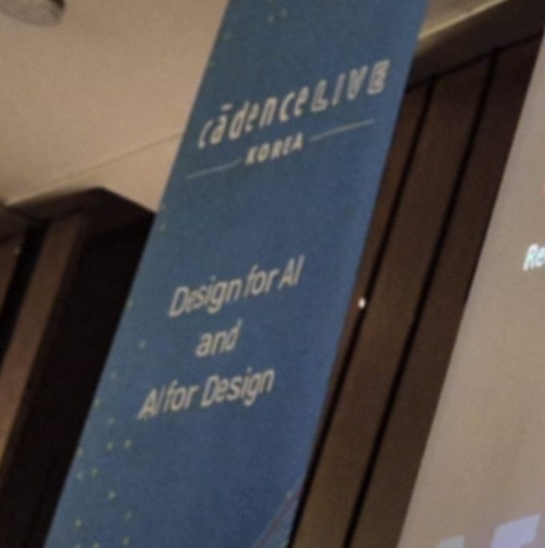
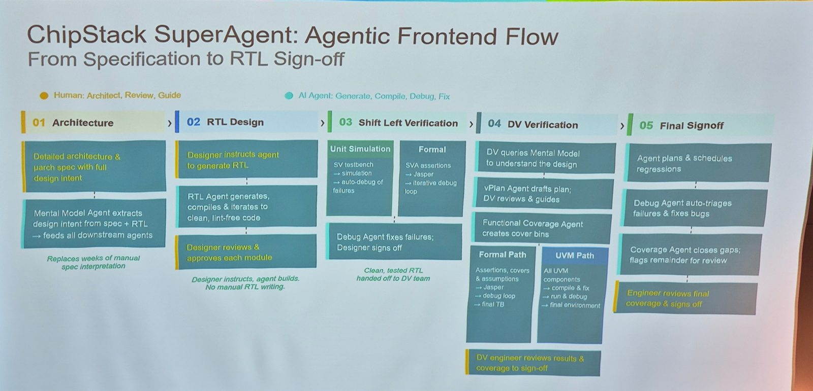
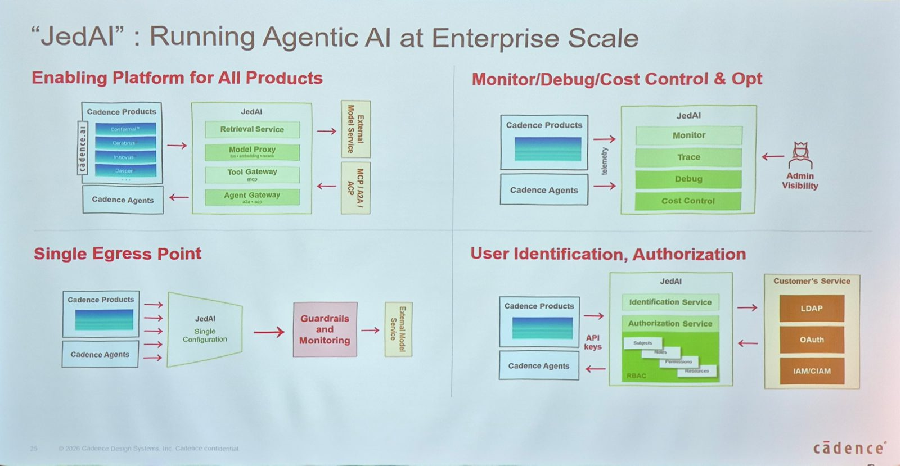

# CadenceLIVE Korea 2026

Cadence · Lotte Hotel World, Seoul · 2026-09-01 · [Official event page](https://events.cadence.com/event/cadencelivekorea2026/summary) · [Agenda at a glance](https://events.cadence.com/event/cadencelivekorea2026/agenda-at-a-glance)

{ loading=lazy }
<small>Image: own photo (event banner at the venue)직접 촬영 (행사장 배너)</small>

Cadence's user conference in Korea ran under the theme "Design for AI and AI for Design", covering Cadence technology and customer use cases across semiconductor and electronic design, with AI-based design at the centre. The morning had a Cadence keynote and three guest keynotes, and in the afternoon I followed Track 3, Verification.
{ .en }

Cadence의 한국 사용자 컨퍼런스로, 주제는 "Design for AI and AI for Design"이었습니다. AI 기반 설계를 중심으로 반도체·전자 설계 전반의 Cadence 기술과 고객 사례를 다뤘습니다. 오전에는 Cadence 키노트와 게스트 키노트 3개가 있었고, 오후에는 Track 3(검증)을 들었습니다.
{ .ko }

## Key takeaway

Agents are only the top layer; what makes them usable in chip design is the simulation and verification underneath.
{ .en }

에이전트는 맨 위 계층일 뿐이고, 칩 설계에서 쓸 만하게 만드는 것은 그 아래의 시뮬레이션과 검증이다.
{ .ko }

## Highlights

### 1. Cadence frames its strategy as agents on top of simulation and accelerated computing { .en }

### 1. Cadence는 전략을 시뮬레이션과 가속 컴퓨팅 위에 에이전트를 얹는 구조로 설명한다 { .ko }

The strategy slide stacked AI agents over principled simulation and optimization, which sit on accelerated computing and data. Design, verification, PCB and packaging, and multiphysics all hang off that same stack.
{ .en }

전략 슬라이드는 AI 에이전트를 맨 위에, 그 아래에 원리 기반 시뮬레이션과 최적화, 맨 아래에 가속 컴퓨팅과 데이터를 쌓은 구조였습니다. 디자인, 검증, PCB와 패키징, 멀티피직스가 모두 이 같은 스택에 연결됩니다.
{ .ko }

### 2. ChipStack aims at agentic front-end design and verification { .en }

### 2. ChipStack은 에이전트 방식의 프론트엔드 설계와 검증을 겨냥한다 { .ko }

ChipStack AI Super Agent covers the front-end flow from spec to RTL sign-off: architecture, RTL design, shift-left verification and DV. It is grounded in Cadence tools and static analysis rather than one-shot prompting, with human-in-the-loop correction.
{ .en }

ChipStack AI Super Agent는 아키텍처, RTL 설계, shift-left 검증, DV까지 사양서에서 RTL sign-off에 이르는 프론트엔드 플로우를 다룹니다. 일회성 프롬프트가 아니라 Cadence 도구와 정적 분석에 기반하고, 사람이 교정에 참여합니다.
{ .ko }

### 3. JedAI is the enterprise layer under every agent { .en }

### 3. JedAI는 모든 에이전트 아래의 엔터프라이즈 계층이다 { .ko }

JedAI provides the shared platform for all Cadence products and agents: a model gateway, monitoring and cost control, user identification and authorization, and a single egress point from the customer's firewall that the customer can guard and audit.
{ .en }

JedAI는 모든 Cadence 제품과 에이전트가 공유하는 플랫폼입니다. 모델 게이트웨이, 모니터링과 비용 제어, 사용자 식별과 권한 관리, 그리고 고객이 감시하고 감사할 수 있는 방화벽의 단일 egress 지점을 제공합니다.
{ .ko }

### 4. Memory vendors are moving toward custom HBM { .en }

### 4. 메모리 업체들은 커스텀 HBM으로 가고 있다 { .ko }

The HBM keynote covered power, thermal and power-integrity challenges, and what comes next: logic-foundry base dies, near-memory, 3D-stacked DRAM on logic, and customer-specific HBM platforms, with the standards side in JEDEC.
{ .en }

HBM 키노트는 전력, 열, 전력 무결성 과제와 그다음 방향, 즉 로직 파운드리 기반 베이스 다이, near-memory, 로직 위 3D 적층 DRAM, 고객별 맞춤 HBM 플랫폼을 다뤘고, 표준화 쪽은 JEDEC이 언급됐습니다.
{ .ko }

### 5. Cache-coherent SoC verification: declare intent instead of writing tests { .en }

### 5. 캐시 일관성 SoC 검증: 테스트를 쓰는 대신 의도를 선언한다 { .ko }

Perspec System Verifier with System Traffic Libraries generates coherency scenarios from declared intent. Even address hashing, such as targeting a hashed address region, is declared once in a CSV and the library produces correctly targeted addresses.
{ .en }

Perspec System Verifier와 System Traffic Libraries는 선언한 의도에서 일관성 시나리오를 생성합니다. 해시된 주소 영역을 겨냥하는 경우도 해시 함수를 CSV에 한 번 선언하면 라이브러리가 올바른 주소를 생성합니다.
{ .ko }

## Keynotes

| Time | Keynote | Speaker |
|---|---|---|
| 09:30 | Opening Speech | Cadence, 서병훈 |
| 09:40 | Cadence Keynote: Design for AI and AI for Design | Cadence, Paul Cunningham |
| 10:10 | Guest Keynote 1: Design Enablement for Silicon Intelligence | Samsung |
| 10:40 | Guest Keynote 2: Beyond the Limits of HBM: Challenges and Solutions for Future Memory Ecosystems | SK hynix, 박명재 |
| 11:10 | Guest Keynote 3: Enabling End-to-End EDA on Arm Compute for Lower TCO and Higher Infrastructure Flexibility | Arm, 황선욱 |

## Photos

{ loading=lazy }
<small>ChipStack: agentic front-end flow, spec to RTL sign-off (own photo)ChipStack: 에이전트 프론트엔드 플로우, 사양서에서 RTL sign-off까지 (직접 촬영)</small>

{ loading=lazy }
<small>JedAI: running agentic AI at enterprise scale (own photo)JedAI: 엔터프라이즈 규모의 에이전트 AI 운영 (직접 촬영)</small>
