# DAC 2026

63rd Design Automation Conference · Long Beach, CA · 2026-07-26 ~ 2026-07-29

[Official site](https://dac.com/63rd-dac) · [Home](../index.md)

*Front-End Verification & Emulation Perspective* — 18 posters and slides I looked at.
{ .en }

*프론트엔드 검증과 에뮬레이션 관점* — 제가 본 포스터와 슬라이드 18개입니다.
{ .ko }

## About DAC { .en }

## DAC 소개 { .ko }

DAC, the Design Automation Conference, is the annual conference and exhibition for electronic design automation and chip-to-system design. The 63rd edition, billed as The Chips to Systems Conference, ran in Long Beach from July 26 to 29, 2026.
{ .en }

DAC(Design Automation Conference)는 전자 설계 자동화와 칩에서 시스템까지의 설계를 다루는 연례 학회 겸 전시회입니다. 'The Chips to Systems Conference'를 내건 제63회 행사는 2026년 7월 26일부터 29일까지 롱비치에서 열렸습니다.
{ .ko }

The program combines research papers with an Engineering Track of industry talks and posters, plus an exhibition floor with the DAC Pavilion. This page covers the posters and slides I photographed, grouped by topic and linked to their official program pages.
{ .en }

프로그램은 연구 논문과, 업계 발표와 포스터로 구성된 Engineering Track, 그리고 DAC Pavilion이 있는 전시장으로 이루어집니다. 이 페이지는 제가 사진으로 남긴 포스터와 슬라이드를 주제별로 묶고, 각각 공식 프로그램 페이지로 연결했습니다.
{ .ko }

## Official DAC 2026 Archive { .en }

## 공식 DAC 2026 아카이브 { .ko #archive-ko }

Everything here comes from the official conference; my photos below link back to it.
{ .en }

여기 있는 자료는 모두 공식 학회에서 나온 것이며, 아래 제 사진은 공식 자료로 연결됩니다.
{ .ko }

- [Searchable program (one page per talk/poster/paper, with abstracts)](https://63dac.conference-program.com/)
- [63rd DAC page (recordings, keynotes, Poster Gladiators, TechTalks, program)](https://dac.com/63rd-dac)
- [Proceedings (ACM Digital Library)](https://dl.acm.org/doi/proceedings/10.1145/3770743)
- [Engineering Track proceedings (zip with HTML, about 580 MB)](http://confcats-event-sessions.s3.amazonaws.com/dac26/uploads/DAC_2026_ET_Full_Proceedings_with_HTML.zip)
- [PDF program](https://confcats-siteplex.s3.amazonaws.com/dac/images/dac-2026_program_july-22.pdf)
- [DAC conference archive (all years)](https://dac.com/conference-archive)

Every talk, poster and paper has its own page, with abstract, in the searchable program; full texts are in the ACM proceedings (research) and the Engineering Track proceedings zip.
{ .en }

모든 발표, 포스터, 논문은 검색 가능한 프로그램에 초록과 함께 각자의 페이지가 있고, 전문은 ACM 프로시딩(연구)과 Engineering Track 프로시딩 zip에 있습니다.
{ .ko }

## Emulation, virtualization and firmware-driven verification { .en }

## 에뮬레이션, 가상화, 펌웨어 기반 검증 { .ko }

### Hybrid Virtual ICE — Pre-Silicon Real Workloads Validation {#p20260727165840}

**Anritsu / Samsung / Synopsys (ZeBu)**

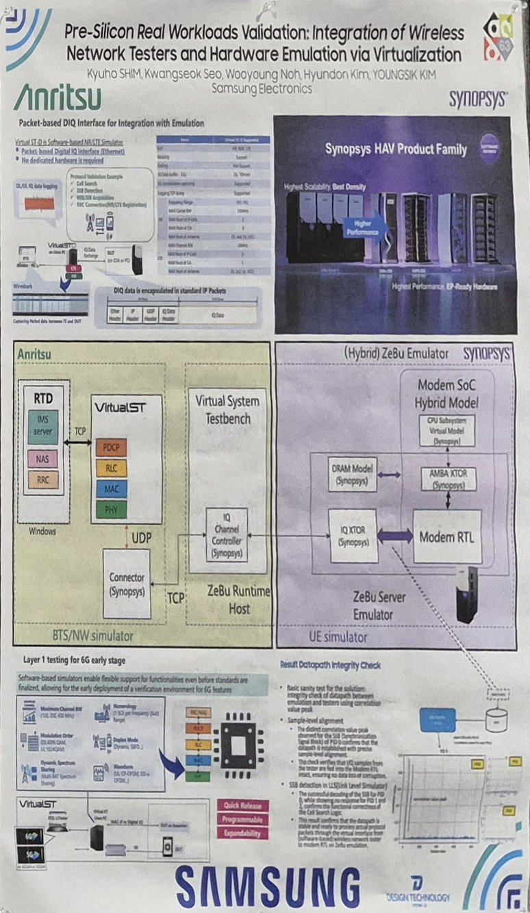{ loading=lazy }

[`emulation`](#tag-emulation) [`virtualization`](#tag-virtualization) [`virtual-ice`](#tag-virtual-ice)

!!! info "Slide / Poster Summary"
    Engineering Track poster (right; the Samsung Fastboot poster is on the left). A hybrid virtual ICE: instead of a physical target cable, speed adapter and real tester hardware, a wireless network tester (Anritsu) is connected to the ZeBu-emulated modem SoC through a virtualized packet-based IQ interface, so real network workloads run against cycle-accurate RTL before silicon.

!!! info "슬라이드 / 포스터 요약"
    Engineering Track 포스터(오른쪽, 왼쪽은 삼성 Fastboot 포스터)입니다. 하이브리드 virtual ICE로, 물리 타깃 케이블, 스피드 어댑터, 실제 테스터 하드웨어 대신 무선망 테스터(Anritsu)를 패킷 기반 IQ 인터페이스로 가상화해 ZeBu로 에뮬레이션한 모뎀 SoC에 연결합니다. 실리콘 이전에 사이클 정확한 RTL로 실제 네트워크 워크로드를 돌릴 수 있습니다.

!!! tip "Front-End & Emulation Perspective"
    Traditional ICE ties emulation to physical cables and speed adapters, which causes frequency mismatch, hard-to-reproduce runs and no remote access, while a pure virtual platform is not cycle accurate. Hybrid virtual ICE keeps the RTL in the emulator and virtualizes the outside world. We frame it as an industry interoperability challenge between tools and emulators, not a one-off internal fix.

!!! tip "프론트엔드 · 에뮬레이션 관점"
    기존 ICE는 에뮬레이션을 물리 케이블과 스피드 어댑터에 묶어 두기 때문에 주파수 불일치, 재현이 어려운 실행, 원격 접속 불가 문제가 생기고, 순수 가상 플랫폼은 사이클 정확하지 않습니다. 하이브리드 virtual ICE는 RTL은 에뮬레이터에 두고 외부 세계만 가상화합니다. 사내 한 번의 해결책이 아니라 툴과 에뮬레이터 사이의 업계 상호운용성 과제로 보고 있습니다.

!!! abstract "In the official DAC 2026 program"
    *Pre-Silicon Real Workloads Validation: Integration of Wireless Network Testers and Hardware Emulation via Virtualization*  
    Engineering Poster Session One — Mon Jul 27, 5-6pm, DAC Pavilion, Exhibit Floor · [program](https://confcats-siteplex.s3.amazonaws.com/dac/images/dac-2026_program_july-22.pdf) · [official page](https://63dac.conference-program.com/presentation/?id=ENGPOST060&sess=sess264) · [archive](#official-dac-2026-archive)

!!! abstract "공식 DAC 2026 프로그램"
    *Pre-Silicon Real Workloads Validation: Integration of Wireless Network Testers and Hardware Emulation via Virtualization*  
    Engineering Poster Session One — Mon Jul 27, 5-6pm, DAC Pavilion, Exhibit Floor · [프로그램](https://confcats-siteplex.s3.amazonaws.com/dac/images/dac-2026_program_july-22.pdf) · [공식 페이지](https://63dac.conference-program.com/presentation/?id=ENGPOST060&sess=sess264) · [아카이브](#archive-ko)

Related:관련: [Fastboot virtualization and on-prem LLM failure analysis (Main Idea slide)](#p20260727162722) · [Firmware-driven random verification on emulation](#p20260727155157) · [DFT verification with Veloce full-chip gate-level emulation](#p20260728134334)

### Fastboot virtualization and on-prem LLM failure analysis (Main Idea slide) {#p20260727162722}

**Samsung Electronics**

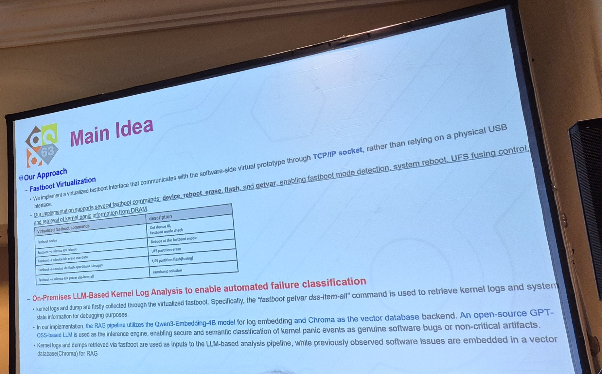{ loading=lazy }

[`emulation`](#tag-emulation) [`virtualization`](#tag-virtualization) [`llm`](#tag-llm)

!!! info "Slide / Poster Summary"
    Main Idea slide: a software test platform drives a hybrid emulation environment through a virtualized Fastboot interface, and an on-premises LLM (RAG) classifies kernel logs as real software bugs or non-critical events.

!!! info "슬라이드 / 포스터 요약"
    Main Idea 슬라이드입니다. 소프트웨어 테스트 플랫폼이 가상화된 Fastboot 인터페이스로 하이브리드 에뮬레이션 환경을 구동하고, 온프레미스 LLM(RAG)이 커널 로그를 실제 소프트웨어 버그와 중요하지 않은 이벤트로 분류합니다.

!!! tip "Front-End & Emulation Perspective"
    Virtualizing Fastboot removes the need for a physical USB link in emulation. Keeping the LLM on-premises matters for confidentiality of logs; the cost is how much emulation time the automated reboot/flash loop consumes.

!!! tip "프론트엔드 · 에뮬레이션 관점"
    Fastboot를 가상화하면 에뮬레이션에서 물리 USB 연결이 필요 없어집니다. LLM을 온프레미스에 두는 것은 로그 기밀 때문에 중요하고, 대가로 자동 reboot/flash 루프가 에뮬레이션 시간을 얼마나 쓰는지가 관건입니다.

!!! abstract "In the official DAC 2026 program"
    *Enabling Automated Software Testing in Emulation Environments via Fastboot Virtualization and On-Premises LLM-Based Failure Analysis*  
    System & Software Deployment — Mon Jul 27, 3:30-5pm, Seaside Ballroom B · [program](https://confcats-siteplex.s3.amazonaws.com/dac/images/dac-2026_program_july-22.pdf) · [official page](https://63dac.conference-program.com/presentation/?id=ENGPRES061&sess=sess263) · [archive](#official-dac-2026-archive)

!!! abstract "공식 DAC 2026 프로그램"
    *Enabling Automated Software Testing in Emulation Environments via Fastboot Virtualization and On-Premises LLM-Based Failure Analysis*  
    System & Software Deployment — Mon Jul 27, 3:30-5pm, Seaside Ballroom B · [프로그램](https://confcats-siteplex.s3.amazonaws.com/dac/images/dac-2026_program_july-22.pdf) · [공식 페이지](https://63dac.conference-program.com/presentation/?id=ENGPRES061&sess=sess263) · [아카이브](#archive-ko)

Related:관련: [Hybrid Virtual ICE — Pre-Silicon Real Workloads Validation](#p20260727165840) · [Firmware-driven random verification on emulation](#p20260727155157) · [AI-Assisted EDA Tools Development](#p20260728110354)

### Firmware-driven random verification on emulation {#p20260727155157}

**Samsung (image sensor / ISP)**

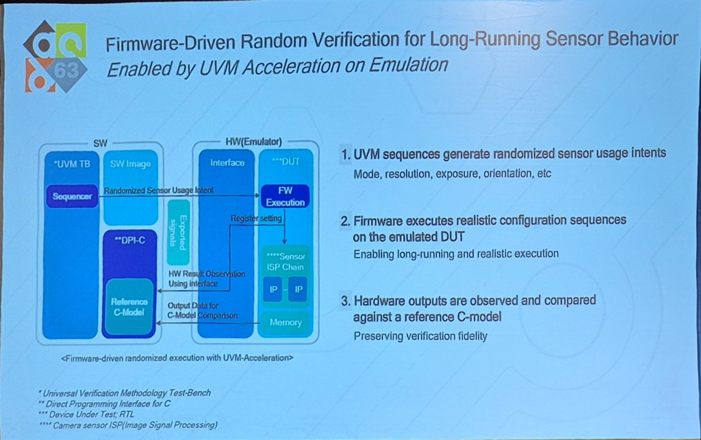{ loading=lazy }

[`emulation`](#tag-emulation) [`uvm`](#tag-uvm) [`firmware`](#tag-firmware)

!!! info "Slide / Poster Summary"
    UVM sequences generate randomized sensor usage intents (mode, resolution, exposure, orientation). Firmware on the emulated DUT executes realistic configuration sequences, and hardware outputs are observed and compared with a reference C-model through DPI-C. UVM acceleration on the emulator makes long-running runs feasible.

!!! info "슬라이드 / 포스터 요약"
    UVM 시퀀스가 센서 사용 의도(모드, 해상도, 노출, 방향)를 무작위로 생성합니다. 에뮬레이션된 DUT 위의 펌웨어가 실제와 같은 설정 시퀀스를 실행하고, 하드웨어 출력은 DPI-C를 통해 reference C-model과 비교됩니다. 에뮬레이터의 UVM acceleration으로 긴 실행이 가능해집니다.

!!! tip "Front-End & Emulation Perspective"
    This is the closest talk to everyday emulation work: UVM-acceleration with real firmware. The things to check are testbench-to-DUT transaction overhead in acceleration mode and how failures that need long-running state are debugged with limited signal visibility.

!!! tip "프론트엔드 · 에뮬레이션 관점"
    일상적인 에뮬레이션 업무에 가장 가까운 발표입니다. 실제 펌웨어를 쓰는 UVM acceleration이라서, acceleration 모드에서 테스트벤치와 DUT 사이의 트랜잭션 오버헤드와, 긴 상태가 필요한 실패를 제한된 신호 가시성으로 어떻게 디버그하는지를 확인해 볼 만합니다.

!!! abstract "In the official DAC 2026 program"
    *Shifting System-Level Verification Left with Firmware-Driven Execution*  
    System & Software Deployment — Mon Jul 27, 3:30-5pm, Seaside Ballroom B · [program](https://confcats-siteplex.s3.amazonaws.com/dac/images/dac-2026_program_july-22.pdf) · [official page](https://63dac.conference-program.com/presentation/?id=ENGPRES119&sess=sess263) · [archive](#official-dac-2026-archive)

!!! abstract "공식 DAC 2026 프로그램"
    *Shifting System-Level Verification Left with Firmware-Driven Execution*  
    System & Software Deployment — Mon Jul 27, 3:30-5pm, Seaside Ballroom B · [프로그램](https://confcats-siteplex.s3.amazonaws.com/dac/images/dac-2026_program_july-22.pdf) · [공식 페이지](https://63dac.conference-program.com/presentation/?id=ENGPRES119&sess=sess263) · [아카이브](#archive-ko)

Related:관련: [Fastboot virtualization and on-prem LLM failure analysis (Main Idea slide)](#p20260727162722) · [Hybrid Virtual ICE — Pre-Silicon Real Workloads Validation](#p20260727165840) · [DFT verification with Veloce full-chip gate-level emulation](#p20260728134334)

### DFT verification with Veloce full-chip gate-level emulation {#p20260728134334}

**Samsung / Siemens**

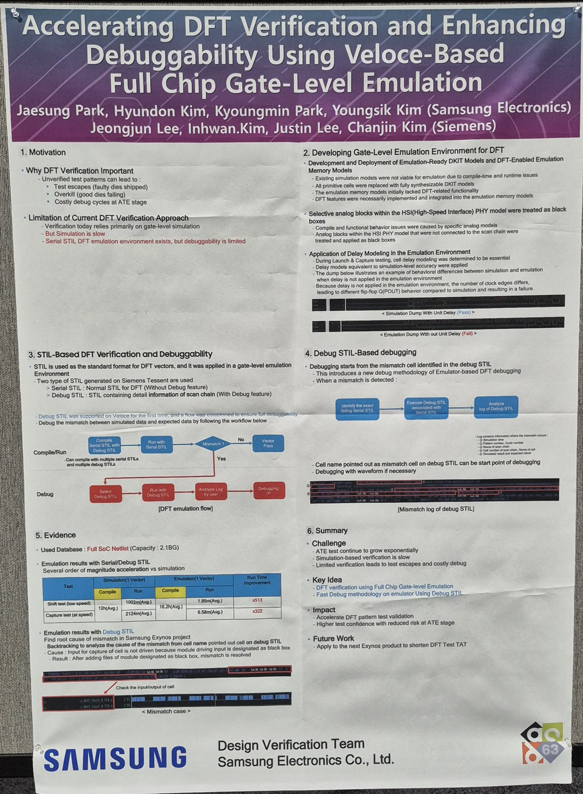{ loading=lazy }

[`emulation`](#tag-emulation) [`dft`](#tag-dft) [`debug`](#tag-debug)

!!! info "Slide / Poster Summary"
    Veloce-based full-chip gate-level emulation for DFT verification: roughly x513 faster shift and x322 faster capture than simulation, with a Debug STIL flow for debuggability.

!!! info "슬라이드 / 포스터 요약"
    Veloce 기반 풀칩 게이트 레벨 에뮬레이션으로 DFT를 검증합니다. 시뮬레이션 대비 shift는 약 513배, capture는 약 322배 빠르고, 디버깅을 위한 Debug STIL 플로우가 있습니다.

!!! tip "Front-End & Emulation Perspective"
    Highly relevant. Gate-level emulation speedups are easy to quote; the real cost is netlist compile time and debug visibility, which this poster addresses with Debug STIL.

!!! tip "프론트엔드 · 에뮬레이션 관점"
    매우 관련이 큽니다. 게이트 레벨 에뮬레이션의 속도 향상은 수치로 말하기 쉽지만 실제 비용은 넷리스트 컴파일 시간과 디버그 가시성이며, 이 포스터는 Debug STIL로 이를 다룹니다.

!!! abstract "In the official DAC 2026 program"
    *Accelerating DFT Verification and Enhancing Debuggability Using Veloce-Based Full Chip Gate-Level Emulation*  
    Engineering Poster Session Two — Tue Jul 28, 5-6pm, DAC Pavilion, Exhibit Floor · [program](https://confcats-siteplex.s3.amazonaws.com/dac/images/dac-2026_program_july-22.pdf) · [official page](https://63dac.conference-program.com/presentation/?id=ENGPOST315&sess=sess295) · [archive](#official-dac-2026-archive)

!!! abstract "공식 DAC 2026 프로그램"
    *Accelerating DFT Verification and Enhancing Debuggability Using Veloce-Based Full Chip Gate-Level Emulation*  
    Engineering Poster Session Two — Tue Jul 28, 5-6pm, DAC Pavilion, Exhibit Floor · [프로그램](https://confcats-siteplex.s3.amazonaws.com/dac/images/dac-2026_program_july-22.pdf) · [공식 페이지](https://63dac.conference-program.com/presentation/?id=ENGPOST315&sess=sess295) · [아카이브](#archive-ko)

Related:관련: [Firmware-driven random verification on emulation](#p20260727155157) · [Fastboot virtualization and on-prem LLM failure analysis (Main Idea slide)](#p20260727162722) · [Hybrid Virtual ICE — Pre-Silicon Real Workloads Validation](#p20260727165840)

## DFT and RTL generation { .en }

## DFT와 RTL 생성 { .ko }

### Design-aware test points in SystemRDL-to-RTL generators {#p20260728134119}

**Google / Agnisys**

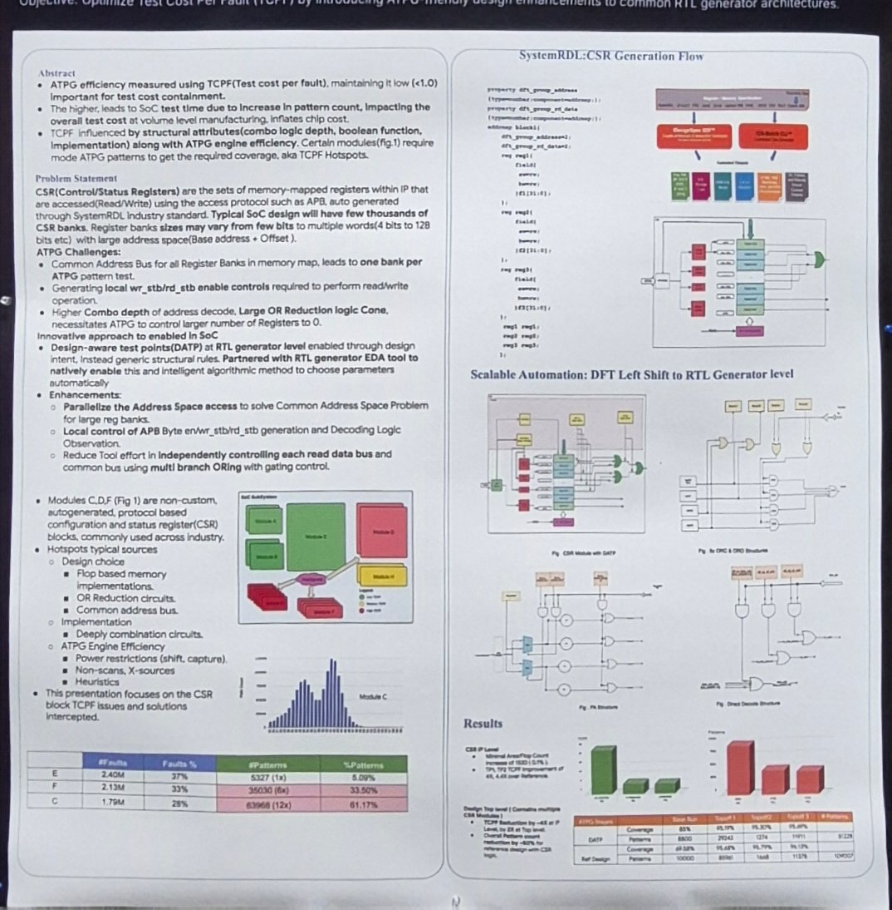{ loading=lazy }

[`dft`](#tag-dft) [`rtl-generation`](#tag-rtl-generation)

!!! info "Slide / Poster Summary"
    Engineering Track paper 64: DFT intelligence through design-aware test points inserted by SystemRDL-to-RTL generators; reported ~40% pattern reduction.

!!! info "슬라이드 / 포스터 요약"
    Engineering Track 논문 64입니다. SystemRDL-to-RTL 생성기가 넣는 design-aware test point로 DFT 지능을 높이는 방법을 다루며, 패턴이 약 40% 줄었다고 보고했습니다.

!!! tip "Front-End & Emulation Perspective"
    Moving DFT decisions into the RTL generator shifts work left; the downstream effect on gate-level verification and emulation runtime is what to look for.

!!! tip "프론트엔드 · 에뮬레이션 관점"
    DFT 판단을 RTL 생성기로 옮기면 작업이 앞당겨집니다. 게이트 레벨 검증과 에뮬레이션 런타임에 주는 후속 영향을 봐야 합니다.

!!! abstract "In the official DAC 2026 program"
    *Automating DFT Intelligence: Addressing TCPF HotSpots at Source through Design Aware Test Points in SystemRDL-to-RTL Generators*  
    Engineering session (DFT) — Tue Jul 28, 10:30am-12pm, Seaside RM 7 · [program](https://confcats-siteplex.s3.amazonaws.com/dac/images/dac-2026_program_july-22.pdf) · [official page](https://63dac.conference-program.com/presentation/?id=ENGPRES064&sess=sess277) · [archive](#official-dac-2026-archive)

!!! abstract "공식 DAC 2026 프로그램"
    *Automating DFT Intelligence: Addressing TCPF HotSpots at Source through Design Aware Test Points in SystemRDL-to-RTL Generators*  
    Engineering session (DFT) — Tue Jul 28, 10:30am-12pm, Seaside RM 7 · [프로그램](https://confcats-siteplex.s3.amazonaws.com/dac/images/dac-2026_program_july-22.pdf) · [공식 페이지](https://63dac.conference-program.com/presentation/?id=ENGPRES064&sess=sess277) · [아카이브](#archive-ko)

Related:관련: [AI-Assisted EDA Tools Development](#p20260728110354) · [DFT verification with Veloce full-chip gate-level emulation](#p20260728134334)

## Power integrity and signoff { .en }

## 전력 무결성과 signoff { .ko }

### Voltage-droop mitigation on MAIA 200 {#p20260727114025}

**Microsoft**

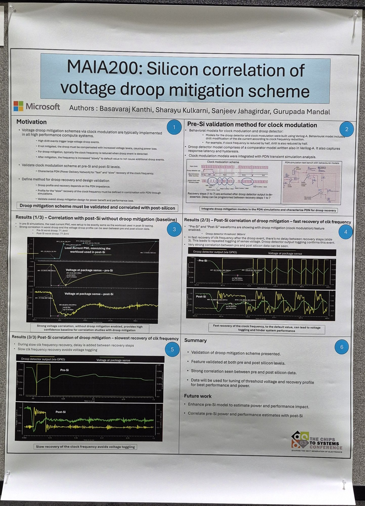{ loading=lazy }

[`power`](#tag-power) [`post-silicon`](#tag-post-silicon)

!!! info "Slide / Poster Summary"
    Poster on voltage-droop mitigation for MAIA 200 with Pre-Si / Post-Si correlation and Verilog-A models.

!!! info "슬라이드 / 포스터 요약"
    MAIA 200의 전압 강하(voltage droop) 완화에 관한 포스터입니다. Pre-Si/Post-Si 상관 분석과 Verilog-A 모델을 다룹니다.

!!! tip "Front-End & Emulation Perspective"
    Pre-Si/Post-Si correlation is the useful part: it shows how far pre-silicon power/droop analysis can be trusted against measured silicon.

!!! tip "프론트엔드 · 에뮬레이션 관점"
    Pre-Si/Post-Si 상관이 핵심입니다. 실리콘 이전의 전력/droop 분석을 실측 실리콘과 비교해 어디까지 믿을 수 있는지 보여줍니다.

!!! abstract "In the official DAC 2026 program"
    *Silicon correlation of voltage droop mitigation scheme*  
    Engineering Poster Session One — Mon Jul 27, 5-6pm, DAC Pavilion, Exhibit Floor · [program](https://confcats-siteplex.s3.amazonaws.com/dac/images/dac-2026_program_july-22.pdf) · [official page](https://63dac.conference-program.com/presentation/?id=ENGPOST150&sess=sess264) · [archive](#official-dac-2026-archive)

!!! abstract "공식 DAC 2026 프로그램"
    *Silicon correlation of voltage droop mitigation scheme*  
    Engineering Poster Session One — Mon Jul 27, 5-6pm, DAC Pavilion, Exhibit Floor · [프로그램](https://confcats-siteplex.s3.amazonaws.com/dac/images/dac-2026_program_july-22.pdf) · [공식 페이지](https://63dac.conference-program.com/presentation/?id=ENGPOST150&sess=sess264) · [아카이브](#archive-ko)

Related:관련: [Multi-cycle dynamic vectorless analysis for PDN signoff](#p20260728100544) · [VT-skew MC analysis and load-splitting IR-ECO](#p20260728134139)

### Multi-cycle dynamic vectorless analysis for PDN signoff {#p20260728100544}

**Qualcomm / Cadence**

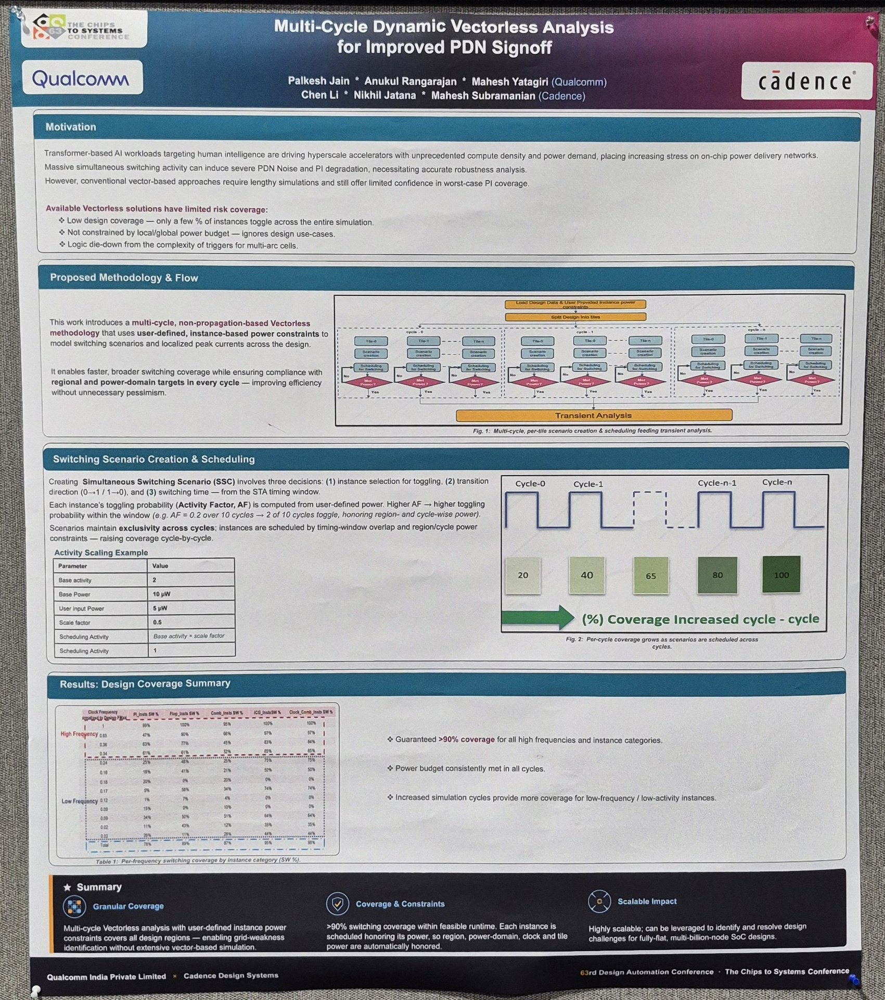{ loading=lazy }

[`power`](#tag-power) [`signoff`](#tag-signoff)

!!! info "Slide / Poster Summary"
    Poster on multi-cycle dynamic vectorless analysis for improving power-delivery-network signoff.

!!! info "슬라이드 / 포스터 요약"
    PDN(전원 공급 네트워크) 사인오프를 개선하기 위한 multi-cycle dynamic vectorless 분석 포스터입니다.

!!! tip "Front-End & Emulation Perspective"
    Vectorless analysis is an alternative to waiting for realistic emulation vectors; it is worth comparing which cases still need real activity from emulation.

!!! tip "프론트엔드 · 에뮬레이션 관점"
    Vectorless 분석은 현실적인 에뮬레이션 벡터를 기다리는 것의 대안입니다. 어떤 경우에 에뮬레이션의 실제 활동 데이터가 여전히 필요한지 비교해 볼 만합니다.

!!! abstract "In the official DAC 2026 program"
    *Multi-Cycle Dynamic Vectorless Analysis for Improved PDN Signoff*  
    Engineering Poster Session Two — Tue Jul 28, 5-6pm, DAC Pavilion, Exhibit Floor · [program](https://confcats-siteplex.s3.amazonaws.com/dac/images/dac-2026_program_july-22.pdf) · [official page](https://63dac.conference-program.com/presentation/?id=ENGPOST090&sess=sess295) · [archive](#official-dac-2026-archive)

!!! abstract "공식 DAC 2026 프로그램"
    *Multi-Cycle Dynamic Vectorless Analysis for Improved PDN Signoff*  
    Engineering Poster Session Two — Tue Jul 28, 5-6pm, DAC Pavilion, Exhibit Floor · [프로그램](https://confcats-siteplex.s3.amazonaws.com/dac/images/dac-2026_program_july-22.pdf) · [공식 페이지](https://63dac.conference-program.com/presentation/?id=ENGPOST090&sess=sess295) · [아카이브](#archive-ko)

Related:관련: [VT-skew MC analysis and load-splitting IR-ECO](#p20260728134139) · [Voltage-droop mitigation on MAIA 200](#p20260727114025) · [Automated LVS rule deck qualification](#p20260728170302)

### VT-skew MC analysis and load-splitting IR-ECO {#p20260728134139}

**TSMC (+ Synopsys)**

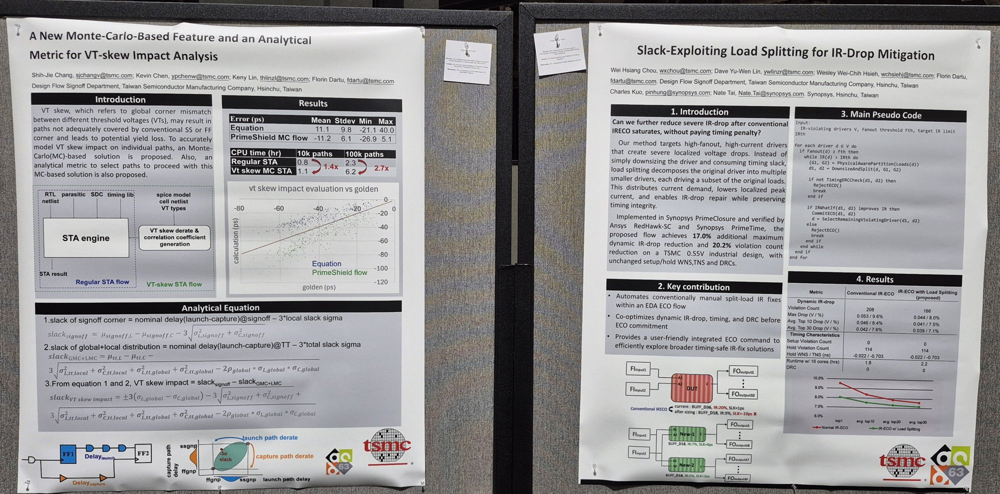{ loading=lazy }

[`signoff`](#tag-signoff) [`power`](#tag-power)

!!! info "Slide / Poster Summary"
    Two TSMC posters: a Monte-Carlo feature with an analytical metric for VT-skew impact (CPU time 1.4x/2.7x vs regular STA on 10k/100k paths) and slack-exploiting load splitting for IR-drop mitigation (17.0% additional max dynamic IR-drop reduction, 20.2% fewer violations).

!!! info "슬라이드 / 포스터 요약"
    TSMC 포스터 두 편입니다. VT-skew 영향을 분석적 지표로 다루는 Monte-Carlo 기능(경로 1만/10만 개에서 일반 STA 대비 CPU 시간 1.4배/2.7배)과, IR-drop 완화를 위한 slack 활용 load splitting(최대 동적 IR-drop 17.0% 추가 감소, 위반 20.2% 감소)입니다.

!!! tip "Front-End & Emulation Perspective"
    Back-end topics; included for context on how signoff-side methods are being tuned.

!!! tip "프론트엔드 · 에뮬레이션 관점"
    백엔드 주제로, 사인오프 쪽 기법이 어떻게 다듬어지고 있는지 맥락을 위해 포함했습니다.

!!! abstract "In the official DAC 2026 program"
    *Slack-Exploiting Load Splitting for IR-Drop Mitigation*  
    Engineering Poster Session Two — Tue Jul 28, 5-6pm, DAC Pavilion, Exhibit Floor · [program](https://confcats-siteplex.s3.amazonaws.com/dac/images/dac-2026_program_july-22.pdf) · [official page](https://63dac.conference-program.com/presentation/?id=ENGPOST059&sess=sess295) · [archive](#official-dac-2026-archive)

!!! abstract "공식 DAC 2026 프로그램"
    *Slack-Exploiting Load Splitting for IR-Drop Mitigation*  
    Engineering Poster Session Two — Tue Jul 28, 5-6pm, DAC Pavilion, Exhibit Floor · [프로그램](https://confcats-siteplex.s3.amazonaws.com/dac/images/dac-2026_program_july-22.pdf) · [공식 페이지](https://63dac.conference-program.com/presentation/?id=ENGPOST059&sess=sess295) · [아카이브](#archive-ko)

Related:관련: [Multi-cycle dynamic vectorless analysis for PDN signoff](#p20260728100544) · [Voltage-droop mitigation on MAIA 200](#p20260727114025) · [Automated LVS rule deck qualification](#p20260728170302)

## Physical verification (LVS) { .en }

## 물리 검증(LVS) { .ko }

### Automated LVS rule deck qualification {#p20260728170302}

**Samsung / Siemens**

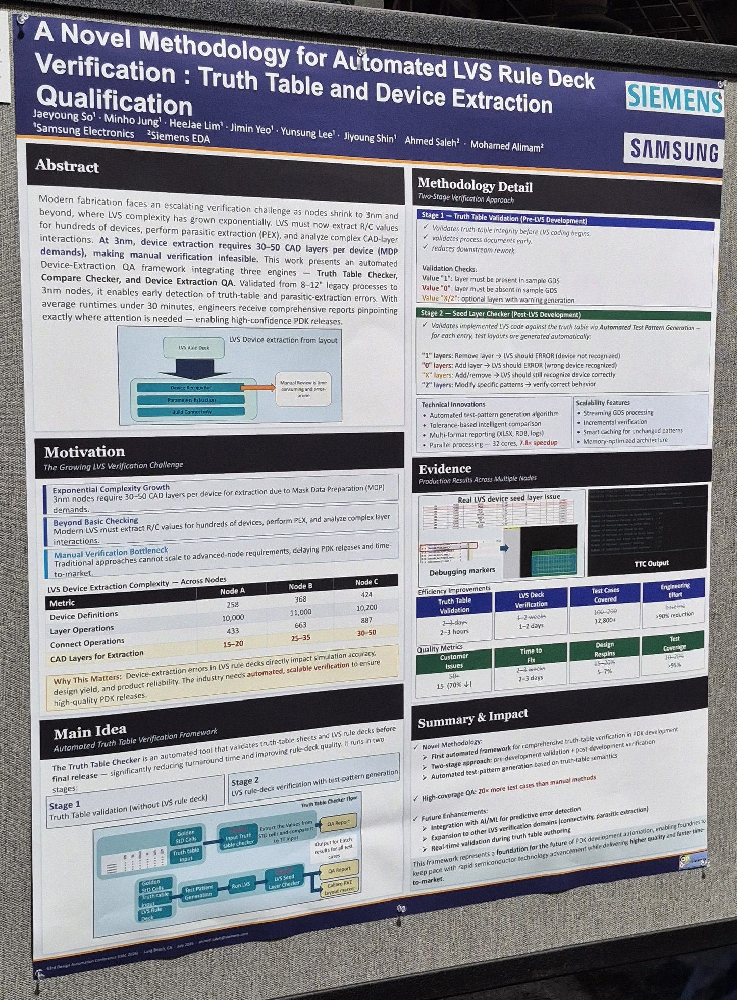{ loading=lazy }

[`signoff`](#tag-signoff) [`lvs`](#tag-lvs)

!!! info "Slide / Poster Summary"
    Poster on automating LVS rule-deck qualification.

!!! info "슬라이드 / 포스터 요약"
    LVS 룰 덱 검증을 자동화하는 포스터입니다.

!!! abstract "In the official DAC 2026 program"
    *A Novel Methodology for Automated LVS Rule Deck Verification: Truth Table and Device Extraction*  
    Engineering Poster Session Two — Tue Jul 28, 5-6pm, DAC Pavilion, Exhibit Floor · [program](https://confcats-siteplex.s3.amazonaws.com/dac/images/dac-2026_program_july-22.pdf) · [official page](https://63dac.conference-program.com/presentation/?id=ENGPOST188&sess=sess295) · [archive](#official-dac-2026-archive)

!!! abstract "공식 DAC 2026 프로그램"
    *A Novel Methodology for Automated LVS Rule Deck Verification: Truth Table and Device Extraction*  
    Engineering Poster Session Two — Tue Jul 28, 5-6pm, DAC Pavilion, Exhibit Floor · [프로그램](https://confcats-siteplex.s3.amazonaws.com/dac/images/dac-2026_program_july-22.pdf) · [공식 페이지](https://63dac.conference-program.com/presentation/?id=ENGPOST188&sess=sess295) · [아카이브](#archive-ko)

Related:관련: [Accelerating circuit verification with Calibre nmLVS Recon](#p20260729123634) · [Multi-cycle dynamic vectorless analysis for PDN signoff](#p20260728100544) · [VT-skew MC analysis and load-splitting IR-ECO](#p20260728134139)

### Accelerating circuit verification with Calibre nmLVS Recon {#p20260729123634}

**Microsoft / Siemens**

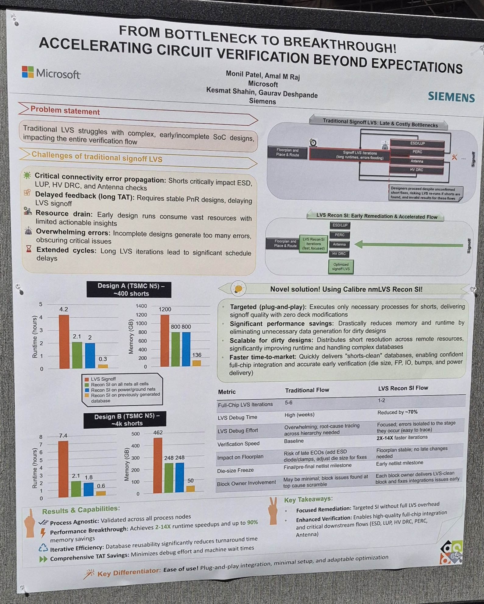{ loading=lazy }

[`lvs`](#tag-lvs) [`signoff`](#tag-signoff)

!!! info "Slide / Poster Summary"
    Poster on accelerating circuit verification with Calibre nmLVS Recon SI.

!!! info "슬라이드 / 포스터 요약"
    Calibre nmLVS Recon SI로 회로 검증을 가속하는 포스터입니다.

!!! abstract "In the official DAC 2026 program"
    *From Bottleneck to Breakthrough! Accelerating Circuit Verification Beyond Expectations*  
    Engineering Poster Session Three — Wed Jul 29, 3-4pm, DAC Pavilion, Exhibit Floor · [program](https://confcats-siteplex.s3.amazonaws.com/dac/images/dac-2026_program_july-22.pdf) · [official page](https://63dac.conference-program.com/presentation/?id=ENGPOST265&sess=sess296) · [archive](#official-dac-2026-archive)

!!! abstract "공식 DAC 2026 프로그램"
    *From Bottleneck to Breakthrough! Accelerating Circuit Verification Beyond Expectations*  
    Engineering Poster Session Three — Wed Jul 29, 3-4pm, DAC Pavilion, Exhibit Floor · [프로그램](https://confcats-siteplex.s3.amazonaws.com/dac/images/dac-2026_program_july-22.pdf) · [공식 페이지](https://63dac.conference-program.com/presentation/?id=ENGPOST265&sess=sess296) · [아카이브](#archive-ko)

Related:관련: [Automated LVS rule deck qualification](#p20260728170302) · [Multi-cycle dynamic vectorless analysis for PDN signoff](#p20260728100544) · [VT-skew MC analysis and load-splitting IR-ECO](#p20260728134139)

## Verification methodology (CDC, RDC, formal, network) { .en }

## 검증 방법론(CDC, RDC, formal, 네트워크) { .ko }

### Zero-glitch confidence: static, formal and simulation {#p20260729120436}

**Meta / Synopsys**

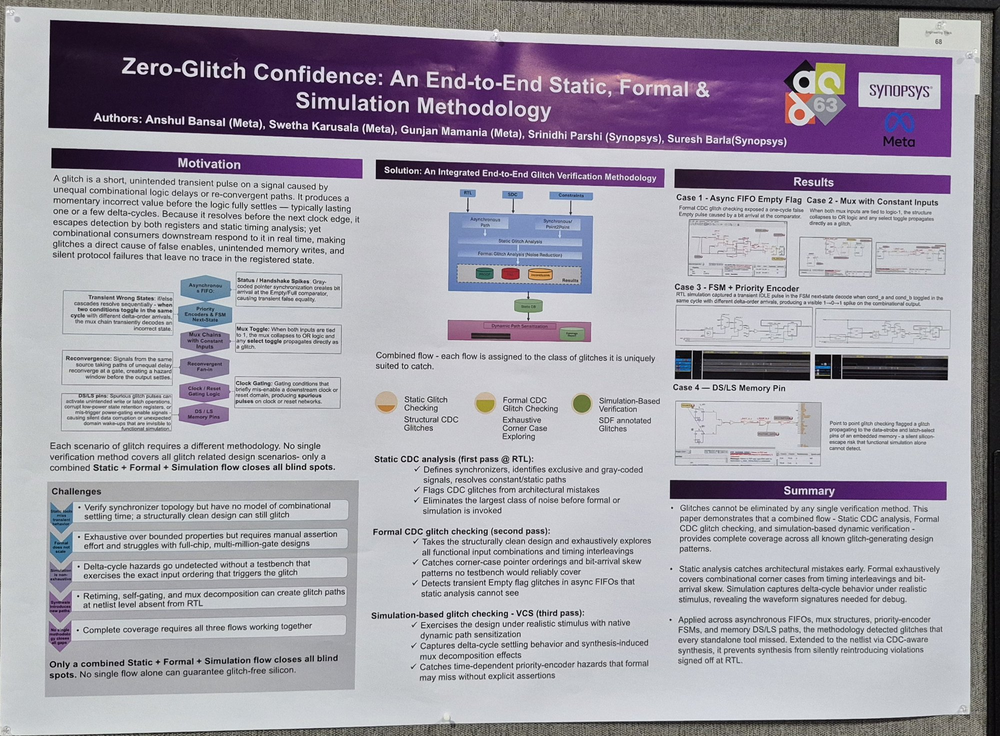{ loading=lazy }

[`cdc`](#tag-cdc) [`formal`](#tag-formal) [`verification`](#tag-verification)

!!! info "Slide / Poster Summary"
    Combined static CDC, formal CDC glitch checking and VCS simulation flow, applied to async FIFOs, mux structures, FSMs and memory DS/LS pins.

!!! info "슬라이드 / 포스터 요약"
    static CDC, formal CDC glitch 검사, VCS 시뮬레이션을 결합한 플로우입니다. 비동기 FIFO, mux 구조, FSM, 메모리 DS/LS 핀에 적용했습니다.

!!! tip "Front-End & Emulation Perspective"
    A layered flow is realistic; since gate-level behavior matters for glitches, the interesting question is where emulation could fill the remaining gap.

!!! tip "프론트엔드 · 에뮬레이션 관점"
    계층형 플로우는 현실적입니다. glitch에는 게이트 레벨 동작이 중요하므로, 남는 공백을 에뮬레이션이 어디서 채울 수 있는지가 흥미로운 질문입니다.

!!! abstract "In the official DAC 2026 program"
    *Zero-Glitch Confidence: An End-to-End Static, Formal & Simulation Methodology*  
    Engineering Poster Session Three — Wed Jul 29, 3-4pm, DAC Pavilion, Exhibit Floor · [program](https://confcats-siteplex.s3.amazonaws.com/dac/images/dac-2026_program_july-22.pdf) · [official page](https://63dac.conference-program.com/presentation/?id=ENGPOST426&sess=sess296) · [archive](#official-dac-2026-archive)

!!! abstract "공식 DAC 2026 프로그램"
    *Zero-Glitch Confidence: An End-to-End Static, Formal & Simulation Methodology*  
    Engineering Poster Session Three — Wed Jul 29, 3-4pm, DAC Pavilion, Exhibit Floor · [프로그램](https://confcats-siteplex.s3.amazonaws.com/dac/images/dac-2026_program_july-22.pdf) · [공식 페이지](https://63dac.conference-program.com/presentation/?id=ENGPOST426&sess=sess296) · [아카이브](#archive-ko)

Related:관련: [RDC methodology: noise reduction and accuracy](#p20260728134255) · [Flexible and scalable network modeling for AI/HPC network verification](#p20260728172318)

### RDC methodology: noise reduction and accuracy {#p20260728134255}

**Google**

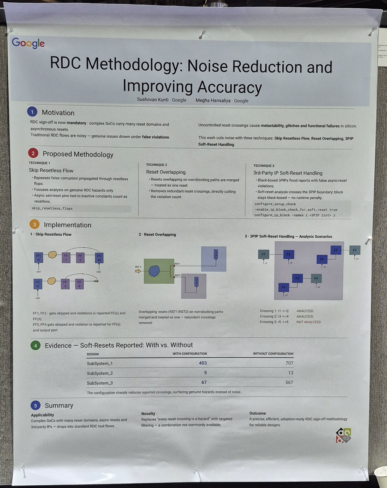{ loading=lazy }

[`rdc`](#tag-rdc) [`verification`](#tag-verification)

!!! info "Slide / Poster Summary"
    Reset-domain-crossing methodology: soft-reset handling reduced reported items (707 to 403, 13 to 5, 567 to 67 in the cases shown).

!!! info "슬라이드 / 포스터 요약"
    Reset-domain-crossing 방법론입니다. soft-reset 처리로 보고 항목이 줄었습니다(소개된 사례에서 707→403, 13→5, 567→67).

!!! tip "Front-End & Emulation Perspective"
    Large RDC noise reduction is a good sign for sign-off flows; the open point is how much is waived by methodology versus truly resolved.

!!! tip "프론트엔드 · 에뮬레이션 관점"
    RDC 노이즈가 크게 줄었다는 점은 사인오프 플로우에 좋은 신호입니다. 다만 방법론으로 waive된 것과 실제로 해결된 것의 비율이 열린 질문입니다.

!!! abstract "In the official DAC 2026 program"
    *RDC Methodology: Noise Reduction and Improving Accuracy*  
    Engineering Poster Session Two — Tue Jul 28, 5-6pm, DAC Pavilion, Exhibit Floor · [program](https://confcats-siteplex.s3.amazonaws.com/dac/images/dac-2026_program_july-22.pdf) · [official page](https://63dac.conference-program.com/presentation/?id=ENGPOST212&sess=sess295) · [archive](#official-dac-2026-archive)

!!! abstract "공식 DAC 2026 프로그램"
    *RDC Methodology: Noise Reduction and Improving Accuracy*  
    Engineering Poster Session Two — Tue Jul 28, 5-6pm, DAC Pavilion, Exhibit Floor · [프로그램](https://confcats-siteplex.s3.amazonaws.com/dac/images/dac-2026_program_july-22.pdf) · [공식 페이지](https://63dac.conference-program.com/presentation/?id=ENGPOST212&sess=sess295) · [아카이브](#archive-ko)

Related:관련: [Flexible and scalable network modeling for AI/HPC network verification](#p20260728172318) · [Zero-glitch confidence: static, formal and simulation](#p20260729120436)

### Flexible and scalable network modeling for AI/HPC network verification {#p20260728172318}

**MangoBoost**

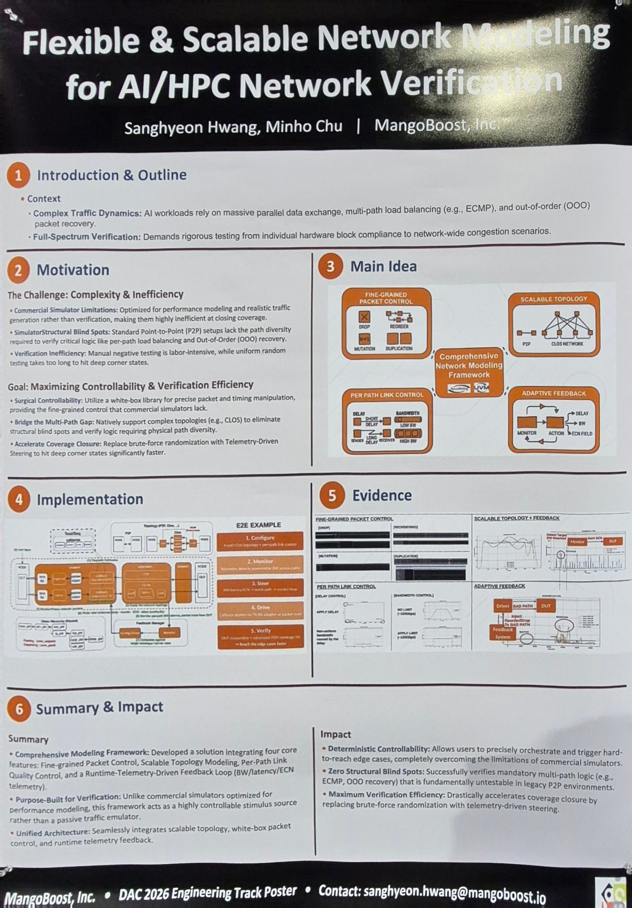{ loading=lazy }

[`uvm`](#tag-uvm) [`network`](#tag-network) [`verification`](#tag-verification)

!!! info "Slide / Poster Summary"
    UVM-based network model with a white-box library and telemetry-driven steering for verifying AI/HPC network designs.

!!! info "슬라이드 / 포스터 요약"
    AI/HPC 네트워크 설계 검증을 위한 UVM 기반 네트워크 모델입니다. white-box 라이브러리와 telemetry 기반 steering을 씁니다.

!!! tip "Front-End & Emulation Perspective"
    Network-scale verification of this kind is hard to fit in an emulator; the question is which parts run on emulation and which stay as models.

!!! tip "프론트엔드 · 에뮬레이션 관점"
    이런 네트워크 규모의 검증은 에뮬레이터에 올리기 어렵습니다. 어느 부분을 에뮬레이션에서 돌리고 어느 부분을 모델로 둘지가 질문입니다.

!!! abstract "In the official DAC 2026 program"
    *Flexible & Scalable Network Modeling for AI/HPC Network Verification*  
    Engineering Poster Session Two (also Gladiator Arena - Poster Battle One — Tue Jul 28, 5-6pm, DAC Pavilion, Exhibit Floor · [program](https://confcats-siteplex.s3.amazonaws.com/dac/images/dac-2026_program_july-22.pdf) · [official page](https://63dac.conference-program.com/presentation/?id=ENGPOST463&sess=sess223) · [archive](#official-dac-2026-archive)

!!! abstract "공식 DAC 2026 프로그램"
    *Flexible & Scalable Network Modeling for AI/HPC Network Verification*  
    Engineering Poster Session Two (also Gladiator Arena - Poster Battle One — Tue Jul 28, 5-6pm, DAC Pavilion, Exhibit Floor · [프로그램](https://confcats-siteplex.s3.amazonaws.com/dac/images/dac-2026_program_july-22.pdf) · [공식 페이지](https://63dac.conference-program.com/presentation/?id=ENGPOST463&sess=sess223) · [아카이브](#archive-ko)

Related:관련: [Firmware-driven random verification on emulation](#p20260727155157) · [RDC methodology: noise reduction and accuracy](#p20260728134255) · [Zero-glitch confidence: static, formal and simulation](#p20260729120436)

## AI and agentic flows for EDA { .en }

## EDA를 위한 AI와 에이전틱 플로우 { .ko }

### AI-Assisted EDA Tools Development {#p20260728110354}

**IBM Austin**

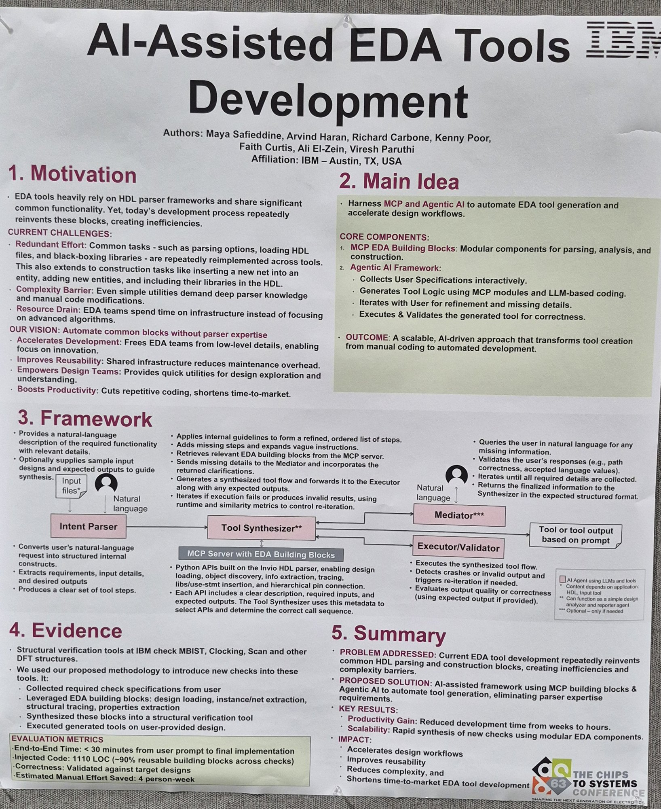{ loading=lazy }

[`llm`](#tag-llm) [`agentic-ai`](#tag-agentic-ai) [`dft`](#tag-dft)

!!! info "Slide / Poster Summary"
    MCP building blocks (parsing, analysis, construction on an HDL parser) plus an agentic framework (Intent Parser, Tool Synthesizer, Mediator, Executor/Validator) that generate EDA tools from natural language. Evidence: new DFT structural checks produced in under 30 minutes, 1110 injected LOC (~90% reusable blocks), ~4 person-weeks of manual effort saved.

!!! info "슬라이드 / 포스터 요약"
    HDL 파서 위의 MCP 구성 요소(파싱, 분석, 생성)와 에이전트 프레임워크(Intent Parser, Tool Synthesizer, Mediator, Executor/Validator)로 자연어에서 EDA 툴을 만듭니다. 근거로 새 DFT 구조 검사를 30분 이내에 생성했고, 주입된 코드는 1110줄(약 90%는 재사용 블록)이며, 수작업 약 4 person-week를 줄였다고 합니다.

!!! tip "Front-End & Emulation Perspective"
    Generated checks are only as good as the validation against known designs; the poster reports correctness against target designs but not false-positive rates. Interesting for in-house lint/rule-check scripting.

!!! tip "프론트엔드 · 에뮬레이션 관점"
    생성된 검사는 알려진 설계로 한 검증만큼만 믿을 수 있습니다. 포스터는 대상 설계에 대한 정확성은 보고하지만 false-positive 비율은 보고하지 않습니다. 사내 lint/룰 체크 스크립팅에 참고할 만합니다.

!!! abstract "In the official DAC 2026 program"
    *AI-Assisted EDA Tools Development*  
    From Concept to Confidence: The AI Evolution in Design & Verification — Tue Jul 28, 10:30am-12pm, Seaside Ballroom A · [program](https://confcats-siteplex.s3.amazonaws.com/dac/images/dac-2026_program_july-22.pdf) · [official page](https://63dac.conference-program.com/presentation/?id=ENGPRES389&sess=sess267) · [archive](#official-dac-2026-archive)

!!! abstract "공식 DAC 2026 프로그램"
    *AI-Assisted EDA Tools Development*  
    From Concept to Confidence: The AI Evolution in Design & Verification — Tue Jul 28, 10:30am-12pm, Seaside Ballroom A · [프로그램](https://confcats-siteplex.s3.amazonaws.com/dac/images/dac-2026_program_july-22.pdf) · [공식 페이지](https://63dac.conference-program.com/presentation/?id=ENGPRES389&sess=sess267) · [아카이브](#archive-ko)

Related:관련: [Fastboot virtualization and on-prem LLM failure analysis (Main Idea slide)](#p20260727162722) · [Design-aware test points in SystemRDL-to-RTL generators](#p20260728134119) · [DFT verification with Veloce full-chip gate-level emulation](#p20260728134334)

### AI-powered batch flow for memory cache verification {#p20260729154134}

**Qualcomm / Siemens (Solido)**

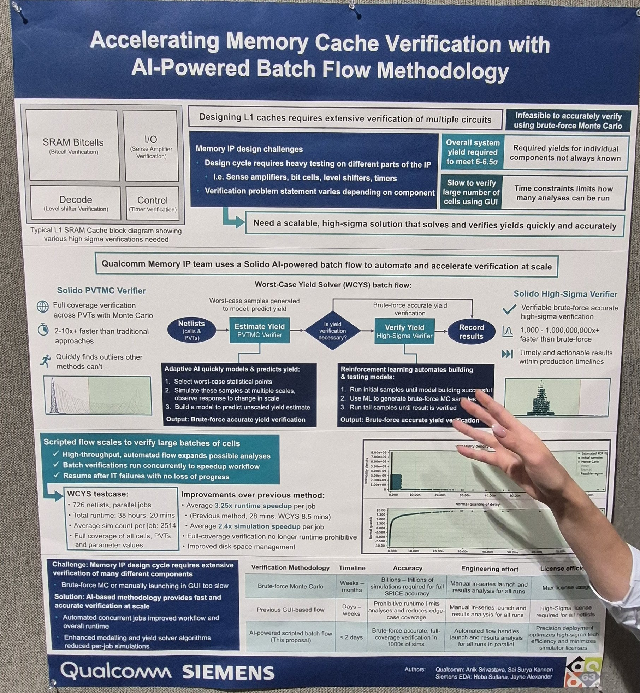{ loading=lazy }

[`ai`](#tag-ai) [`signoff`](#tag-signoff)

!!! info "Slide / Poster Summary"
    Solido worst-case yield solver: adaptive AI predicts yield, reinforcement learning drives high-sigma verification; 726 netlists, 3.25x runtime speedup per job and 2.4x simulation speedup per job against the previous method.

!!! info "슬라이드 / 포스터 요약"
    Solido worst-case yield solver입니다. adaptive AI가 수율을 예측하고 강화학습이 high-sigma 검증을 이끕니다. 넷리스트 726개에서 기존 방식 대비 작업당 런타임 3.25배, 시뮬레이션 2.4배 빨라졌습니다.

!!! tip "Front-End & Emulation Perspective"
    Analog/memory yield rather than digital emulation, but the batch-flow pattern (scripted, resumable after IT failures) applies to any long regression.

!!! tip "프론트엔드 · 에뮬레이션 관점"
    디지털 에뮬레이션이 아니라 아날로그/메모리 수율 이야기지만, 스크립트화되고 IT 장애 뒤에도 재개할 수 있는 batch flow 패턴은 긴 regression 전반에 적용할 수 있습니다.

!!! abstract "In the official DAC 2026 program"
    *Accelerating Memory Cache Verification with AI-Powered Batch Flow Methodology*  
    Engineering Poster Session Three — Wed Jul 29, 3-4pm, DAC Pavilion, Exhibit Floor · [program](https://confcats-siteplex.s3.amazonaws.com/dac/images/dac-2026_program_july-22.pdf) · [official page](https://63dac.conference-program.com/presentation/?id=ENGPOST351&sess=sess296) · [archive](#official-dac-2026-archive)

!!! abstract "공식 DAC 2026 프로그램"
    *Accelerating Memory Cache Verification with AI-Powered Batch Flow Methodology*  
    Engineering Poster Session Three — Wed Jul 29, 3-4pm, DAC Pavilion, Exhibit Floor · [프로그램](https://confcats-siteplex.s3.amazonaws.com/dac/images/dac-2026_program_july-22.pdf) · [공식 페이지](https://63dac.conference-program.com/presentation/?id=ENGPOST351&sess=sess296) · [아카이브](#archive-ko)

Related:관련: [Multi-cycle dynamic vectorless analysis for PDN signoff](#p20260728100544) · [VT-skew MC analysis and load-splitting IR-ECO](#p20260728134139) · [Automated LVS rule deck qualification](#p20260728170302)

## SoC architecture and memory { .en }

## SoC 아키텍처와 메모리 { .ko }

### Evidence: Imsys IM3000 microcode CPU {#p20260727154434}

**Stefan Blixt, Telesis Innovation**

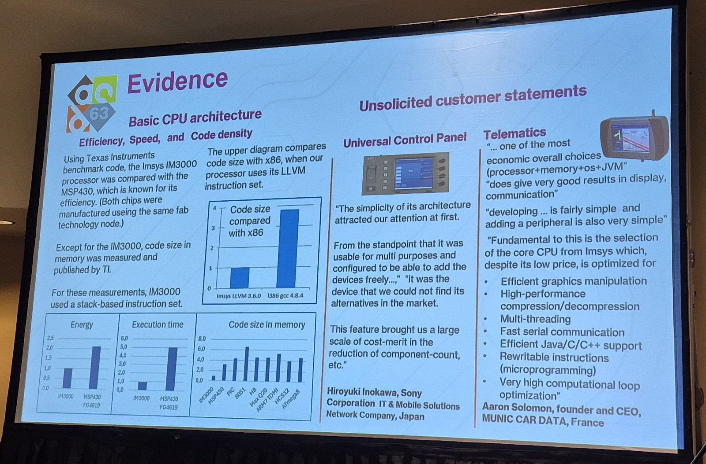{ loading=lazy }

[`cpu-architecture`](#tag-cpu-architecture)

!!! info "Slide / Poster Summary"
    Evidence slide for the soft-microcode engine talk: IM3000 versus MSP430 on TI benchmarks (energy, execution time, code size), code size compared with x86, and customer statements (Sony, MUNIC CAR DATA).

!!! info "슬라이드 / 포스터 요약"
    소프트 마이크로코드 엔진 발표의 근거 슬라이드입니다. TI 벤치마크에서 IM3000과 MSP430을 비교(에너지, 실행 시간, 코드 크기)하고, x86과 코드 크기를 비교하며, 고객 발언(Sony, MUNIC CAR DATA)을 싣고 있습니다.

!!! tip "Front-End & Emulation Perspective"
    The slide is mostly customer testimonials; for emulation use, a rewritable-microcode CPU raises the question of how its state would be observed and debugged.

!!! tip "프론트엔드 · 에뮬레이션 관점"
    슬라이드 대부분이 고객 증언입니다. 에뮬레이션 관점에서는 마이크로코드를 다시 쓸 수 있는 CPU의 상태를 어떻게 관측하고 디버그할지가 의문입니다.

!!! abstract "In the official DAC 2026 program"
    *A Soft-Microcode Engine to Power the Next Wave of Edge Intelligence*  
    System & Software Deployment — Mon Jul 27, 3:30-5pm, Seaside Ballroom B · [program](https://confcats-siteplex.s3.amazonaws.com/dac/images/dac-2026_program_july-22.pdf) · [official page](https://63dac.conference-program.com/presentation/?id=ENGPRES406&sess=sess263) · [archive](#official-dac-2026-archive)

!!! abstract "공식 DAC 2026 프로그램"
    *A Soft-Microcode Engine to Power the Next Wave of Edge Intelligence*  
    System & Software Deployment — Mon Jul 27, 3:30-5pm, Seaside Ballroom B · [프로그램](https://confcats-siteplex.s3.amazonaws.com/dac/images/dac-2026_program_july-22.pdf) · [공식 페이지](https://63dac.conference-program.com/presentation/?id=ENGPRES406&sess=sess263) · [아카이브](#archive-ko)

### SLC-based real-time traffic buffering {#p20260729120300}

**Samsung**

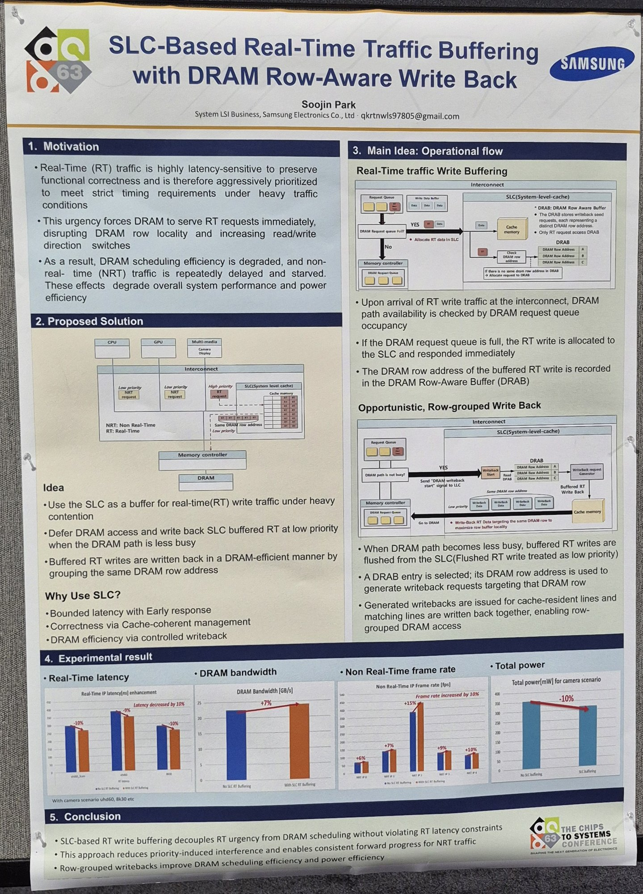{ loading=lazy }

[`soc`](#tag-soc) [`memory`](#tag-memory)

!!! info "Slide / Poster Summary"
    Poster on system-level-cache buffering for real-time traffic with DRAM row-aware write-back.

!!! info "슬라이드 / 포스터 요약"
    실시간 트래픽을 위한 시스템 레벨 캐시(SLC) 버퍼링과 DRAM row-aware write-back 포스터입니다.

!!! abstract "In the official DAC 2026 program"
    *SLC-Based Real-Time Traffic Buffering with DRAM Row-Aware Write Back*  
    Engineering Poster Session Three — Wed Jul 29, 3-4pm, DAC Pavilion, Exhibit Floor · [program](https://confcats-siteplex.s3.amazonaws.com/dac/images/dac-2026_program_july-22.pdf) · [official page](https://63dac.conference-program.com/presentation/?id=ENGPOST307&sess=sess296) · [archive](#official-dac-2026-archive)

!!! abstract "공식 DAC 2026 프로그램"
    *SLC-Based Real-Time Traffic Buffering with DRAM Row-Aware Write Back*  
    Engineering Poster Session Three — Wed Jul 29, 3-4pm, DAC Pavilion, Exhibit Floor · [프로그램](https://confcats-siteplex.s3.amazonaws.com/dac/images/dac-2026_program_july-22.pdf) · [공식 페이지](https://63dac.conference-program.com/presentation/?id=ENGPOST307&sess=sess296) · [아카이브](#archive-ko)

Related:관련: [Best Presentation Award — Systems & Software](#p20260729151330)

### Best Presentation Award — Systems & Software {#p20260729151330}

**Samsung**

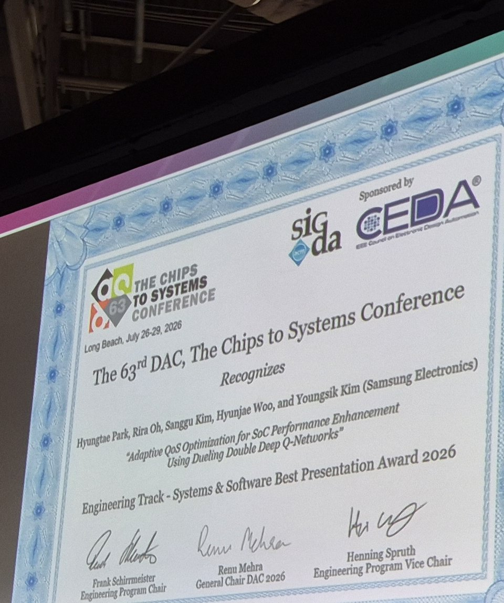{ loading=lazy }

[`award`](#tag-award) [`soc`](#tag-soc)

!!! info "Slide / Poster Summary"
    Award slide for the Engineering Track Systems and Software category: adaptive QoS with dueling double deep Q-networks.

!!! info "슬라이드 / 포스터 요약"
    Engineering Track Systems and Software 부문 수상 슬라이드입니다. dueling double deep Q-network 기반 adaptive QoS를 다룹니다.

!!! abstract "In the official DAC 2026 program"
    *Adaptive QoS Optimization for SoC Performance Enhancement Using Dueling Double Deep Q-Networks*  
    Beyond the Block: Verifying Complex Systems in Context — Wed Jul 29, 2:45-3pm, Seaside Ballroom A · [program](https://confcats-siteplex.s3.amazonaws.com/dac/images/dac-2026_program_july-22.pdf) · [official page](https://63dac.conference-program.com/presentation/?id=ENGPRES048&sess=sess269) · [archive](#official-dac-2026-archive)

!!! abstract "공식 DAC 2026 프로그램"
    *Adaptive QoS Optimization for SoC Performance Enhancement Using Dueling Double Deep Q-Networks*  
    Beyond the Block: Verifying Complex Systems in Context — Wed Jul 29, 2:45-3pm, Seaside Ballroom A · [프로그램](https://confcats-siteplex.s3.amazonaws.com/dac/images/dac-2026_program_july-22.pdf) · [공식 페이지](https://63dac.conference-program.com/presentation/?id=ENGPRES048&sess=sess269) · [아카이브](#archive-ko)

Related:관련: [SLC-based real-time traffic buffering](#p20260729120300)

## From the Official DAC 2026 Program { .en }

## 공식 DAC 2026 프로그램에서 { .ko }

Titles, times and rooms only, from the [official program](https://confcats-siteplex.s3.amazonaws.com/dac/images/dac-2026_program_july-22.pdf); not summaries and not necessarily sessions I attended.
{ .en }

[공식 프로그램](https://confcats-siteplex.s3.amazonaws.com/dac/images/dac-2026_program_july-22.pdf)에서 가져온 제목, 시간, 장소만 적었습니다. 요약이 아니고, 제가 참석한 세션이라는 뜻도 아닙니다.
{ .ko }

### Hybrid Virtual ICE / virtualized tester on emulation { .en }

### 하이브리드 Virtual ICE / 에뮬레이션 위의 가상화 테스터 { .ko }

- **Engineering Poster Session One** — Mon Jul 27, 5-6pm, DAC Pavilion, Exhibit Floor
    - [Pre-Silicon Real Workloads Validation: Integration of Wireless Network Testers and Hardware Emulation via Virtualization](https://63dac.conference-program.com/presentation/?id=ENGPOST060&sess=sess264) — [my photo](#p20260727165840)
    - [A Security-Centric Virtual Platform for Accelerating Shift-Left Security Firmware Development](https://63dac.conference-program.com/presentation/?id=ENGPOST135&sess=sess264)
    - [Using Arm Native Acceleration with VLAB Virtual Platforms](https://63dac.conference-program.com/presentation/?id=ENGPRES191&sess=sess263)
    - [Transforming Linux Drivers for Pre-Silicon Verification and Emulation Using SystemVerilog DPI-C](https://63dac.conference-program.com/presentation/?id=ENGPOST289&sess=sess264)
- **System & Software Deployment** — Mon Jul 27, 3:30-5pm, Seaside Ballroom B
    - [Shifting System-Level Verification Left with Firmware-Driven Execution](https://63dac.conference-program.com/presentation/?id=ENGPRES119&sess=sess263) — [my photo](#p20260727155157)
    - [Enabling Automated Software Testing in Emulation Environments via Fastboot Virtualization and On-Premises LLM-Based Failure Analysis](https://63dac.conference-program.com/presentation/?id=ENGPRES061&sess=sess263) — [my photo](#p20260727162722)

### DFT automation (SystemRDL-to-RTL, DATP) and gate-level DFT emulation { .en }

### DFT 자동화(SystemRDL-to-RTL, DATP)와 게이트 레벨 DFT 에뮬레이션 { .ko }

- **Engineering session (DFT)** — Tue Jul 28, 10:30am-12pm, Seaside RM 7
    - [Automating DFT Intelligence: Addressing TCPF HotSpots at Source through Design Aware Test Points in SystemRDL-to-RTL Generators](https://63dac.conference-program.com/presentation/?id=ENGPRES064&sess=sess277) — [my photo](#p20260728134119)
- **Engineering Poster Session Two** — Tue Jul 28, 5-6pm, DAC Pavilion, Exhibit Floor
    - [Accelerating DFT Verification and Enhancing Debuggability Using Veloce-Based Full Chip Gate-Level Emulation](https://63dac.conference-program.com/presentation/?id=ENGPOST315&sess=sess295) — [my photo](#p20260728134334)

### AI/HPC multi-path network verification { .en }

### AI/HPC 멀티패스 네트워크 검증 { .ko }

- **Gladiator Arena - Poster Battle One** — Mon Jul 27, 5-6pm, DAC Pavilion, Exhibit Floor
    - [Flexible & Scalable Network Modeling for AI/HPC Network Verification (MangoBoost)](https://63dac.conference-program.com/presentation/?id=ENGPOST463&sess=sess223) — [my photo](#p20260728172318)

### Emulation, UVM acceleration and firmware-driven verification { .en }

### 에뮬레이션, UVM acceleration, 펌웨어 기반 검증 { .ko }

- **Advancements in Emulation and Prototyping for Semiconductor: Hardware Tools, Challenges, and FPGA Solutions** — Tue Jul 28, 3:30-5pm, Seaside RM 7
    - [Challenges and Solutions in the next-generation Emulation and Prototyping solutions (Synopsys)](https://63dac.conference-program.com/presentation/?id=ENGINV102&sess=sess294)
    - [Role of HW based tools like Emulation and Prototyping in semiconductor design methodology (Synopsys, NVIDIA)](https://63dac.conference-program.com/presentation/?id=ENGINV101&sess=sess294)
    - [Role of FPGAs in Emulation and Prototyping systems (Synopsys, AMD)](https://63dac.conference-program.com/presentation/?id=ENGINV103&sess=sess294)
- **Beyond the Block: Verifying Complex Systems in Context** — Wed Jul 29, 1:30-3pm, Seaside Ballroom A
    - [Accelerating X-State Aware Power Simulation using Advanced Hardware Emulation](https://63dac.conference-program.com/presentation/?id=ENGPRES153&sess=sess269)
    - [Automated System for FPGA-Based SoC Prototyping](https://63dac.conference-program.com/presentation/?id=ENGPRES224&sess=sess269)
    - [Scalable, Emulation-Friendly, Co-Simulation Testbench for Exhaustive RISC-V Cluster Configuration](https://63dac.conference-program.com/presentation/?id=ENGPRES143&sess=sess269)
- **Fast, Smart, and Agentic: Accelerated Verification with Fuzzing, RL, and LLMs** — Mon Jul 27, 3:30-5:30pm, Mtg Room 201B
    - [TOB-Sched: Topological Order Balancing-Driven Static Scheduling for Processor-based Emulation](https://63dac.conference-program.com/presentation/?id=RESEARCH1348&sess=sess164)
    - [A Boolean Processor-Based Hardware Emulation System with Reconfigurable Interconnects](https://63dac.conference-program.com/presentation/?id=RESEARCH3153&sess=sess164)

### Power analysis with emulation { .en }

### Power analysis with emulation { .ko }

- **Engineering Poster Session Three** — Wed Jul 29, 3-4pm, DAC Pavilion, Exhibit Floor
    - [Accelerating X-State Aware Power Simulation using Advanced Hardware Emulation](https://63dac.conference-program.com/presentation/?id=ENGPRES153&sess=sess269)
- **Engineering Poster Session Two** — Tue Jul 28, 5-6pm, DAC Pavilion, Exhibit Floor
    - [Low power optimization through fast and accurate time-based power analysis](https://63dac.conference-program.com/presentation/?id=ENGPOST075&sess=sess295)
- **Engineering Poster Session One** — Mon Jul 27, 5-6pm, DAC Pavilion, Exhibit Floor
    - [First-Time-Right Power Analysis: Data-Driven Test Selection Through Real-Time Validation of Clocks, ...](https://63dac.conference-program.com/presentation/?id=ENGPOST326&sess=sess264)

### CXL, near-memory and PIM { .en }

### CXL, near-memory and PIM { .ko }

*Mostly architecture/design papers, not verification talks.*
{ .en }

*검증 발표보다는 아키텍처/설계 논문이 대부분입니다.*
{ .ko }

- **The Dawn of the Computational Frontier: Pioneering Devices and Interconnects Empowering Memory-Centric, AI-Scale Systems** — Mon Jul 27, 10:30am-12:30pm, Mtg Room 202C
    - [ReMemTier: Rethinking Memory Tiering for CXL-based SSD via Large Granularity Memory Access](https://63dac.conference-program.com/presentation/?id=RESEARCH2945&sess=sess169)
    - [TierANNS: Scalable Graph-based ANNS with CXL-enabled Tiered Data Placement](https://63dac.conference-program.com/presentation/?id=RESEARCH2268&sess=sess169)
- **Intelligent Fetch & Match Architectures** — Mon Jul 27, 1:30-3pm, Mtg Room 202C
    - [CANNON: A CXL-Based Near-Memory Processing Architecture for Approximate Nearest Neighbor Search](https://63dac.conference-program.com/presentation/?id=RESEARCH108&sess=sess119)
    - [PIMGRAG: A Heterogeneous PIM Architecture for Graph-based Retrieval-Augmented Generation](https://63dac.conference-program.com/presentation/?id=RESEARCH1596&sess=sess119)
- **Move Less, Compute More: Memory-Centric Architectures for AI** — Wed Jul 29, 1:30-3pm, Mtg Room 203AB
    - [PIMony: A DRAM-PIM Design for Harmonizing PIM and Memory Accesses with Minimal Interference](https://63dac.conference-program.com/presentation/?id=RESEARCH1909&sess=sess138)
- **Engineering Poster Session Two** — Tue Jul 28, 5-6pm, DAC Pavilion, Exhibit Floor
    - [Agentic AI Partition And Floorplan Assistance For PCIe/CXL Subsystem Physical Design](https://63dac.conference-program.com/presentation/?id=ENGPOST141&sess=sess295)

### Agentic AI and LLM for EDA / triage { .en }

### EDA와 triage를 위한 에이전틱 AI와 LLM { .ko }

- **Fast, Smart, and Agentic: Accelerated Verification with Fuzzing, RL, and LLMs** — Mon Jul 27, 3:30-5:30pm, Mtg Room 201B
    - [UVMarvel: An Automated LLM-Aided UVM Machine for Subsystem-Level RTL Verification](https://63dac.conference-program.com/presentation/?id=RESEARCH2880&sess=sess164)
    - [Stitch: Assertion-Guided Patching of On-Chip Protocol Implementations using LLMs](https://63dac.conference-program.com/presentation/?id=RESEARCH2443&sess=sess164)
- **Engineering Poster Session One** — Mon Jul 27, 5-6pm, DAC Pavilion, Exhibit Floor
    - [Agentic Time-Travel Debugging for HLS Code](https://63dac.conference-program.com/presentation/?id=ENGPOST272&sess=sess264)
    - [The new era of digital verification: a revolution driven by agentic AI acceleration](https://63dac.conference-program.com/presentation/?id=ENGPOST043&sess=sess264)
- **Engineering Poster Session Two** — Tue Jul 28, 5-6pm, DAC Pavilion, Exhibit Floor
    - [XChip: A Guardrailed Agentic Gen-AI Front-End Flow from Intent to GDSII](https://63dac.conference-program.com/presentation/?id=ENGPOST248&sess=sess295)

## Tags { .en }

## 태그 { .ko }

### agentic-ai {#tag-agentic-ai}

[AI-Assisted EDA Tools Development](#p20260728110354)

### ai {#tag-ai}

[AI-powered batch flow for memory cache verification](#p20260729154134)

### award {#tag-award}

[Best Presentation Award — Systems & Software](#p20260729151330)

### cdc {#tag-cdc}

[Zero-glitch confidence: static, formal and simulation](#p20260729120436)

### cpu-architecture {#tag-cpu-architecture}

[Evidence: Imsys IM3000 microcode CPU](#p20260727154434)

### debug {#tag-debug}

[DFT verification with Veloce full-chip gate-level emulation](#p20260728134334)

### dft {#tag-dft}

[AI-Assisted EDA Tools Development](#p20260728110354), [Design-aware test points in SystemRDL-to-RTL generators](#p20260728134119), [DFT verification with Veloce full-chip gate-level emulation](#p20260728134334)

### emulation {#tag-emulation}

[Firmware-driven random verification on emulation](#p20260727155157), [Fastboot virtualization and on-prem LLM failure analysis (Main Idea slide)](#p20260727162722), [Hybrid Virtual ICE — Pre-Silicon Real Workloads Validation](#p20260727165840), [DFT verification with Veloce full-chip gate-level emulation](#p20260728134334)

### firmware {#tag-firmware}

[Firmware-driven random verification on emulation](#p20260727155157)

### formal {#tag-formal}

[Zero-glitch confidence: static, formal and simulation](#p20260729120436)

### llm {#tag-llm}

[Fastboot virtualization and on-prem LLM failure analysis (Main Idea slide)](#p20260727162722), [AI-Assisted EDA Tools Development](#p20260728110354)

### lvs {#tag-lvs}

[Automated LVS rule deck qualification](#p20260728170302), [Accelerating circuit verification with Calibre nmLVS Recon](#p20260729123634)

### memory {#tag-memory}

[SLC-based real-time traffic buffering](#p20260729120300)

### network {#tag-network}

[Flexible and scalable network modeling for AI/HPC network verification](#p20260728172318)

### post-silicon {#tag-post-silicon}

[Voltage-droop mitigation on MAIA 200](#p20260727114025)

### power {#tag-power}

[Voltage-droop mitigation on MAIA 200](#p20260727114025), [Multi-cycle dynamic vectorless analysis for PDN signoff](#p20260728100544), [VT-skew MC analysis and load-splitting IR-ECO](#p20260728134139)

### rdc {#tag-rdc}

[RDC methodology: noise reduction and accuracy](#p20260728134255)

### rtl-generation {#tag-rtl-generation}

[Design-aware test points in SystemRDL-to-RTL generators](#p20260728134119)

### signoff {#tag-signoff}

[Multi-cycle dynamic vectorless analysis for PDN signoff](#p20260728100544), [VT-skew MC analysis and load-splitting IR-ECO](#p20260728134139), [Automated LVS rule deck qualification](#p20260728170302), [Accelerating circuit verification with Calibre nmLVS Recon](#p20260729123634), [AI-powered batch flow for memory cache verification](#p20260729154134)

### soc {#tag-soc}

[SLC-based real-time traffic buffering](#p20260729120300), [Best Presentation Award — Systems & Software](#p20260729151330)

### uvm {#tag-uvm}

[Firmware-driven random verification on emulation](#p20260727155157), [Flexible and scalable network modeling for AI/HPC network verification](#p20260728172318)

### verification {#tag-verification}

[RDC methodology: noise reduction and accuracy](#p20260728134255), [Flexible and scalable network modeling for AI/HPC network verification](#p20260728172318), [Zero-glitch confidence: static, formal and simulation](#p20260729120436)

### virtual-ice {#tag-virtual-ice}

[Hybrid Virtual ICE — Pre-Silicon Real Workloads Validation](#p20260727165840)

### virtualization {#tag-virtualization}

[Fastboot virtualization and on-prem LLM failure analysis (Main Idea slide)](#p20260727162722), [Hybrid Virtual ICE — Pre-Silicon Real Workloads Validation](#p20260727165840)

