# DAC 2026

63rd Design Automation Conference · Long Beach, CA · 2026-07-26 ~ 2026-07-29

[Official site](https://dac.com/63rd-dac) · [Home](../index.md)

*Front-End Verification & Emulation Perspective* — 18 posters and slides I looked at.

## Official DAC 2026 Archive

Everything here comes from the official conference; my photos below link back to it.

- [Searchable program (one page per talk/poster/paper, with abstracts)](https://63dac.conference-program.com/)
- [63rd DAC page (recordings, keynotes, Poster Gladiators, TechTalks, program)](https://dac.com/63rd-dac)
- [Proceedings (ACM Digital Library)](https://dl.acm.org/doi/proceedings/10.1145/3770743)
- [Engineering Track proceedings (zip with HTML, about 580 MB)](http://confcats-event-sessions.s3.amazonaws.com/dac26/uploads/DAC_2026_ET_Full_Proceedings_with_HTML.zip)
- [PDF program](https://confcats-siteplex.s3.amazonaws.com/dac/images/dac-2026_program_july-22.pdf)
- [DAC conference archive (all years)](https://dac.com/conference-archive)

Every talk, poster and paper has its own page, with abstract, in the searchable program; full texts are in the ACM proceedings (research) and the Engineering Track proceedings zip.

## What I Wanted to Learn at DAC

- **Hybrid Virtual ICE / virtualized tester on emulation** — My own poster, plus the other posters that virtualize the outside world around the emulator. [My poster: Hybrid Virtual ICE — Pre-Silicon Real Workloads Validation](#p20260727165840), [Fastboot virtualization and on-prem LLM failure analysis (Main Idea slide)](#p20260727162722)
- **DFT automation (SystemRDL-to-RTL, DATP) and gate-level DFT emulation** [Design-aware test points in SystemRDL-to-RTL generators](#p20260728134119), [DFT verification with Veloce full-chip gate-level emulation](#p20260728134334)
- **AI/HPC multi-path network verification** [Flexible and scalable network modeling for AI/HPC network verification](#p20260728172318)
- **Emulation, UVM acceleration and firmware-driven verification** [Firmware-driven random verification on emulation](#p20260727155157), [My poster: Hybrid Virtual ICE — Pre-Silicon Real Workloads Validation](#p20260727165840), [DFT verification with Veloce full-chip gate-level emulation](#p20260728134334)
- **Agentic AI and LLM for EDA / triage** [AI-Assisted EDA Tools Development](#p20260728110354), [Fastboot virtualization and on-prem LLM failure analysis (Main Idea slide)](#p20260727162722)
- **CXL / near-memory / PIM and emulation power analysis** — No photos of mine; see the program listing below for the sessions and papers.

## From the Official DAC 2026 Program

Titles, times and rooms only, from the [official program](https://confcats-siteplex.s3.amazonaws.com/dac/images/dac-2026_program_july-22.pdf); not summaries and not necessarily sessions I attended.

### Hybrid Virtual ICE / virtualized tester on emulation

- **Engineering Poster Session One** — Mon Jul 27, 5-6pm, DAC Pavilion, Exhibit Floor
    - [Pre-Silicon Real Workloads Validation: Integration of Wireless Network Testers and Hardware Emulation via Virtualization (mine)](https://63dac.conference-program.com/?post_type=page&p=16&id=ENGPOST060&sess=sess264) — [my photo](#p20260727165840)
    - [A Security-Centric Virtual Platform for Accelerating Shift-Left Security Firmware Development](https://63dac.conference-program.com/?post_type=page&p=16&id=ENGPOST135&sess=sess264)
    - [Using Arm Native Acceleration with VLAB Virtual Platforms](https://63dac.conference-program.com/?post_type=page&p=16&id=ENGPRES191&sess=sess263)
    - [Transforming Linux Drivers for Pre-Silicon Verification and Emulation Using SystemVerilog DPI-C](https://63dac.conference-program.com/?post_type=page&p=16&id=ENGPOST289&sess=sess264)
- **System & Software Deployment** — Mon Jul 27, 3:30-5pm, Seaside Ballroom B
    - [Shifting System-Level Verification Left with Firmware-Driven Execution](https://63dac.conference-program.com/?post_type=page&p=16&id=ENGPRES119&sess=sess263) — [my photo](#p20260727155157)
    - [Enabling Automated Software Testing in Emulation Environments via Fastboot Virtualization and On-Premises LLM-Based Failure Analysis](https://63dac.conference-program.com/?post_type=page&p=16&id=ENGPRES061&sess=sess263) — [my photo](#p20260727162722)

### DFT automation (SystemRDL-to-RTL, DATP) and gate-level DFT emulation

- **Engineering session (DFT)** — Tue Jul 28, 10:30am-12pm, Seaside RM 7
    - [Automating DFT Intelligence: Addressing TCPF HotSpots at Source through Design Aware Test Points in SystemRDL-to-RTL Generators](https://63dac.conference-program.com/?post_type=page&p=16&id=ENGPRES064&sess=sess277) — [my photo](#p20260728134119)
- **Engineering Poster Session Two** — Tue Jul 28, 5-6pm, DAC Pavilion, Exhibit Floor
    - [Accelerating DFT Verification and Enhancing Debuggability Using Veloce-Based Full Chip Gate-Level Emulation](https://63dac.conference-program.com/?post_type=page&p=16&id=ENGPOST315&sess=sess295) — [my photo](#p20260728134334)

### AI/HPC multi-path network verification

- **Gladiator Arena - Poster Battle One** — Mon Jul 27, 5-6pm, DAC Pavilion, Exhibit Floor
    - [Flexible & Scalable Network Modeling for AI/HPC Network Verification (MangoBoost)](https://63dac.conference-program.com/?post_type=page&p=16&id=ENGPOST463&sess=sess223) — [my photo](#p20260728172318)

### Emulation, UVM acceleration and firmware-driven verification

- **Advancements in Emulation and Prototyping for Semiconductor: Hardware Tools, Challenges, and FPGA Solutions** — Tue Jul 28, 3:30-5pm, Seaside RM 7
    - [Challenges and Solutions in the next-generation Emulation and Prototyping solutions (Synopsys)](https://63dac.conference-program.com/?post_type=page&p=16&id=ENGINV102&sess=sess294)
    - [Role of HW based tools like Emulation and Prototyping in semiconductor design methodology (Synopsys, NVIDIA)](https://63dac.conference-program.com/?post_type=page&p=16&id=ENGINV101&sess=sess294)
    - [Role of FPGAs in Emulation and Prototyping systems (Synopsys, AMD)](https://63dac.conference-program.com/?post_type=page&p=16&id=ENGINV103&sess=sess294)
- **Beyond the Block: Verifying Complex Systems in Context** — Wed Jul 29, 1:30-3pm, Seaside Ballroom A
    - [Accelerating X-State Aware Power Simulation using Advanced Hardware Emulation](https://63dac.conference-program.com/?post_type=page&p=16&id=ENGPRES153&sess=sess269)
    - [Automated System for FPGA-Based SoC Prototyping](https://63dac.conference-program.com/?post_type=page&p=16&id=ENGPRES224&sess=sess269)
    - [Scalable, Emulation-Friendly, Co-Simulation Testbench for Exhaustive RISC-V Cluster Configuration](https://63dac.conference-program.com/?post_type=page&p=16&id=ENGPRES143&sess=sess269)
- **Fast, Smart, and Agentic: Accelerated Verification with Fuzzing, RL, and LLMs** — Mon Jul 27, 3:30-5:30pm, Mtg Room 201B
    - [TOB-Sched: Topological Order Balancing-Driven Static Scheduling for Processor-based Emulation](https://63dac.conference-program.com/?post_type=page&p=16&id=RESEARCH1348&sess=sess164)
    - [A Boolean Processor-Based Hardware Emulation System with Reconfigurable Interconnects](https://63dac.conference-program.com/?post_type=page&p=16&id=RESEARCH3153&sess=sess164)

### Power analysis with emulation

- **Engineering Poster Session Three** — Wed Jul 29, 3-4pm, DAC Pavilion, Exhibit Floor
    - [Accelerating X-State Aware Power Simulation using Advanced Hardware Emulation](https://63dac.conference-program.com/?post_type=page&p=16&id=ENGPRES153&sess=sess269)
- **Engineering Poster Session Two** — Tue Jul 28, 5-6pm, DAC Pavilion, Exhibit Floor
    - [Low power optimization through fast and accurate time-based power analysis](https://63dac.conference-program.com/?post_type=page&p=16&id=ENGPOST075&sess=sess295)
- **Engineering Poster Session One** — Mon Jul 27, 5-6pm, DAC Pavilion, Exhibit Floor
    - [First-Time-Right Power Analysis: Data-Driven Test Selection Through Real-Time Validation of Clocks, ...](https://63dac.conference-program.com/?post_type=page&p=16&id=ENGPOST326&sess=sess264)

### CXL, near-memory and PIM

*Mostly architecture/design papers, not verification talks.*

- **The Dawn of the Computational Frontier: Pioneering Devices and Interconnects Empowering Memory-Centric, AI-Scale Systems** — Mon Jul 27, 10:30am-12:30pm, Mtg Room 202C
    - [ReMemTier: Rethinking Memory Tiering for CXL-based SSD via Large Granularity Memory Access](https://63dac.conference-program.com/?post_type=page&p=16&id=RESEARCH2945&sess=sess169)
    - [TierANNS: Scalable Graph-based ANNS with CXL-enabled Tiered Data Placement](https://63dac.conference-program.com/?post_type=page&p=16&id=RESEARCH2268&sess=sess169)
- **Intelligent Fetch & Match Architectures** — Mon Jul 27, 1:30-3pm, Mtg Room 202C
    - [CANNON: A CXL-Based Near-Memory Processing Architecture for Approximate Nearest Neighbor Search](https://63dac.conference-program.com/?post_type=page&p=16&id=RESEARCH108&sess=sess119)
    - [PIMGRAG: A Heterogeneous PIM Architecture for Graph-based Retrieval-Augmented Generation](https://63dac.conference-program.com/?post_type=page&p=16&id=RESEARCH1596&sess=sess119)
- **Move Less, Compute More: Memory-Centric Architectures for AI** — Wed Jul 29, 1:30-3pm, Mtg Room 203AB
    - [PIMony: A DRAM-PIM Design for Harmonizing PIM and Memory Accesses with Minimal Interference](https://63dac.conference-program.com/?post_type=page&p=16&id=RESEARCH1909&sess=sess138)
- **Engineering Poster Session Two** — Tue Jul 28, 5-6pm, DAC Pavilion, Exhibit Floor
    - [Agentic AI Partition And Floorplan Assistance For PCIe/CXL Subsystem Physical Design](https://63dac.conference-program.com/?post_type=page&p=16&id=ENGPOST141&sess=sess295)

### Agentic AI and LLM for EDA / triage

- **Fast, Smart, and Agentic: Accelerated Verification with Fuzzing, RL, and LLMs** — Mon Jul 27, 3:30-5:30pm, Mtg Room 201B
    - [UVMarvel: An Automated LLM-Aided UVM Machine for Subsystem-Level RTL Verification](https://63dac.conference-program.com/?post_type=page&p=16&id=RESEARCH2880&sess=sess164)
    - [Stitch: Assertion-Guided Patching of On-Chip Protocol Implementations using LLMs](https://63dac.conference-program.com/?post_type=page&p=16&id=RESEARCH2443&sess=sess164)
- **Engineering Poster Session One** — Mon Jul 27, 5-6pm, DAC Pavilion, Exhibit Floor
    - [Agentic Time-Travel Debugging for HLS Code](https://63dac.conference-program.com/?post_type=page&p=16&id=ENGPOST272&sess=sess264)
    - [The new era of digital verification: a revolution driven by agentic AI acceleration](https://63dac.conference-program.com/?post_type=page&p=16&id=ENGPOST043&sess=sess264)
- **Engineering Poster Session Two** — Tue Jul 28, 5-6pm, DAC Pavilion, Exhibit Floor
    - [XChip: A Guardrailed Agentic Gen-AI Front-End Flow from Intent to GDSII](https://63dac.conference-program.com/?post_type=page&p=16&id=ENGPOST248&sess=sess295)

## My Work

### My poster: Hybrid Virtual ICE — Pre-Silicon Real Workloads Validation {#p20260727165840}

**Anritsu / Samsung / Synopsys (ZeBu)**

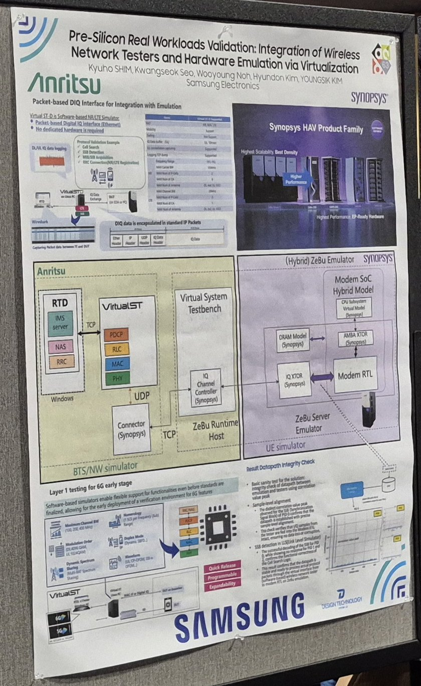{ loading=lazy }

[`emulation`](#tag-emulation) [`virtualization`](#tag-virtualization) [`virtual-ice`](#tag-virtual-ice) [`my-work`](#tag-my-work)

!!! info "Slide / Poster Summary"
    Our Engineering Track poster (right; the Samsung Fastboot poster is on the left). A hybrid virtual ICE: instead of a physical target cable, speed adapter and real tester hardware, a wireless network tester (Anritsu) is connected to the ZeBu-emulated modem SoC through a virtualized packet-based IQ interface, so real network workloads run against cycle-accurate RTL before silicon.

!!! tip "Front-End & Emulation Perspective"
    Traditional ICE ties emulation to physical cables and speed adapters, which causes frequency mismatch, hard-to-reproduce runs and no remote access, while a pure virtual platform is not cycle accurate. Hybrid virtual ICE keeps the RTL in the emulator and virtualizes the outside world. We frame it as an industry interoperability challenge between tools and emulators, not a one-off internal fix.

!!! abstract "In the official DAC 2026 program"
    *Pre-Silicon Real Workloads Validation: Integration of Wireless Network Testers and Hardware Emulation via Virtualization*  
    Engineering Poster Session One — Mon Jul 27, 5-6pm, DAC Pavilion, Exhibit Floor · [program](https://confcats-siteplex.s3.amazonaws.com/dac/images/dac-2026_program_july-22.pdf) · [official page](https://63dac.conference-program.com/?post_type=page&p=16&id=ENGPOST060&sess=sess264) · [archive](#official-dac-2026-archive)

Related: [Fastboot virtualization and on-prem LLM failure analysis (Main Idea slide)](#p20260727162722) · [Firmware-driven random verification on emulation](#p20260727155157) · [DFT verification with Veloce full-chip gate-level emulation](#p20260728134334)

## Posters & Slides

### Voltage-droop mitigation on MAIA 200 {#p20260727114025}

**Microsoft**

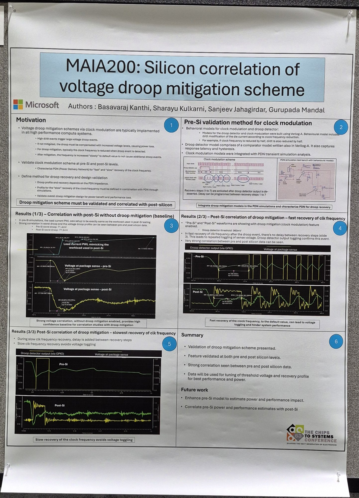{ loading=lazy }

[`power`](#tag-power) [`post-silicon`](#tag-post-silicon)

!!! info "Slide / Poster Summary"
    Poster on voltage-droop mitigation for MAIA 200 with Pre-Si / Post-Si correlation and Verilog-A models.

!!! tip "Front-End & Emulation Perspective"
    Pre-Si/Post-Si correlation is the useful part: it shows how far pre-silicon power/droop analysis can be trusted against measured silicon.

!!! abstract "In the official DAC 2026 program"
    *Silicon correlation of voltage droop mitigation scheme*  
    Engineering Poster Session One — Mon Jul 27, 5-6pm, DAC Pavilion, Exhibit Floor · [program](https://confcats-siteplex.s3.amazonaws.com/dac/images/dac-2026_program_july-22.pdf) · [official page](https://63dac.conference-program.com/?post_type=page&p=16&id=ENGPOST150&sess=sess264) · [archive](#official-dac-2026-archive)

Related: [Multi-cycle dynamic vectorless analysis for PDN signoff](#p20260728100544) · [VT-skew MC analysis and load-splitting IR-ECO](#p20260728134139)

### Evidence: Imsys IM3000 microcode CPU {#p20260727154434}

**Stefan Blixt, Telesis Innovation**

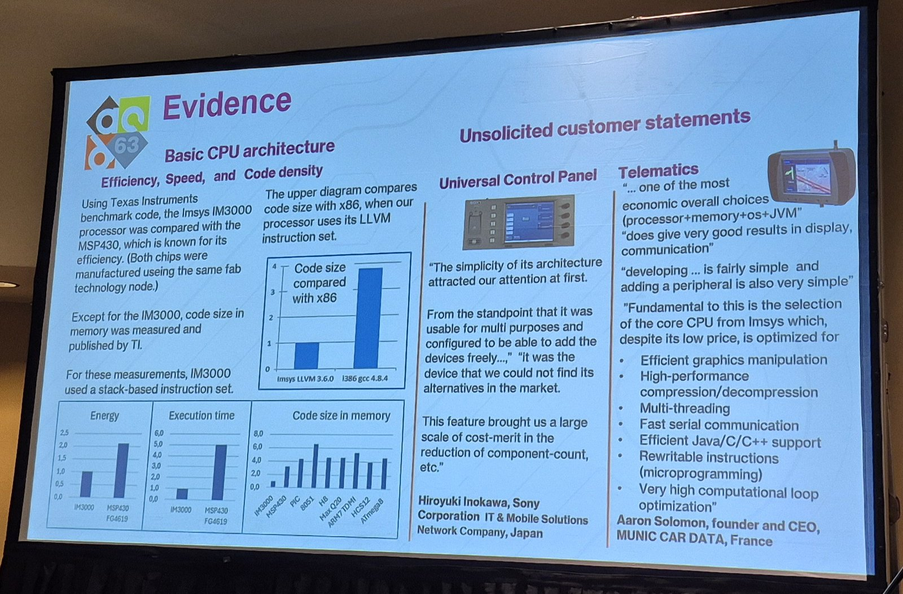{ loading=lazy }

[`cpu-architecture`](#tag-cpu-architecture)

!!! info "Slide / Poster Summary"
    Evidence slide for the soft-microcode engine talk: IM3000 versus MSP430 on TI benchmarks (energy, execution time, code size), code size compared with x86, and customer statements (Sony, MUNIC CAR DATA).

!!! tip "Front-End & Emulation Perspective"
    The slide is mostly customer testimonials; for emulation use, a rewritable-microcode CPU raises the question of how its state would be observed and debugged.

!!! abstract "In the official DAC 2026 program"
    *A Soft-Microcode Engine to Power the Next Wave of Edge Intelligence*  
    System & Software Deployment — Mon Jul 27, 3:30-5pm, Seaside Ballroom B · [program](https://confcats-siteplex.s3.amazonaws.com/dac/images/dac-2026_program_july-22.pdf) · [official page](https://63dac.conference-program.com/?post_type=page&p=16&id=ENGPRES406&sess=sess263) · [archive](#official-dac-2026-archive)

### Firmware-driven random verification on emulation {#p20260727155157}

**Samsung (image sensor / ISP)**

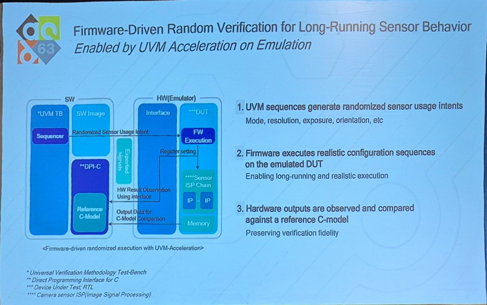{ loading=lazy }

[`emulation`](#tag-emulation) [`uvm`](#tag-uvm) [`firmware`](#tag-firmware)

!!! info "Slide / Poster Summary"
    UVM sequences generate randomized sensor usage intents (mode, resolution, exposure, orientation). Firmware on the emulated DUT executes realistic configuration sequences, and hardware outputs are observed and compared with a reference C-model through DPI-C. UVM acceleration on the emulator makes long-running runs feasible.

!!! tip "Front-End & Emulation Perspective"
    This is the closest talk to everyday emulation work: UVM-acceleration with real firmware. The things to check are testbench-to-DUT transaction overhead in acceleration mode and how failures that need long-running state are debugged with limited signal visibility.

!!! abstract "In the official DAC 2026 program"
    *Shifting System-Level Verification Left with Firmware-Driven Execution*  
    System & Software Deployment — Mon Jul 27, 3:30-5pm, Seaside Ballroom B · [program](https://confcats-siteplex.s3.amazonaws.com/dac/images/dac-2026_program_july-22.pdf) · [official page](https://63dac.conference-program.com/?post_type=page&p=16&id=ENGPRES119&sess=sess263) · [archive](#official-dac-2026-archive)

Related: [Fastboot virtualization and on-prem LLM failure analysis (Main Idea slide)](#p20260727162722) · [My poster: Hybrid Virtual ICE — Pre-Silicon Real Workloads Validation](#p20260727165840) · [DFT verification with Veloce full-chip gate-level emulation](#p20260728134334)

### Fastboot virtualization and on-prem LLM failure analysis (Main Idea slide) {#p20260727162722}

**Samsung Electronics**

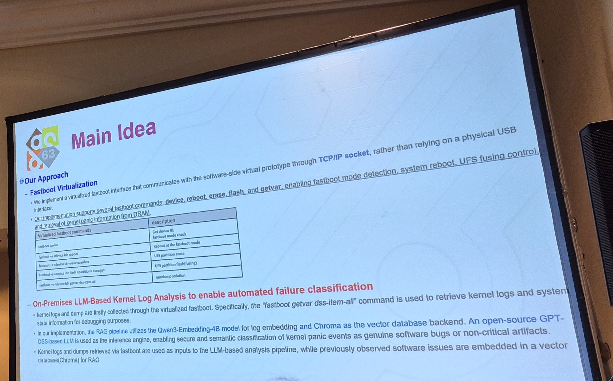{ loading=lazy }

[`emulation`](#tag-emulation) [`virtualization`](#tag-virtualization) [`llm`](#tag-llm)

!!! info "Slide / Poster Summary"
    Main Idea slide: a software test platform drives a hybrid emulation environment through a virtualized Fastboot interface, and an on-premises LLM (RAG) classifies kernel logs as real software bugs or non-critical events.

!!! tip "Front-End & Emulation Perspective"
    Virtualizing Fastboot removes the need for a physical USB link in emulation. Keeping the LLM on-premises matters for confidentiality of logs; the cost is how much emulation time the automated reboot/flash loop consumes.

!!! abstract "In the official DAC 2026 program"
    *Enabling Automated Software Testing in Emulation Environments via Fastboot Virtualization and On-Premises LLM-Based Failure Analysis*  
    System & Software Deployment — Mon Jul 27, 3:30-5pm, Seaside Ballroom B · [program](https://confcats-siteplex.s3.amazonaws.com/dac/images/dac-2026_program_july-22.pdf) · [official page](https://63dac.conference-program.com/?post_type=page&p=16&id=ENGPRES061&sess=sess263) · [archive](#official-dac-2026-archive)

Related: [My poster: Hybrid Virtual ICE — Pre-Silicon Real Workloads Validation](#p20260727165840) · [Firmware-driven random verification on emulation](#p20260727155157) · [AI-Assisted EDA Tools Development](#p20260728110354)

### Multi-cycle dynamic vectorless analysis for PDN signoff {#p20260728100544}

**Qualcomm / Cadence**

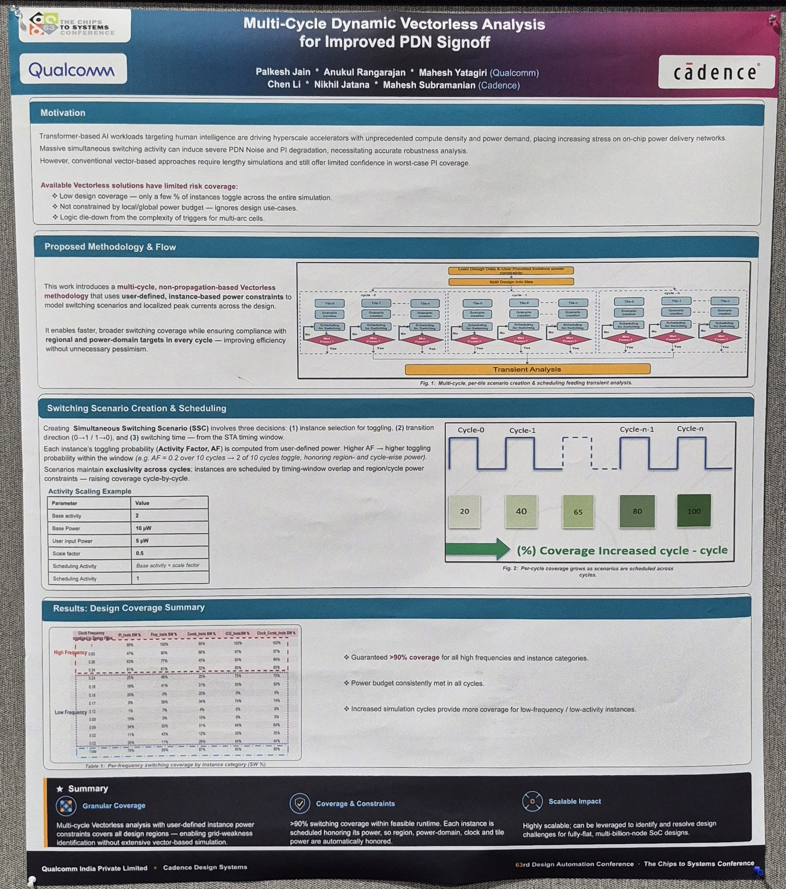{ loading=lazy }

[`power`](#tag-power) [`signoff`](#tag-signoff)

!!! info "Slide / Poster Summary"
    Poster on multi-cycle dynamic vectorless analysis for improving power-delivery-network signoff.

!!! tip "Front-End & Emulation Perspective"
    Vectorless analysis is an alternative to waiting for realistic emulation vectors; it is worth comparing which cases still need real activity from emulation.

!!! abstract "In the official DAC 2026 program"
    *Multi-Cycle Dynamic Vectorless Analysis for Improved PDN Signoff*  
    Engineering Poster Session Two — Tue Jul 28, 5-6pm, DAC Pavilion, Exhibit Floor · [program](https://confcats-siteplex.s3.amazonaws.com/dac/images/dac-2026_program_july-22.pdf) · [official page](https://63dac.conference-program.com/?post_type=page&p=16&id=ENGPOST090&sess=sess295) · [archive](#official-dac-2026-archive)

Related: [VT-skew MC analysis and load-splitting IR-ECO](#p20260728134139) · [Voltage-droop mitigation on MAIA 200](#p20260727114025) · [Automated LVS rule deck qualification](#p20260728170302)

### AI-Assisted EDA Tools Development {#p20260728110354}

**IBM Austin**

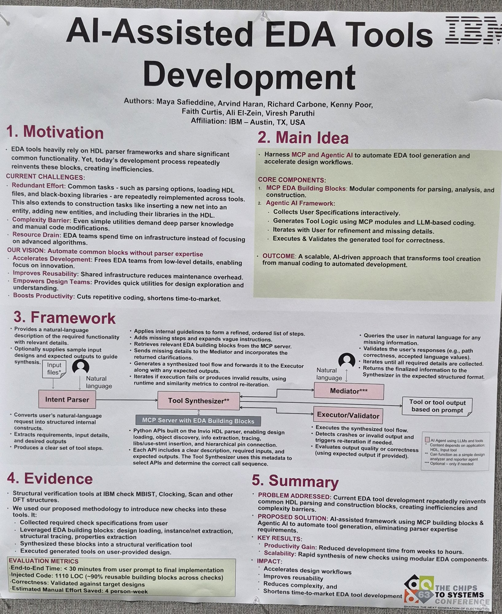{ loading=lazy }

[`llm`](#tag-llm) [`agentic-ai`](#tag-agentic-ai) [`dft`](#tag-dft)

!!! info "Slide / Poster Summary"
    MCP building blocks (parsing, analysis, construction on an HDL parser) plus an agentic framework (Intent Parser, Tool Synthesizer, Mediator, Executor/Validator) that generate EDA tools from natural language. Evidence: new DFT structural checks produced in under 30 minutes, 1110 injected LOC (~90% reusable blocks), ~4 person-weeks of manual effort saved.

!!! tip "Front-End & Emulation Perspective"
    Generated checks are only as good as the validation against known designs; the poster reports correctness against target designs but not false-positive rates. Interesting for in-house lint/rule-check scripting.

!!! abstract "In the official DAC 2026 program"
    *AI-Assisted EDA Tools Development*  
    From Concept to Confidence: The AI Evolution in Design & Verification — Tue Jul 28, 10:30am-12pm, Seaside Ballroom A · [program](https://confcats-siteplex.s3.amazonaws.com/dac/images/dac-2026_program_july-22.pdf) · [official page](https://63dac.conference-program.com/?post_type=page&p=16&id=ENGPRES389&sess=sess267) · [archive](#official-dac-2026-archive)

Related: [Fastboot virtualization and on-prem LLM failure analysis (Main Idea slide)](#p20260727162722) · [Design-aware test points in SystemRDL-to-RTL generators](#p20260728134119) · [DFT verification with Veloce full-chip gate-level emulation](#p20260728134334)

### Design-aware test points in SystemRDL-to-RTL generators {#p20260728134119}

**Google / Agnisys**

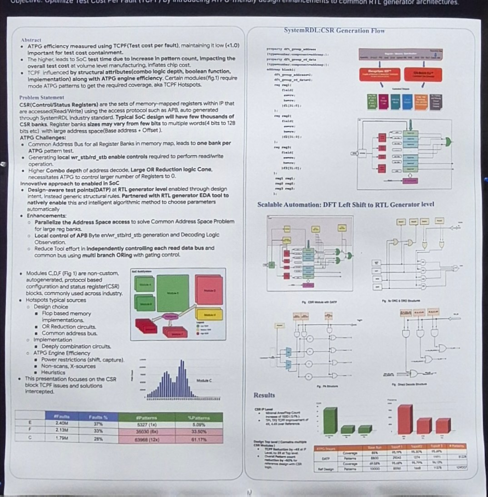{ loading=lazy }

[`dft`](#tag-dft) [`rtl-generation`](#tag-rtl-generation)

!!! info "Slide / Poster Summary"
    Engineering Track paper 64: DFT intelligence through design-aware test points inserted by SystemRDL-to-RTL generators; reported ~40% pattern reduction.

!!! tip "Front-End & Emulation Perspective"
    Moving DFT decisions into the RTL generator shifts work left; the downstream effect on gate-level verification and emulation runtime is what to look for.

!!! abstract "In the official DAC 2026 program"
    *Automating DFT Intelligence: Addressing TCPF HotSpots at Source through Design Aware Test Points in SystemRDL-to-RTL Generators*  
    Engineering session (DFT) — Tue Jul 28, 10:30am-12pm, Seaside RM 7 · [program](https://confcats-siteplex.s3.amazonaws.com/dac/images/dac-2026_program_july-22.pdf) · [official page](https://63dac.conference-program.com/?post_type=page&p=16&id=ENGPRES064&sess=sess277) · [archive](#official-dac-2026-archive)

Related: [AI-Assisted EDA Tools Development](#p20260728110354) · [DFT verification with Veloce full-chip gate-level emulation](#p20260728134334)

### VT-skew MC analysis and load-splitting IR-ECO {#p20260728134139}

**TSMC (+ Synopsys)**

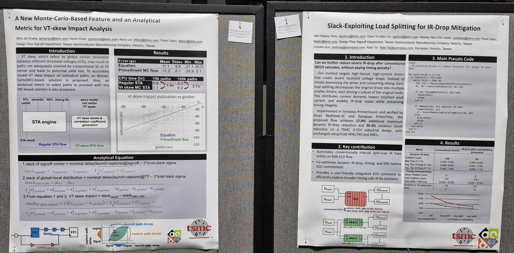{ loading=lazy }

[`signoff`](#tag-signoff) [`power`](#tag-power)

!!! info "Slide / Poster Summary"
    Two TSMC posters: a Monte-Carlo feature with an analytical metric for VT-skew impact (CPU time 1.4x/2.7x vs regular STA on 10k/100k paths) and slack-exploiting load splitting for IR-drop mitigation (17.0% additional max dynamic IR-drop reduction, 20.2% fewer violations).

!!! tip "Front-End & Emulation Perspective"
    Back-end topics; included for context on how signoff-side methods are being tuned.

!!! abstract "In the official DAC 2026 program"
    *Slack-Exploiting Load Splitting for IR-Drop Mitigation*  
    Engineering Poster Session Two — Tue Jul 28, 5-6pm, DAC Pavilion, Exhibit Floor · [program](https://confcats-siteplex.s3.amazonaws.com/dac/images/dac-2026_program_july-22.pdf) · [official page](https://63dac.conference-program.com/?post_type=page&p=16&id=ENGPOST059&sess=sess295) · [archive](#official-dac-2026-archive)

Related: [Multi-cycle dynamic vectorless analysis for PDN signoff](#p20260728100544) · [Voltage-droop mitigation on MAIA 200](#p20260727114025) · [Automated LVS rule deck qualification](#p20260728170302)

### RDC methodology: noise reduction and accuracy {#p20260728134255}

**Google**

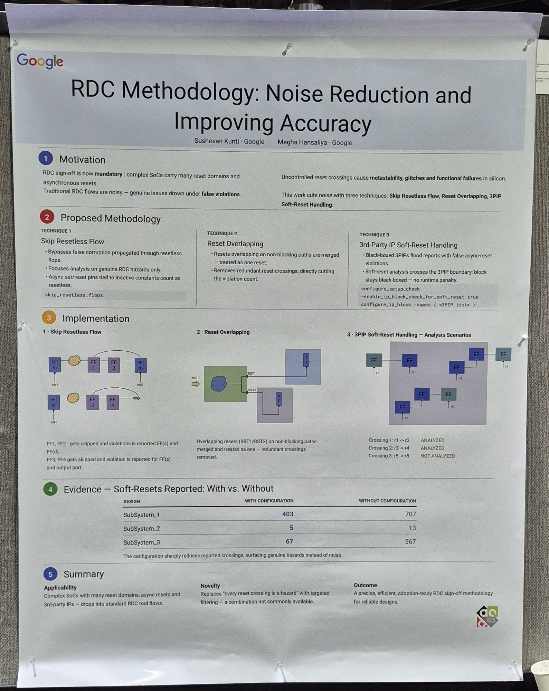{ loading=lazy }

[`rdc`](#tag-rdc) [`verification`](#tag-verification)

!!! info "Slide / Poster Summary"
    Reset-domain-crossing methodology: soft-reset handling reduced reported items (707 to 403, 13 to 5, 567 to 67 in the cases shown).

!!! tip "Front-End & Emulation Perspective"
    Large RDC noise reduction is a good sign for sign-off flows; the open point is how much is waived by methodology versus truly resolved.

!!! abstract "In the official DAC 2026 program"
    *RDC Methodology: Noise Reduction and Improving Accuracy*  
    Engineering Poster Session Two — Tue Jul 28, 5-6pm, DAC Pavilion, Exhibit Floor · [program](https://confcats-siteplex.s3.amazonaws.com/dac/images/dac-2026_program_july-22.pdf) · [official page](https://63dac.conference-program.com/?post_type=page&p=16&id=ENGPOST212&sess=sess295) · [archive](#official-dac-2026-archive)

Related: [Flexible and scalable network modeling for AI/HPC network verification](#p20260728172318) · [Zero-glitch confidence: static, formal and simulation](#p20260729120436)

### DFT verification with Veloce full-chip gate-level emulation {#p20260728134334}

**Samsung / Siemens**

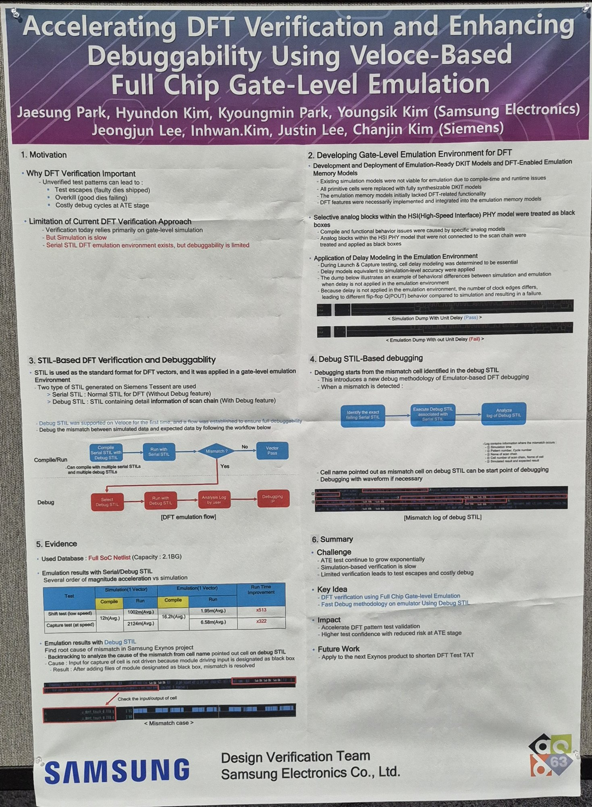{ loading=lazy }

[`emulation`](#tag-emulation) [`dft`](#tag-dft) [`debug`](#tag-debug)

!!! info "Slide / Poster Summary"
    Veloce-based full-chip gate-level emulation for DFT verification: roughly x513 faster shift and x322 faster capture than simulation, with a Debug STIL flow for debuggability.

!!! tip "Front-End & Emulation Perspective"
    Highly relevant. Gate-level emulation speedups are easy to quote; the real cost is netlist compile time and debug visibility, which this poster addresses with Debug STIL.

!!! abstract "In the official DAC 2026 program"
    *Accelerating DFT Verification and Enhancing Debuggability Using Veloce-Based Full Chip Gate-Level Emulation*  
    Engineering Poster Session Two — Tue Jul 28, 5-6pm, DAC Pavilion, Exhibit Floor · [program](https://confcats-siteplex.s3.amazonaws.com/dac/images/dac-2026_program_july-22.pdf) · [official page](https://63dac.conference-program.com/?post_type=page&p=16&id=ENGPOST315&sess=sess295) · [archive](#official-dac-2026-archive)

Related: [Firmware-driven random verification on emulation](#p20260727155157) · [Fastboot virtualization and on-prem LLM failure analysis (Main Idea slide)](#p20260727162722) · [My poster: Hybrid Virtual ICE — Pre-Silicon Real Workloads Validation](#p20260727165840)

### Automated LVS rule deck qualification {#p20260728170302}

**Samsung / Siemens**

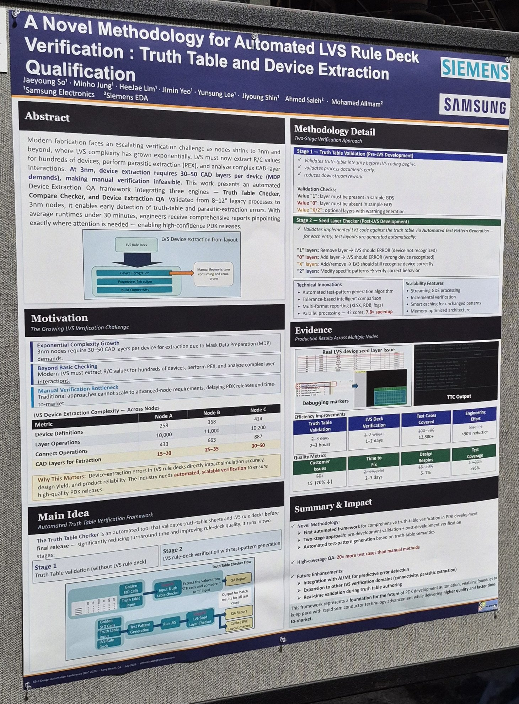{ loading=lazy }

[`signoff`](#tag-signoff) [`lvs`](#tag-lvs)

!!! info "Slide / Poster Summary"
    Poster on automating LVS rule-deck qualification.

!!! abstract "In the official DAC 2026 program"
    *A Novel Methodology for Automated LVS Rule Deck Verification: Truth Table and Device Extraction*  
    Engineering Poster Session Two — Tue Jul 28, 5-6pm, DAC Pavilion, Exhibit Floor · [program](https://confcats-siteplex.s3.amazonaws.com/dac/images/dac-2026_program_july-22.pdf) · [official page](https://63dac.conference-program.com/?post_type=page&p=16&id=ENGPOST188&sess=sess295) · [archive](#official-dac-2026-archive)

Related: [Accelerating circuit verification with Calibre nmLVS Recon](#p20260729123634) · [Multi-cycle dynamic vectorless analysis for PDN signoff](#p20260728100544) · [VT-skew MC analysis and load-splitting IR-ECO](#p20260728134139)

### Flexible and scalable network modeling for AI/HPC network verification {#p20260728172318}

**MangoBoost**

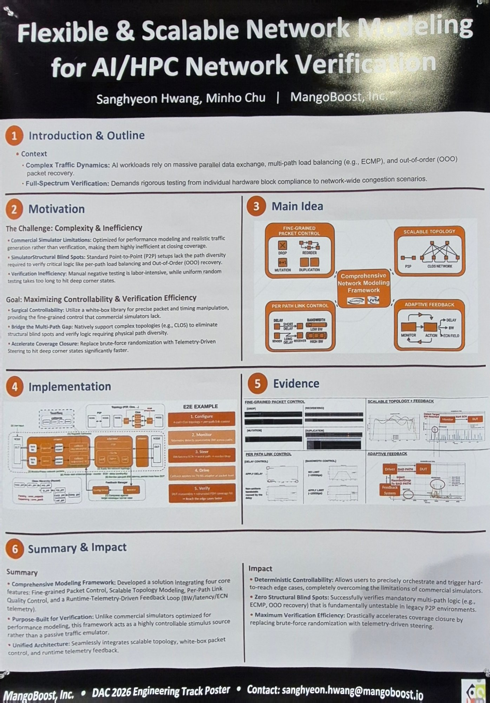{ loading=lazy }

[`uvm`](#tag-uvm) [`network`](#tag-network) [`verification`](#tag-verification)

!!! info "Slide / Poster Summary"
    UVM-based network model with a white-box library and telemetry-driven steering for verifying AI/HPC network designs.

!!! tip "Front-End & Emulation Perspective"
    Network-scale verification of this kind is hard to fit in an emulator; the question is which parts run on emulation and which stay as models.

!!! abstract "In the official DAC 2026 program"
    *Flexible & Scalable Network Modeling for AI/HPC Network Verification*  
    Engineering Poster Session Two (also Gladiator Arena - Poster Battle One — Tue Jul 28, 5-6pm, DAC Pavilion, Exhibit Floor · [program](https://confcats-siteplex.s3.amazonaws.com/dac/images/dac-2026_program_july-22.pdf) · [official page](https://63dac.conference-program.com/?post_type=page&p=16&id=ENGPOST463&sess=sess223) · [archive](#official-dac-2026-archive)

Related: [Firmware-driven random verification on emulation](#p20260727155157) · [RDC methodology: noise reduction and accuracy](#p20260728134255) · [Zero-glitch confidence: static, formal and simulation](#p20260729120436)

### SLC-based real-time traffic buffering {#p20260729120300}

**Samsung**

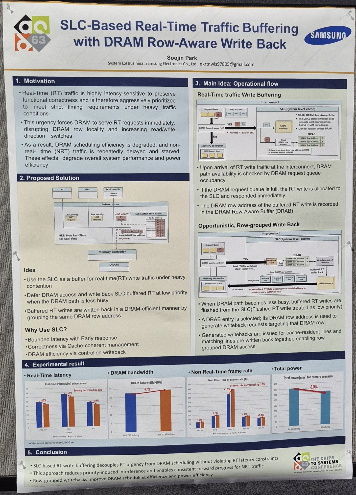{ loading=lazy }

[`soc`](#tag-soc) [`memory`](#tag-memory)

!!! info "Slide / Poster Summary"
    Poster on system-level-cache buffering for real-time traffic with DRAM row-aware write-back.

!!! abstract "In the official DAC 2026 program"
    *SLC-Based Real-Time Traffic Buffering with DRAM Row-Aware Write Back*  
    Engineering Poster Session Three — Wed Jul 29, 3-4pm, DAC Pavilion, Exhibit Floor · [program](https://confcats-siteplex.s3.amazonaws.com/dac/images/dac-2026_program_july-22.pdf) · [official page](https://63dac.conference-program.com/?post_type=page&p=16&id=ENGPOST307&sess=sess296) · [archive](#official-dac-2026-archive)

Related: [Best Presentation Award — Systems & Software](#p20260729151330)

### Zero-glitch confidence: static, formal and simulation {#p20260729120436}

**Meta / Synopsys**

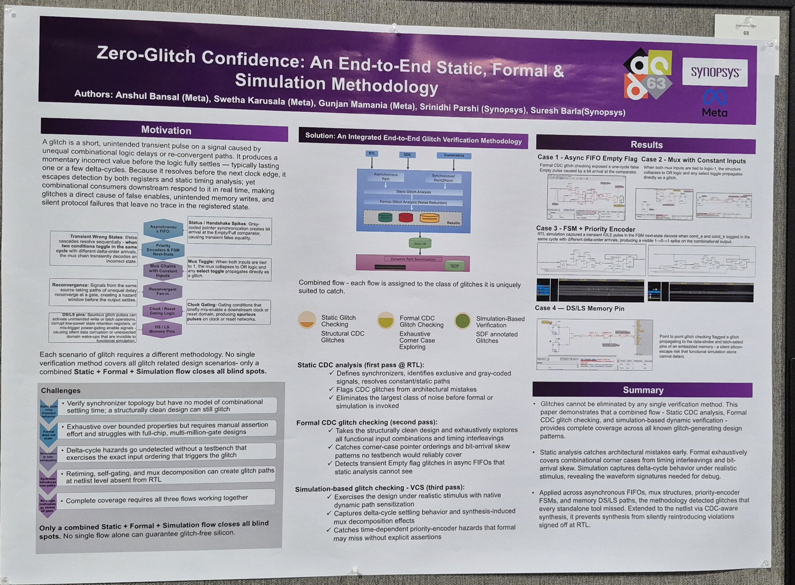{ loading=lazy }

[`cdc`](#tag-cdc) [`formal`](#tag-formal) [`verification`](#tag-verification)

!!! info "Slide / Poster Summary"
    Combined static CDC, formal CDC glitch checking and VCS simulation flow, applied to async FIFOs, mux structures, FSMs and memory DS/LS pins.

!!! tip "Front-End & Emulation Perspective"
    A layered flow is realistic; since gate-level behavior matters for glitches, the interesting question is where emulation could fill the remaining gap.

!!! abstract "In the official DAC 2026 program"
    *Zero-Glitch Confidence: An End-to-End Static, Formal & Simulation Methodology*  
    Engineering Poster Session Three — Wed Jul 29, 3-4pm, DAC Pavilion, Exhibit Floor · [program](https://confcats-siteplex.s3.amazonaws.com/dac/images/dac-2026_program_july-22.pdf) · [official page](https://63dac.conference-program.com/?post_type=page&p=16&id=ENGPOST426&sess=sess296) · [archive](#official-dac-2026-archive)

Related: [RDC methodology: noise reduction and accuracy](#p20260728134255) · [Flexible and scalable network modeling for AI/HPC network verification](#p20260728172318)

### Accelerating circuit verification with Calibre nmLVS Recon {#p20260729123634}

**Microsoft / Siemens**

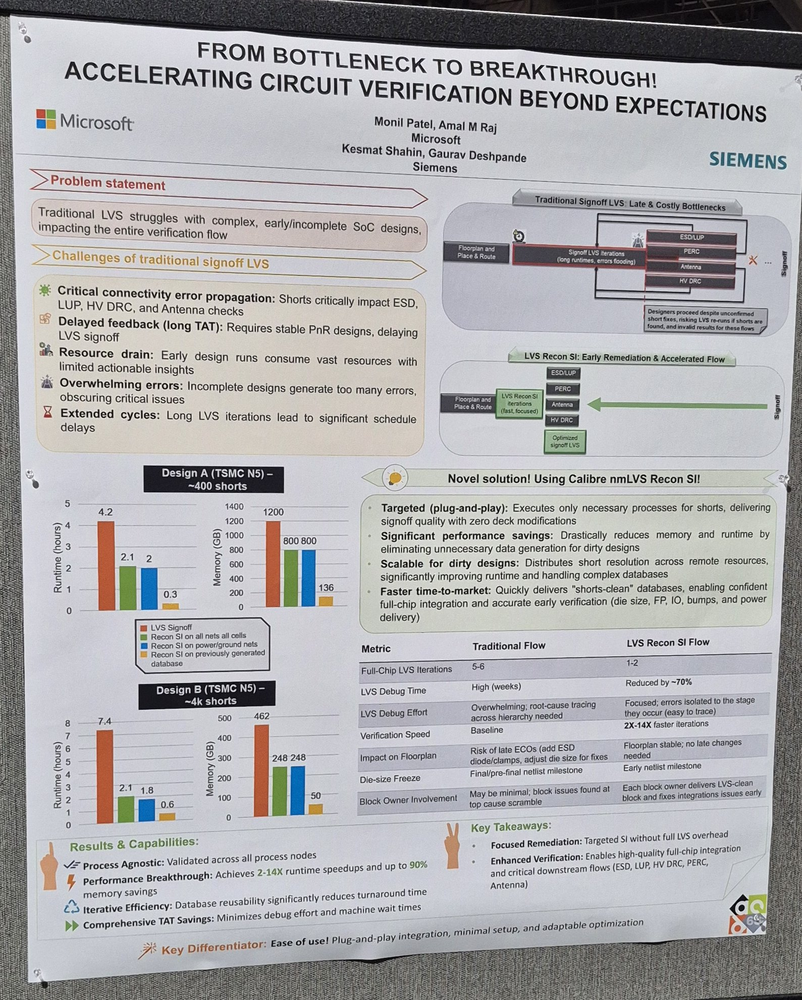{ loading=lazy }

[`lvs`](#tag-lvs) [`signoff`](#tag-signoff)

!!! info "Slide / Poster Summary"
    Poster on accelerating circuit verification with Calibre nmLVS Recon SI.

Official DAC 2026: [63rd DAC page](https://dac.com/63rd-dac)

Related: [Automated LVS rule deck qualification](#p20260728170302) · [Multi-cycle dynamic vectorless analysis for PDN signoff](#p20260728100544) · [VT-skew MC analysis and load-splitting IR-ECO](#p20260728134139)

### Best Presentation Award — Systems & Software {#p20260729151330}

**Samsung**

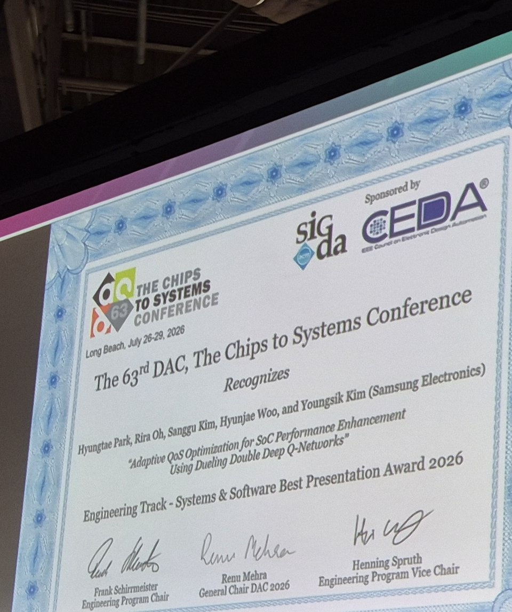{ loading=lazy }

[`award`](#tag-award) [`soc`](#tag-soc)

!!! info "Slide / Poster Summary"
    Award slide for the Engineering Track Systems and Software category: adaptive QoS with dueling double deep Q-networks.

Official DAC 2026: [63rd DAC page](https://dac.com/63rd-dac)

Related: [SLC-based real-time traffic buffering](#p20260729120300)

### AI-powered batch flow for memory cache verification {#p20260729154134}

**Qualcomm / Siemens (Solido)**

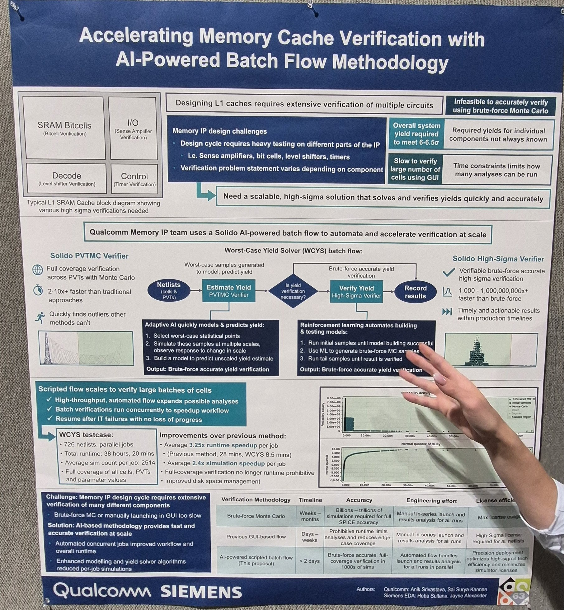{ loading=lazy }

[`ai`](#tag-ai) [`signoff`](#tag-signoff)

!!! info "Slide / Poster Summary"
    Solido worst-case yield solver: adaptive AI predicts yield, reinforcement learning drives high-sigma verification; 726 netlists, 3.25x runtime speedup per job and 2.4x simulation speedup per job against the previous method.

!!! tip "Front-End & Emulation Perspective"
    Analog/memory yield rather than digital emulation, but the batch-flow pattern (scripted, resumable after IT failures) applies to any long regression.

!!! abstract "In the official DAC 2026 program"
    *Accelerating Memory Cache Verification with AI-Powered Batch Flow Methodology*  
    Engineering Poster Session Three — Wed Jul 29, 3-4pm, DAC Pavilion, Exhibit Floor · [program](https://confcats-siteplex.s3.amazonaws.com/dac/images/dac-2026_program_july-22.pdf) · [official page](https://63dac.conference-program.com/?post_type=page&p=16&id=ENGPOST351&sess=sess296) · [archive](#official-dac-2026-archive)

Related: [Multi-cycle dynamic vectorless analysis for PDN signoff](#p20260728100544) · [VT-skew MC analysis and load-splitting IR-ECO](#p20260728134139) · [Automated LVS rule deck qualification](#p20260728170302)

## Tags

### agentic-ai {#tag-agentic-ai}

[AI-Assisted EDA Tools Development](#p20260728110354)

### ai {#tag-ai}

[AI-powered batch flow for memory cache verification](#p20260729154134)

### award {#tag-award}

[Best Presentation Award — Systems & Software](#p20260729151330)

### cdc {#tag-cdc}

[Zero-glitch confidence: static, formal and simulation](#p20260729120436)

### cpu-architecture {#tag-cpu-architecture}

[Evidence: Imsys IM3000 microcode CPU](#p20260727154434)

### debug {#tag-debug}

[DFT verification with Veloce full-chip gate-level emulation](#p20260728134334)

### dft {#tag-dft}

[AI-Assisted EDA Tools Development](#p20260728110354), [Design-aware test points in SystemRDL-to-RTL generators](#p20260728134119), [DFT verification with Veloce full-chip gate-level emulation](#p20260728134334)

### emulation {#tag-emulation}

[Firmware-driven random verification on emulation](#p20260727155157), [Fastboot virtualization and on-prem LLM failure analysis (Main Idea slide)](#p20260727162722), [My poster: Hybrid Virtual ICE — Pre-Silicon Real Workloads Validation](#p20260727165840), [DFT verification with Veloce full-chip gate-level emulation](#p20260728134334)

### firmware {#tag-firmware}

[Firmware-driven random verification on emulation](#p20260727155157)

### formal {#tag-formal}

[Zero-glitch confidence: static, formal and simulation](#p20260729120436)

### llm {#tag-llm}

[Fastboot virtualization and on-prem LLM failure analysis (Main Idea slide)](#p20260727162722), [AI-Assisted EDA Tools Development](#p20260728110354)

### lvs {#tag-lvs}

[Automated LVS rule deck qualification](#p20260728170302), [Accelerating circuit verification with Calibre nmLVS Recon](#p20260729123634)

### memory {#tag-memory}

[SLC-based real-time traffic buffering](#p20260729120300)

### network {#tag-network}

[Flexible and scalable network modeling for AI/HPC network verification](#p20260728172318)

### post-silicon {#tag-post-silicon}

[Voltage-droop mitigation on MAIA 200](#p20260727114025)

### power {#tag-power}

[Voltage-droop mitigation on MAIA 200](#p20260727114025), [Multi-cycle dynamic vectorless analysis for PDN signoff](#p20260728100544), [VT-skew MC analysis and load-splitting IR-ECO](#p20260728134139)

### rdc {#tag-rdc}

[RDC methodology: noise reduction and accuracy](#p20260728134255)

### rtl-generation {#tag-rtl-generation}

[Design-aware test points in SystemRDL-to-RTL generators](#p20260728134119)

### signoff {#tag-signoff}

[Multi-cycle dynamic vectorless analysis for PDN signoff](#p20260728100544), [VT-skew MC analysis and load-splitting IR-ECO](#p20260728134139), [Automated LVS rule deck qualification](#p20260728170302), [Accelerating circuit verification with Calibre nmLVS Recon](#p20260729123634), [AI-powered batch flow for memory cache verification](#p20260729154134)

### soc {#tag-soc}

[SLC-based real-time traffic buffering](#p20260729120300), [Best Presentation Award — Systems & Software](#p20260729151330)

### uvm {#tag-uvm}

[Firmware-driven random verification on emulation](#p20260727155157), [Flexible and scalable network modeling for AI/HPC network verification](#p20260728172318)

### verification {#tag-verification}

[RDC methodology: noise reduction and accuracy](#p20260728134255), [Flexible and scalable network modeling for AI/HPC network verification](#p20260728172318), [Zero-glitch confidence: static, formal and simulation](#p20260729120436)

### virtual-ice {#tag-virtual-ice}

[My poster: Hybrid Virtual ICE — Pre-Silicon Real Workloads Validation](#p20260727165840)

### virtualization {#tag-virtualization}

[Fastboot virtualization and on-prem LLM failure analysis (Main Idea slide)](#p20260727162722), [My poster: Hybrid Virtual ICE — Pre-Silicon Real Workloads Validation](#p20260727165840)

