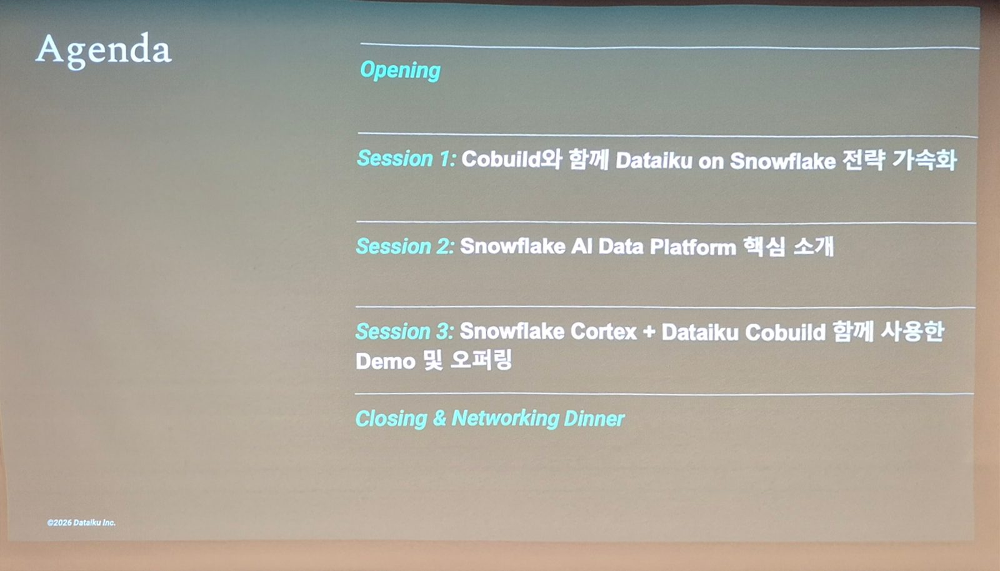
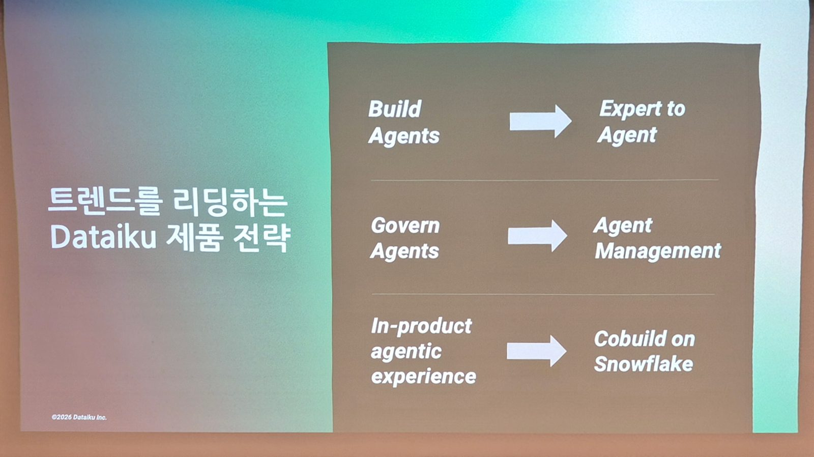
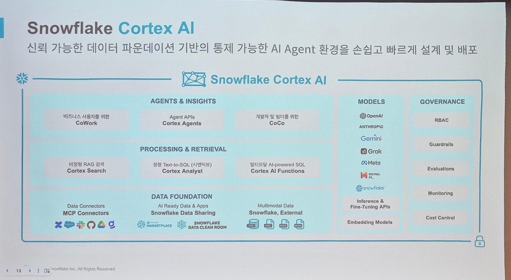

# Better Together: Snowflake × Dataiku Enterprise AI

Dataiku · Snowflake · 바이텍정보통신 · Oakwood Premier COEX Center, 5F Oak Room · 2026-09-16

{ loading=lazy }
<small>Agenda slide (own photo)아젠다 슬라이드 (직접 촬영)</small>

A co-hosted afternoon seminar on enterprise AI: Snowflake provides the trusted data platform, Dataiku lets business users turn requests in natural language into reviewable analytics workflows and AI agents on top of it. Two vendor sessions and a live demo, followed by a networking dinner.
{ .en }

Snowflake가 신뢰할 수 있는 데이터 플랫폼을 맡고, Dataiku가 그 위에서 현업이 자연어로 말한 요구를 검토 가능한 분석 워크플로우와 AI 에이전트로 만들어 주는 구성을 소개한 공동 오후 세미나였습니다. 벤더 세션 둘과 라이브 데모, 이어서 네트워킹 디너가 있었습니다.
{ .ko }

## Key takeaway

Agents have to be managed as governed enterprise assets, on top of a governed data platform.
{ .en }

에이전트도 통제되는 기업 자산으로 관리해야 하고, 그 바탕은 거버넌스된 데이터 플랫폼이다.
{ .ko }

## Highlights

### 1. Enterprises ask two questions about agents: can we trust them, and can the business use them { .en }

### 1. 기업의 질문은 둘이다: 믿을 수 있는가, 현업이 쓸 수 있는가 { .ko }

The host framed the day around these two questions. Snowflake answers the first with governed data, Dataiku the second by putting an agentic experience into the product so non-specialists can build.
{ .en }

주최 측은 이 두 질문을 중심에 놓았습니다. 첫째는 Snowflake의 거버넌스된 데이터가, 둘째는 비전문가도 만들 수 있게 제품에 에이전틱 경험을 넣은 Dataiku가 답하는 구조입니다.
{ .ko }

### 2. Dataiku's strategy: build, govern, and in-product agentic experience { .en }

### 2. Dataiku의 전략: 구축, 통제, 제품 내 에이전틱 경험 { .ko }

Three trends map to three product directions: build agents (Expert-to-Agent), govern agents (Agent Management with discover, monitor and control), and in-product agentic experience (Cobuild on Snowflake).
{ .en }

세 가지 흐름이 세 가지 제품 방향으로 이어집니다. 에이전트 구축(Expert-to-Agent), 에이전트 통제(발견·모니터링·통제의 Agent Management), 제품 내 에이전틱 경험(Cobuild on Snowflake)입니다.
{ .ko }

### 3. Snowflake Cortex covers data, agents and governance in one platform { .en }

### 3. Snowflake Cortex는 데이터, 에이전트, 거버넌스를 한 플랫폼에 담는다 { .ko }

Cortex AI spans AI functions in SQL, Cortex Search, Cortex Analyst on semantic views and Cortex Agent for tool orchestration, with a five-layer governance model from input control to cost control.
{ .en }

Cortex AI는 SQL의 AI 함수, Cortex Search, 시맨틱 뷰 기반 Cortex Analyst, 도구 오케스트레이션을 맡는 Cortex Agent를 아우르고, 입력 제어에서 비용 제어까지 5계층 거버넌스를 둡니다.
{ .ko }

## Sessions

| Session | Title | Speaker |
|---|---|---|
| Opening | Welcome | Dataiku Korea |
| 1 | Cobuild와 함께 Dataiku on Snowflake 전략 가속화 | Dataiku |
| 2 | Snowflake AI Data Platform 핵심 소개 | Snowflake |
| 3 | Snowflake Cortex + Dataiku Cobuild 함께 사용한 Demo 및 오퍼링 | 바이텍정보통신 |
| Closing | Networking dinner | |

{ loading=lazy }
<small>Agenda slide (own photo)아젠다 슬라이드 (직접 촬영)</small>

## Session 1: Dataiku on Snowflake

Three trends (build, govern, in-product agentic experience) map to Expert-to-Agent, Agent Management, and Cobuild on Snowflake, where a business user states a goal in natural language and gets a governed, reviewable workflow.
{ .en }

세 가지 흐름(구축, 통제, 제품 내 에이전틱 경험)이 Expert-to-Agent, Agent Management, Cobuild on Snowflake로 이어집니다. Cobuild에서는 현업이 자연어로 목표를 말하면 통제되고 검토 가능한 워크플로우가 만들어집니다.
{ .ko }

{ loading=lazy }
<small>Dataiku product strategy (own photo)Dataiku 제품 전략 (직접 촬영)</small>

## Session 2: Snowflake AI Data Platform

Cortex AI stacks agents and insights over processing and retrieval (Cortex Search, Cortex Analyst, AI Functions) over the data foundation, with five layers of governance from input control to cost control.
{ .en }

Cortex AI는 에이전트와 인사이트 아래에 처리·검색(Cortex Search, Cortex Analyst, AI Functions), 그 아래 데이터 기반을 쌓고, 입력 제어에서 비용 제어까지 5계층 거버넌스를 둡니다.
{ .ko }

{ loading=lazy }
<small>Snowflake Cortex AI (own photo)Snowflake Cortex AI (직접 촬영)</small>

## Session 3: Demo

A live demo using Snowflake Cortex and Dataiku Cobuild together, given by the partner, followed by an offering overview. Slides are not shown here.
{ .en }

Snowflake Cortex와 Dataiku Cobuild를 함께 쓰는 라이브 데모와 오퍼링 소개를 파트너사가 진행했습니다. 슬라이드는 싣지 않았습니다.
{ .ko }
