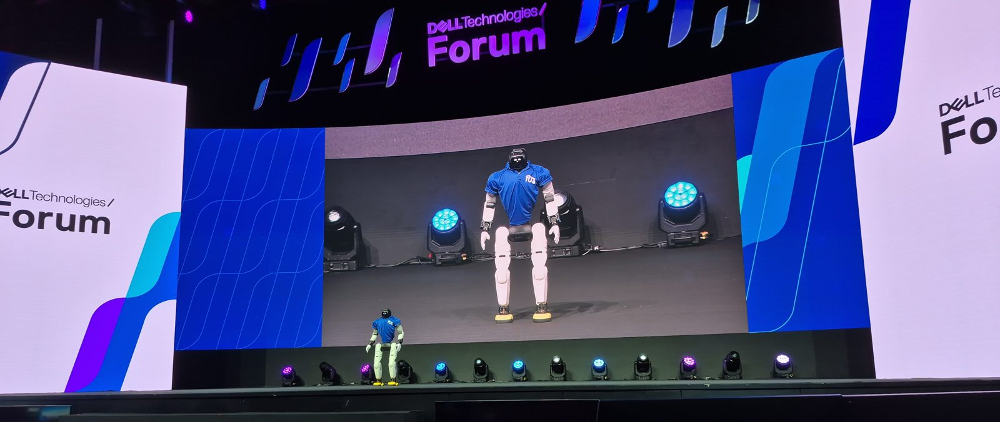
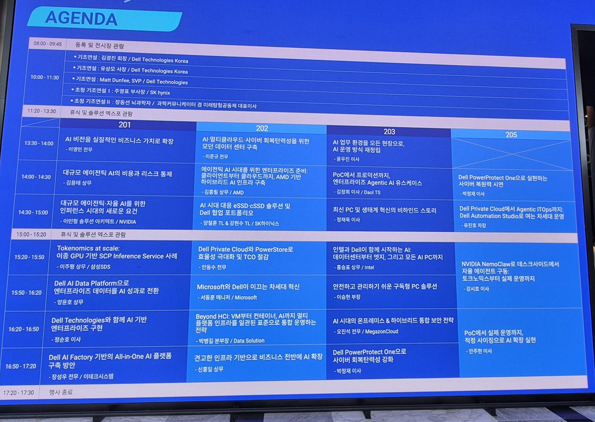
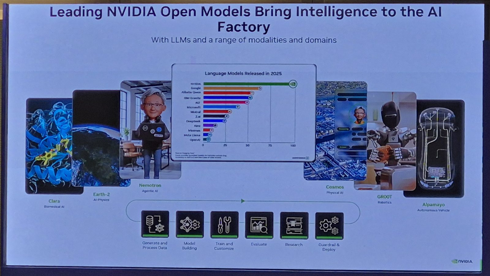

# Dell Technologies Forum 2026 Seoul

Dell Technologies Korea · COEX, Seoul · 2026-08-25 · [Press coverage of the event](https://www.digitaltoday.co.kr/en/view/91635/dell-technologies-to-hold-dtf-2026-on-aug-25-to-share-ai-strategies-for-results)

Dell's annual Korean forum, themed "From Possibility to Progress": a morning of keynotes in the main hall, then afternoon breakout sessions in four rooms where Dell and its partners presented AI infrastructure, data, PC and cyber-resilience topics, with a solution expo alongside.
{ .en }

Dell의 연례 한국 포럼으로 주제는 "From Possibility to Progress"였습니다. 오전에는 메인 홀 키노트, 오후에는 4개 룸에서 Dell과 파트너가 AI 인프라, 데이터, PC, 사이버 복원력 주제를 발표하는 세션이 열렸고 솔루션 엑스포가 함께 운영됐습니다.
{ .ko }

## Key takeaway

AI infrastructure is a stack that partners fill in, and models are packaged as one pipeline from data to deployment.
{ .en }

AI 인프라는 파트너가 채워 가는 스택이고, 모델은 데이터에서 배포까지 하나의 파이프라인으로 묶인다.
{ .ko }

## Highlights

### 1. Open models are packaged as an AI factory workflow { .en }

### 1. 오픈 모델이 AI 팩토리 워크플로우로 묶여 제시된다 { .ko }

The NVIDIA session presented its open model families by domain, such as Nemotron for agentic AI, Cosmos for physical AI, GR00T for robotics, Alpamayo for autonomous vehicles, Clara for biomedical AI and Earth-2 for AI physics, and framed them as a pipeline: generate and process data, build the model, train and customize, evaluate, then apply guardrails and deploy.
{ .en }

NVIDIA 세션은 오픈 모델 계열을 도메인별로, 즉 에이전틱 AI용 Nemotron, 피지컬 AI용 Cosmos, 로보틱스용 GR00T, 자율주행용 Alpamayo, 바이오용 Clara, AI 물리용 Earth-2로 소개하고, 데이터 생성·처리, 모델 구축, 학습·커스터마이즈, 평가, 가드레일과 배포로 이어지는 파이프라인으로 정리했습니다.
{ .ko }

### 2. Partners fill in the stack around Dell infrastructure { .en }

### 2. Dell 인프라 주변 스택은 파트너가 채운다 { .ko }

The breakout agenda mixed Dell with NVIDIA, AMD, Intel, Microsoft, SK hynix, Samsung SDS and others. Topics ran from the cost and risk of large-scale agentic AI, to inference, data platforms and private cloud, to PCs and cyber resilience.
{ .en }

오후 세션은 Dell과 NVIDIA, AMD, Intel, Microsoft, SK hynix, 삼성SDS 등이 함께 구성했습니다. 대규모 에이전틱 AI의 비용과 리스크, 인퍼런스, 데이터 플랫폼과 프라이빗 클라우드, PC, 사이버 복원력까지 주제가 이어졌습니다.
{ .ko }

## Sessions

| Time | Session | Speaker |
|---|---|---|
| 10:00 | Keynote | 김경진 회장, Dell Technologies Korea |
|  | Keynote | 유상모 사장, Dell Technologies Korea |
|  | Keynote | Matt Dunfee, SVP, Dell Technologies |
|  | Guest keynote I | 주영표 부사장, SK hynix |
|  | Guest keynote II | 장동선, 뇌과학자 |

Keynote titles are not on the on-site agenda board, so only names are listed. The full breakout agenda is on the official site.키노트 제목은 현장 아젠다 보드에 없어 이름만 적었습니다. 전체 세션 아젠다는 공식 사이트에 있습니다.

## Photos

{ loading=lazy }
<small>Opening: a humanoid robot on the main stage (own photo)오프닝: 메인 스테이지의 휴머노이드 로봇 (직접 촬영)</small>

{ loading=lazy }
<small>On-site agenda board: keynotes and four breakout rooms (own photo)현장 아젠다 보드: 키노트와 4개 브레이크아웃 룸 (직접 촬영)</small>

{ loading=lazy }
<small>NVIDIA session: open models for the AI factory (own photo)NVIDIA 세션: AI 팩토리를 위한 오픈 모델 (직접 촬영)</small>

