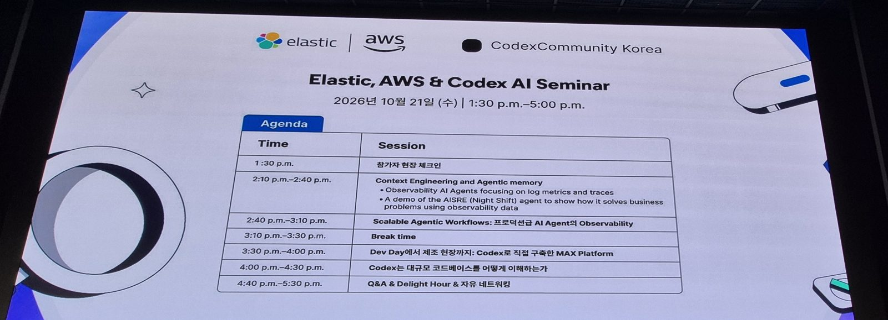
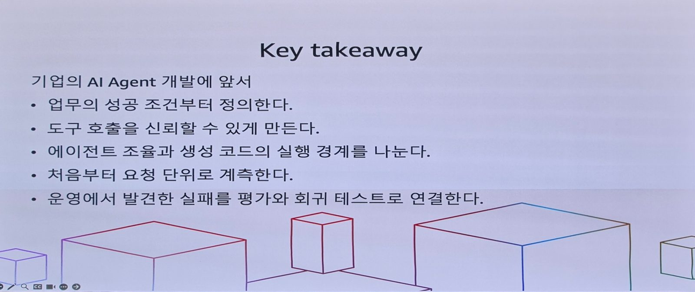
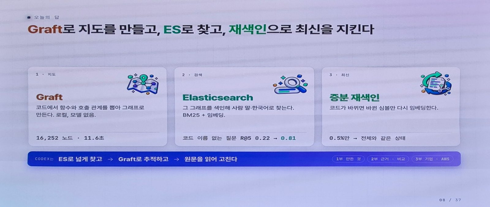

# Elastic Seminars in Seoul, October 2026

Elastic · Seoul · 2026-10-20 and 2026-10-21

{ loading=lazy }
<small>Elastic, AWS and Codex AI Seminar agenda (own photo)Elastic, AWS, Codex AI 세미나 아젠다 (직접 촬영)</small>

Two Elastic seminars in two days, both about agents that need good context. On October 20, Elastic and Google Cloud covered RAG architecture and the context engine. On October 21, Elastic, AWS and the Codex Community Korea covered agent memory, production observability, and how Codex understands large codebases.
{ .en }

이틀 간격으로 열린 두 Elastic 세미나로, 둘 다 에이전트에게 좋은 컨텍스트를 주는 문제를 다뤘습니다. 10월 20일에는 Elastic과 Google Cloud가 RAG 아키텍처와 컨텍스트 엔진을, 10월 21일에는 Elastic, AWS, Codex Community Korea가 에이전트 메모리, 프로덕션 관측, Codex가 대규모 코드베이스를 이해하는 방식을 다뤘습니다.
{ .ko }

## Key takeaway

An agent's weak point is context, not the model, so context should be pre-computed and shared instead of rediscovered every time.
{ .en }

에이전트의 약점은 모델이 아니라 컨텍스트이고, 매번 새로 찾지 않도록 컨텍스트를 미리 계산해 공유해야 한다.
{ .ko }

## Highlights

### 1. Agents fail in production because each one starts from scratch { .en }

### 1. 에이전트는 매번 처음부터 시작해서 프로덕션에서 실패한다 { .ko }

Elastic's keynote argued that agents spend tokens finding data and learning its terminology, and do not share what they learn. Retrieval is only one side, so Elastic proposes pre-computed context (an AI index) that agents query instead of the raw data.
{ .en }

Elastic 키노트는 에이전트가 데이터를 찾고 용어를 익히는 데 토큰을 쓰고, 알게 된 것을 공유하지 못한다고 지적했습니다. 검색은 문제의 한쪽일 뿐이라며, 원시 데이터 대신 에이전트가 조회하는 사전 계산된 컨텍스트(AI 인덱스)를 제안했습니다.
{ .ko }

### 2. Retrieval quality comes from the model and from searching text and images together { .en }

### 2. 검색 품질은 모델과, 텍스트·이미지 결합 검색에서 나온다 { .ko }

The keynote highlighted Jina models for semantic relevance, reranking and multimodal search, including combining the image with the markdown extracted from it so that one query returns the most relevant context.
{ .en }

키노트는 의미 연관성, 리랭킹, 멀티모달 검색을 위한 Jina 모델을 강조했고, 이미지와 거기서 추출한 마크다운을 함께 검색해 한 번의 질의로 가장 관련 있는 컨텍스트를 얻는 방식을 보여줬습니다.
{ .ko }

### 3. Define success first, make tool calls reliable, and measure from the start { .en }

### 3. 성공 조건을 먼저 정의하고, 도구 호출을 신뢰할 수 있게 만들고, 처음부터 계측한다 { .ko }

The AWS session's key takeaway for enterprise agents: define the business success condition, make tool calls reliable, separate agent orchestration from the execution boundary of generated code, measure per request from the beginning, and turn failures found in operation into evaluations and regression tests.
{ .en }

AWS 세션의 기업용 에이전트 핵심 정리는 다음과 같았습니다. 업무 성공 조건부터 정의하고, 도구 호출을 신뢰할 수 있게 만들고, 에이전트 조율과 생성 코드의 실행 경계를 나누고, 처음부터 요청 단위로 계측하며, 운영에서 발견한 실패를 평가와 회귀 테스트로 연결합니다.
{ .ko }

### 4. A code graph in Elasticsearch beats grep for large codebases { .en }

### 4. 대규모 코드베이스에서는 Elasticsearch의 코드 그래프가 grep보다 낫다 { .ko }

The Codex session built a call-relationship map of the code, indexed it in Elasticsearch for candidate search, ranked candidates by following links, and re-indexed only what changed, to cut the tokens an agent wastes on repeated grep.
{ .en }

Codex 세션은 코드의 호출 관계 지도를 만들고 Elasticsearch에 색인해 후보를 찾고, 연결을 따라 순위를 정하며, 바뀐 부분만 재색인하는 방식으로 에이전트가 반복 grep에 낭비하는 토큰을 줄였습니다.
{ .ko }

## Keynotes

### October 20: Elastic × Google Cloud { .en }

### 10월 20일: Elastic × Google Cloud { .ko }

Tech seminar "Elastic & Google Cloud: latest RAG architecture" at the Google office in Gangnam Finance Center, Seoul. The Elastic keynote covered signal search, LLM and RAG at enterprise scale and the Jina AI models; the Google Cloud session covered the Google Cloud AI ecosystem and Gemini-based enterprise RAG.
{ .en }

테크 세미나 "Elastic & Google Cloud: 최신 RAG 아키텍처"로, 서울 강남파이낸스센터 구글 오피스에서 열렸습니다. Elastic 키노트는 엔터프라이즈 규모의 시그널 검색, LLM과 RAG, Jina AI 모델을, Google Cloud 세션은 Google Cloud AI 생태계와 Gemini 기반 엔터프라이즈 RAG를 다뤘습니다.
{ .ko }

### October 21: Elastic, AWS & Codex AI Seminar { .en }

### 10월 21일: Elastic, AWS & Codex AI Seminar { .ko }

Elastic on context engineering and agentic memory, AWS on observability for production-grade agents, and the Codex Community Korea sessions, including how Codex understands a large codebase.
{ .en }

Elastic의 컨텍스트 엔지니어링과 에이전틱 메모리, AWS의 프로덕션급 에이전트 관측, 그리고 Codex가 대규모 코드베이스를 이해하는 방식을 포함한 Codex Community Korea 세션이 있었습니다.
{ .ko }

## Photos

### AWS: five rules for enterprise agents { .en }

### AWS: 기업용 에이전트를 위한 다섯 가지 원칙 { .ko }

From defining the success condition to turning operational failures into regression tests.
{ .en }

성공 조건 정의에서 운영 실패를 회귀 테스트로 연결하기까지입니다.
{ .ko }

{ loading=lazy }
<small>Key takeaway for enterprise agents (own photo)기업 AI 에이전트 핵심 정리 (직접 촬영)</small>

### Codex: how it understands a large codebase { .en }

### Codex: 대규모 코드베이스를 이해하는 방식 { .ko }

Graft builds the code graph, Elasticsearch finds candidates, and re-indexing keeps the index current.
{ .en }

Graft가 코드 그래프를 만들고, Elasticsearch가 후보를 찾고, 재색인이 최신 상태를 유지합니다.
{ .ko }

{ loading=lazy }
<small>Build a map with Graft, search with Elasticsearch, keep it fresh by re-indexing (own photo)Graft로 지도를 만들고, ES로 찾고, 재색인으로 최신을 유지 (직접 촬영)</small>
