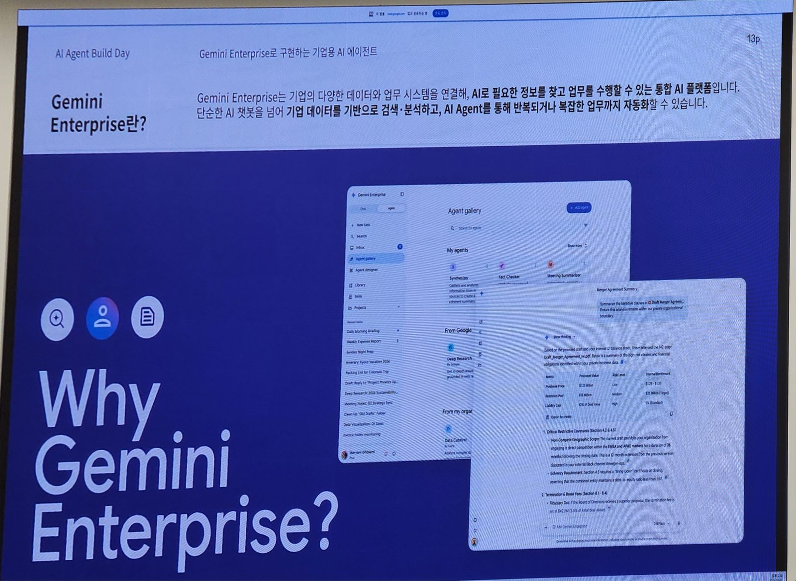
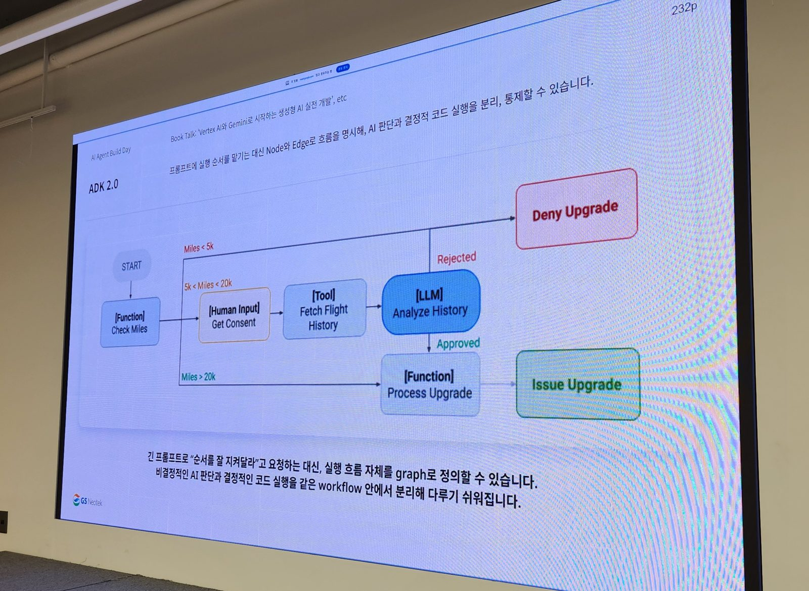
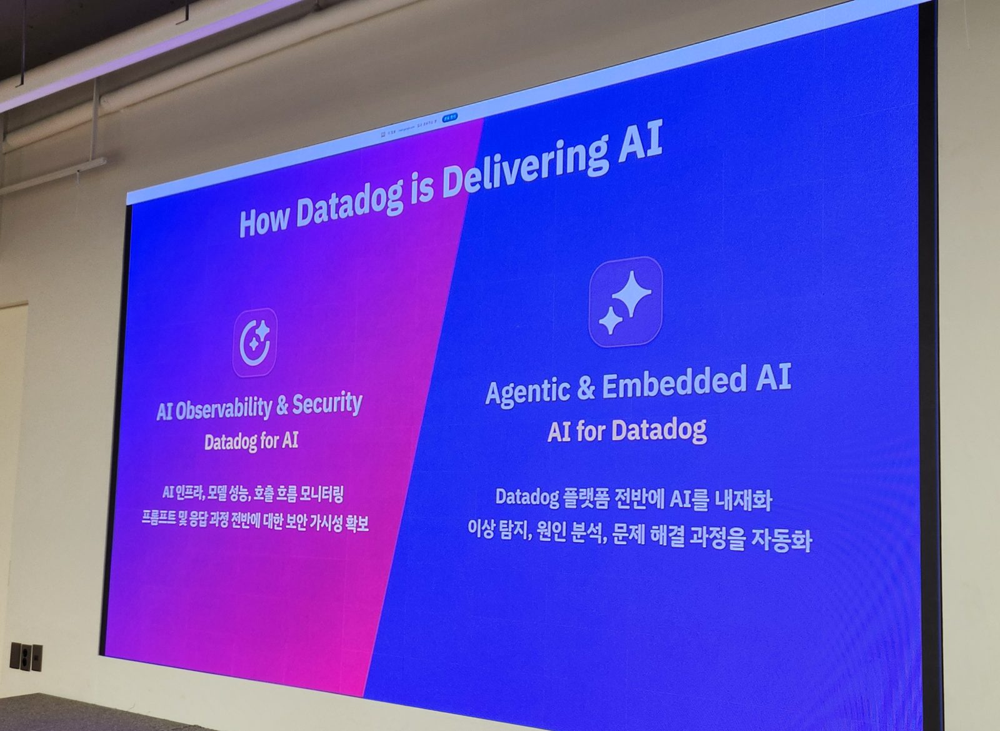

# Google Cloud × Datadog Agent Seminar

Google Cloud · Datadog · 2026-10-01

An afternoon seminar on building, running and observing enterprise AI agents: Gemini Enterprise and its no-code agents, Antigravity for autonomous development, ADK and the agent runtime for production, an agent CLI for the lifecycle, and Datadog on observing the cost, performance and security of AI services.
{ .en }

엔터프라이즈 AI 에이전트를 만들고, 돌리고, 관측하는 방법을 다룬 오후 세미나였습니다. Gemini Enterprise와 노코드 에이전트, 자율형 개발을 위한 Antigravity, 프로덕션을 위한 ADK와 agent runtime, 수명주기를 위한 agent CLI, 그리고 AI 서비스의 비용·성능·보안 관측을 다룬 Datadog 세션으로 구성됐습니다.
{ .ko }

## Key takeaway

Running an agent is harder than building one, and observing its cost, performance and security is part of running it.
{ .en }

에이전트는 만드는 것보다 운영하는 것이 어렵고, 비용·성능·보안을 보는 관측이 그 운영의 일부다.
{ .ko }

## Highlights

### 1. Google positions Gemini Enterprise between frontier labs, hyperscalers and productivity suites { .en }

### 1. Google은 Gemini Enterprise를 프런티어 랩, 하이퍼스케일러, 생산성 스위트의 교집합에 놓는다 { .ko }

The opening keynote used a Venn diagram of AI labs, hyperscalers and productivity suites to place Google Cloud at the intersection, and described an agent platform that builds, scales, governs and optimizes agents.
{ .en }

오프닝 키노트는 AI 랩, 하이퍼스케일러, 생산성 스위트의 벤 다이어그램에서 Google Cloud를 그 교집합에 놓고, 에이전트를 구축하고, 확장하고, 통제하고, 최적화하는 에이전트 플랫폼을 설명했습니다.
{ .ko }

### 2. From PoC to production means build, test, run and operate { .en }

### 2. PoC에서 프로덕션까지는 구축, 테스트, 실행, 운영이다 { .ko }

The ADK session mapped the path as connect and build, test in the ADK dev UI, run on the agent runtime, and operate from the Google Cloud console, with a demo that mapped a business task into a controllable agent workflow.
{ .en }

ADK 세션은 연결·구축, ADK 개발 UI에서의 테스트, agent runtime에서의 실행, Google Cloud 콘솔에서의 운영으로 경로를 그렸고, 업무를 통제 가능한 에이전트 워크플로우로 옮기는 데모를 보여줬습니다.
{ .ko }

### 3. Observing AI services is its own discipline { .en }

### 3. AI 서비스 관측은 별도의 영역이다 { .ko }

The Datadog session asked four operating questions and covered cost visibility across Google Cloud, performance visibility into how an LLM application is structured and where it bottlenecks, and security visibility, framed as AI observability and security plus embedded AI in Datadog itself.
{ .en }

Datadog 세션은 운영에서 확인할 네 가지 질문을 던지고, Google Cloud 전반의 비용 가시성, LLM 애플리케이션의 구조와 병목을 보는 성능 가시성, 보안 가시성을 다뤘습니다. 구도는 AI 관측·보안과 Datadog 자체에 내장된 AI였습니다.
{ .ko }

## Keynotes

| Session | Title | Speaker |
|---|---|---|
| Keynote | Gemini Enterprise and the agent platform | Google Cloud |
| Datadog | Agent Observability와 Antigravity: 비용, 성능, 보안 관측부터 스마트 운영까지 | Datadog |

## Photos

{ loading=lazy }
<small>Why Gemini Enterprise (own photo)왜 Gemini Enterprise인가 (직접 촬영)</small>

{ loading=lazy }
<small>ADK 2.0 workflow with approve and deny branches (own photo)승인·거부 분기가 있는 ADK 2.0 워크플로우 (직접 촬영)</small>

{ loading=lazy }
<small>How Datadog is delivering AI (own photo)Datadog이 AI를 제공하는 방식 (직접 촬영)</small>
