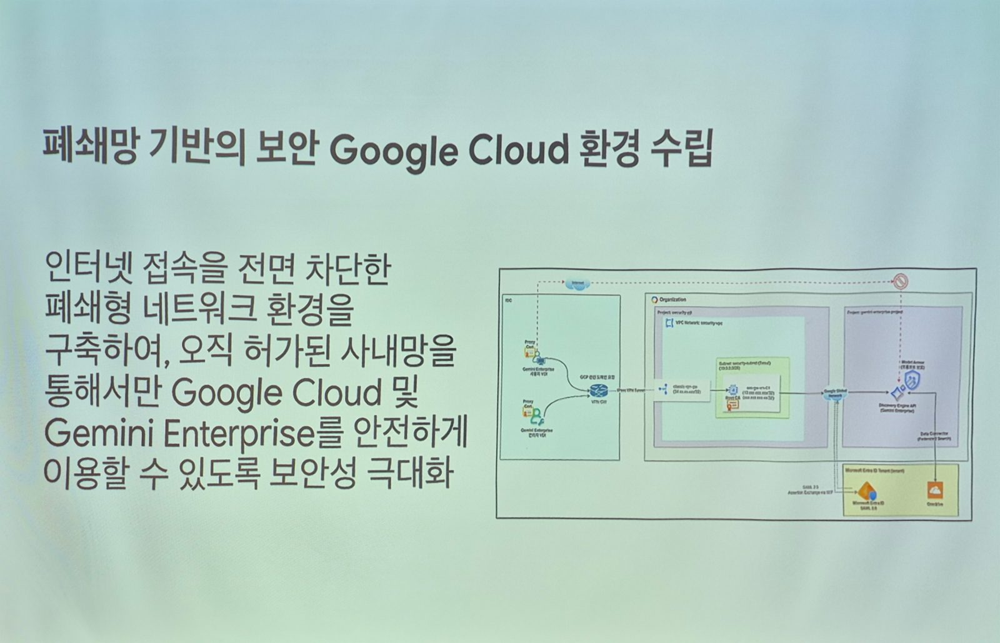
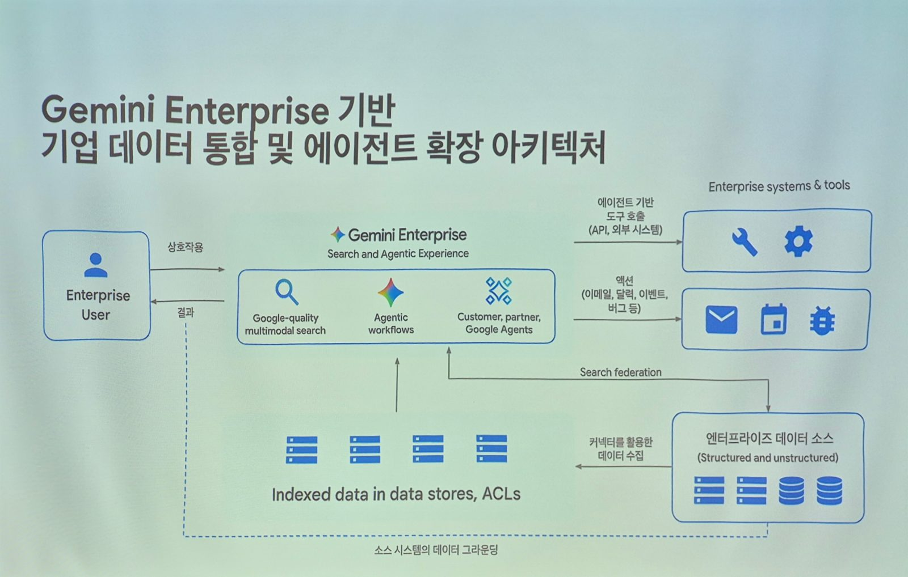
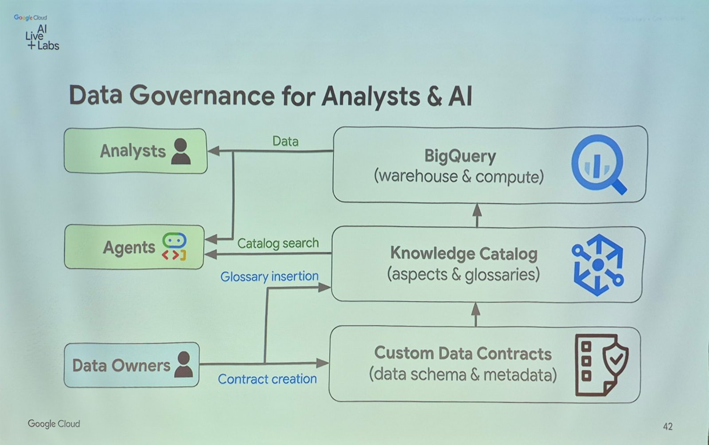

# Google AI for Business 2026

Google · The Shilla Seoul · 2026-07-14 to 07-16 · [Google Korea blog](https://blog.google/intl/ko-kr/company-news/google-ai-for-business/)

Google's first combined event, merging Google Marketing Live and Google Cloud AI Live+Labs. The theme was a full-stack AI strategy and the move to an "agentic enterprise" built around Gemini Enterprise. I attended the first day, mainly the Cloud AI Live+Labs sessions on Gemini Enterprise and agentic data.
{ .en }

Google Marketing Live와 Google Cloud AI Live+Labs를 처음 통합해 연 행사였습니다. 주제는 풀 스택 AI 전략과 Gemini Enterprise를 중심으로 한 "에이전트 중심 기업(agentic enterprise)"으로의 전환이었습니다. 저는 첫째 날에 참석해 주로 Gemini Enterprise와 에이전틱 데이터를 다룬 Cloud AI Live+Labs 세션을 들었습니다.
{ .ko }

## Key takeaway

The starting point for enterprise agents is not the model but a controlled environment: a closed network and the company's existing identity.
{ .en }

기업용 에이전트의 출발점은 모델이 아니라 폐쇄망과 기존 인증 체계 같은 통제된 환경이다.
{ .ko }

## Highlights

### 1. Gemini Enterprise starts with a secure, closed environment { .en }

### 1. Gemini Enterprise는 폐쇄적이고 안전한 환경에서 시작한다 { .ko }

The first sessions showed how to run Gemini Enterprise inside a network cut off from the internet and let only the internal network reach Google Cloud, and how to connect the company's existing identity provider through Workforce Identity so access stays under familiar controls.
{ .en }

첫 세션들은 인터넷 접속을 차단한 폐쇄망에서 사내망만 Google Cloud에 접근하도록 Gemini Enterprise를 쓰는 방법과, 기존 IdP를 Workforce Identity로 연동해 익숙한 통제 아래 접근을 관리하는 방법을 보여줬습니다.
{ .ko }

### 2. Enterprise data and agents hang off one architecture { .en }

### 2. 기업 데이터와 에이전트는 하나의 아키텍처에 연결된다 { .ko }

The reference architecture indexes data from enterprise stores with their access controls, exposes search and agent workflows to users, and lets agents call business tools. Agents can be built three ways: no-code with Agent Designer, low-code with conversational agents, or high-code with the Agent Development Kit and frameworks such as LangGraph and CrewAI, all registered in one agent registry and gallery.
{ .en }

참조 아키텍처는 기업 데이터 저장소의 데이터를 접근 권한과 함께 색인하고, 사용자에게 검색과 에이전트 워크플로우를 제공하며, 에이전트가 업무 도구를 호출하게 합니다. 에이전트는 Agent Designer의 노코드, 대화형 에이전트의 로우코드, Agent Development Kit와 LangGraph·CrewAI 같은 프레임워크의 하이코드 세 방식으로 만들 수 있고, 모두 하나의 에이전트 레지스트리와 갤러리에 등록됩니다.
{ .ko }

### 3. Agents need contextualized, governed data { .en }

### 3. 에이전트에는 맥락이 입혀지고 거버넌스된 데이터가 필요하다 { .ko }

The data session argued that agentic data work means giving data business context with Knowledge Catalog on top of BigQuery, and governing it for both analysts and agents through glossaries, catalog search and custom data contracts. The second half of the lab day moved to Operational AI with Zero ETL.
{ .en }

데이터 세션은 에이전틱 데이터 작업이 BigQuery 위에 Knowledge Catalog로 데이터에 업무 맥락을 입히고, 용어집·카탈로그 검색·커스텀 데이터 컨트랙트로 분석가와 에이전트 모두를 위해 거버넌스하는 것이라고 설명했습니다. 랩 데이의 후반부는 Zero ETL 기반 Operational AI로 이어졌습니다.
{ .ko }

## Sessions

| Time | Session | Speaker |
|---|---|---|
| 13:20 | Gemini Enterprise: secure environment, identity and agent development | Google Cloud |
| 13:30 | Data Contextualization: agentic data with Knowledge Catalog and BigQuery | Google Cloud |
| 15:30 | Operational AI with Zero ETL | Google Cloud |

## Photos

{ loading=lazy }
<small>Closed-network Google Cloud environment (own photo)폐쇄망 기반 Google Cloud 환경 (직접 촬영)</small>

{ loading=lazy }
<small>Enterprise data and agent architecture (own photo)기업 데이터 통합 및 에이전트 확장 아키텍처 (직접 촬영)</small>

{ loading=lazy }
<small>Data governance for analysts and AI (own photo)분석가와 AI를 위한 데이터 거버넌스 (직접 촬영)</small>
