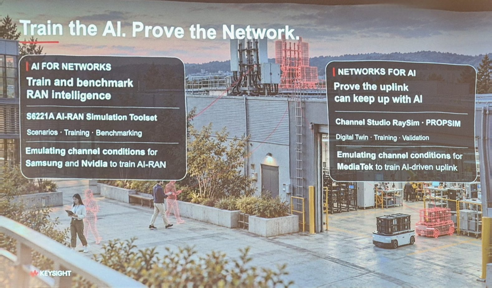
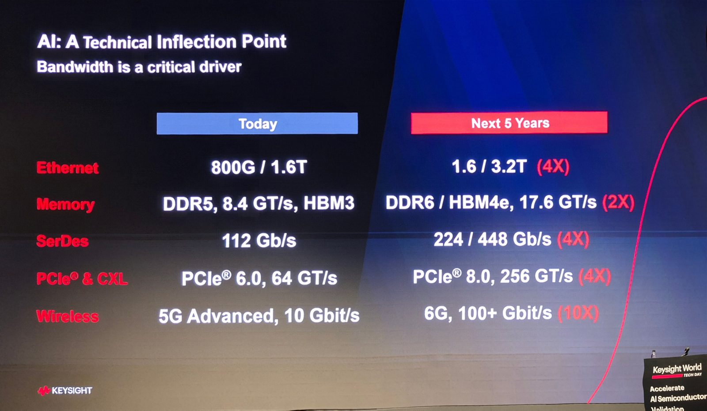
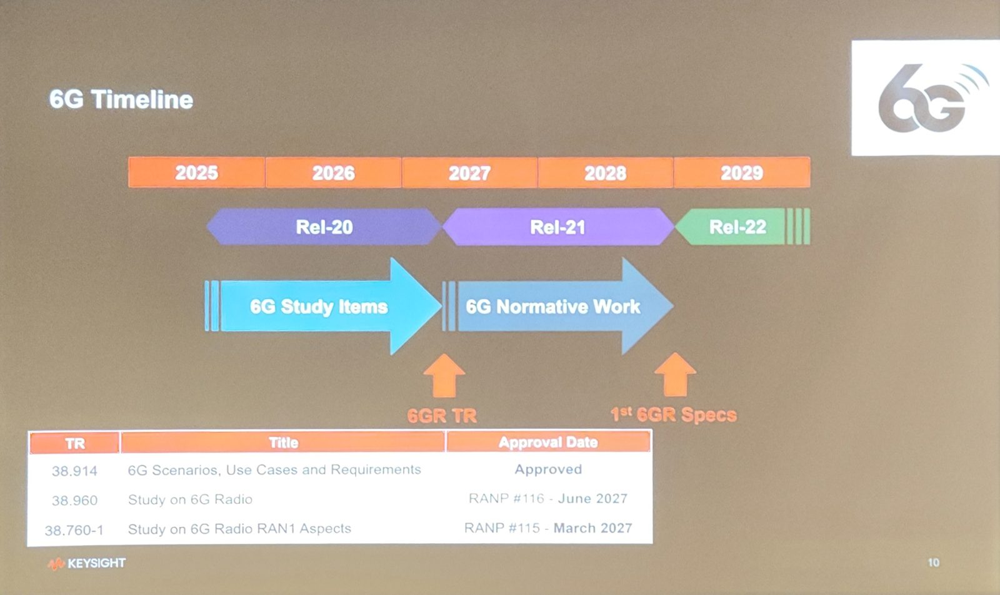

# Keysight World Tech Day Seoul 2026

Keysight · Orche Hall, 5F, EL Tower, Seoul · 2026-10-21 · [Official event page](https://www.keysight.com/kr/ko/cmp/keysight-world-tech-day-korea.html)

A one-day Keysight event with a plenary keynote session in the morning and three parallel tracks (AI Semiconductor, 6G, Aerospace & Defense), plus a demo booth area. I followed the plenary keynotes, then moved between the AI Semiconductor and 6G tracks.
{ .en }

오전 전체 기조 세션과 3개 병렬 트랙(AI Semiconductor, 6G, Aerospace & Defense), 데모 부스로 구성된 Keysight의 하루짜리 행사였습니다. 전체 키노트를 듣고, 이후 AI Semiconductor 트랙과 6G 트랙을 오가며 들었습니다.
{ .ko }

## Key takeaway

Testing in the AI era targets the whole system, from chiplets and optical links to the network, not a single chip.
{ .en }

AI 시대의 테스트는 칩 한 개가 아니라 칩렛, 광 링크, 네트워크까지 이어진 시스템 전체를 대상으로 한다.
{ .ko }

## Highlights

### 1. AI changes both what is tested and how fast it moves { .en }

### 1. AI는 테스트 대상과 변화 속도를 모두 바꾼다 { .ko }

The opening keynote argued that AI capability now compounds in months rather than years, that copper links are reaching their limit so optical interconnect is entering the AI data center, and that test has to widen from a single chip to a system of systems. For wireless, it framed the direction as AI for RAN and RAN for AI.
{ .en }

오프닝 키노트는 AI 역량이 해가 아니라 달 단위로 복리 성장하고, 구리 배선이 한계에 다가가 광 인터커넥트가 AI 데이터센터로 들어오며, 테스트도 단일 칩에서 시스템의 시스템으로 넓어져야 한다고 말했습니다. 무선 쪽 방향은 AI for RAN과 RAN for AI로 정리했습니다.
{ .ko }

### 2. AI interconnect validation spans chiplets, optics and PCIe { .en }

### 2. AI 인터커넥트 검증은 칩렛, 광, PCIe에 걸친다 { .ko }

The AI Semiconductor track covered UCIe chiplet and co-packaged optics trends and silicon validation, then Keysight's silicon photonics talk on moving optical links into AI infrastructure and the test setups for them, from photonic IC characterization to 448 Gbps-class measurements.
{ .en }

AI Semiconductor 트랙은 UCIe 칩렛과 CPO 동향, 실리콘 검증을 다뤘고, 이어 Keysight의 실리콘 포토닉스 세션은 광 링크가 AI 인프라로 들어오는 흐름과 이를 위한 테스트 구성(포토닉 IC 특성 분석부터 448 Gbps급 측정까지)을 보여줬습니다.
{ .ko }

### 3. 6G standardization is moving from study to work item { .en }

### 3. 6G 표준화는 스터디에서 워크아이템으로 넘어간다 { .ko }

The 3GPP session placed 6G as a study item in Release 20 and normative work in Release 21, with the first specifications expected around 2028 to 2029. It also noted that 6G builds on the 5G NR foundation, with the lesson from non-standalone 5G in mind, and listed sensing (ISAC) and NTN as active topics.
{ .en }

3GPP 세션은 6G가 Release 20에서 스터디 아이템, Release 21에서 규범 작업으로 진행되고 첫 규격은 2028~2029년경 나올 것으로 설명했습니다. 6G가 5G NR 기반 위에 서고 비독립형 5G의 교훈을 반영한다는 점, ISAC 센싱과 NTN이 활발한 주제라는 점도 언급했습니다.
{ .ko }

## Keynotes

| Time | Keynote | Speaker |
|---|---|---|
| 09:00 | Welcome and keynote | Satish Dhanasekaran, CEO, Keysight |
| 09:30 | AI Semiconductor in the Era of Sovereign Technology: Strategy, Scale, and Sustainability | 교수, Seoul National University |
| 10:00 | Korea's 6G and AI network R&D strategy and next-generation network vision | 김근대, IITP |
| 10:20 | Designing the future: Keysight technology strategy for next-generation innovation | 최준호, Keysight |

## Photos

{ loading=lazy }
<small>Opening keynote: Train the AI. Prove the Network. (own photo)오프닝 키노트: Train the AI. Prove the Network. (직접 촬영)</small>

{ loading=lazy }
<small>Keysight silicon photonics talk: AI as a technical inflection point (own photo)Keysight 실리콘 포토닉스 세션: AI는 기술적 변곡점 (직접 촬영)</small>

{ loading=lazy }
<small>Keysight 3GPP session: 6G timeline (own photo)Keysight 3GPP 세션: 6G 타임라인 (직접 촬영)</small>
