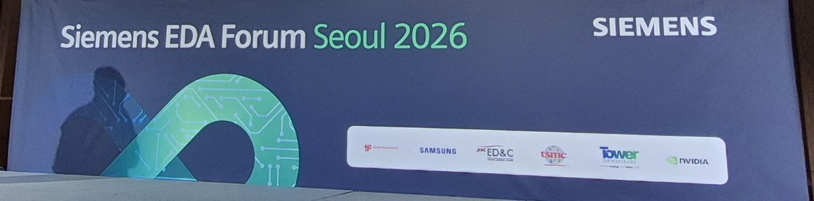
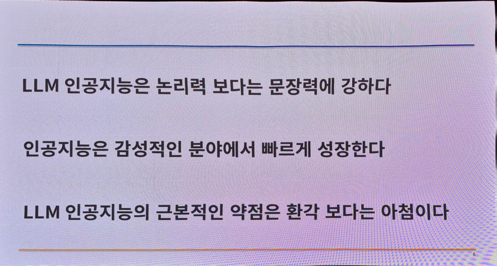
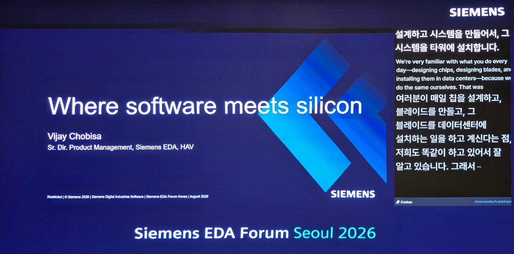

# Siemens EDA Forum Seoul 2026

Siemens EDA Korea · Lotte Hotel World, Jamsil (3F) · 2026-08-11 · [Official page](https://www.siemensedaforum.co.kr/agenda.php?tc)

{ loading=lazy }
<small>Image: own photo (stage banner at the venue)직접 촬영 (행사장 무대 배너)</small>

A one-day forum where Siemens EDA laid out its AI-native design direction, a Samsung engineer shared practical experience with generative AI, and a guest speaker talked about what AI is and is not good at. The afternoon continued with product and technology sessions.
{ .en }

Siemens EDA가 AI-native 설계 방향을 소개하고, Samsung 엔지니어가 생성형 AI 활용 경험을 공유하고, 초청 연사가 AI의 강점과 한계를 이야기한 하루짜리 포럼이었습니다. 오후에는 제품·기술 세션이 이어졌습니다.
{ .ko }

## Key takeaway

The greater risk of an LLM is sycophancy, not hallucination.
{ .en }

LLM의 더 큰 위험은 환각보다 맞장구를 치는 아첨이다.
{ .ko }

## Highlights

### 1. EDA vendors are repositioning around AI-native design { .en }

### 1. EDA 벤더들이 AI-native 설계로 방향을 옮기고 있다 { .ko }

Siemens organized its message around four pillars: AI-native EDA, faster engines, smarter execution and trusted outcomes. Agent-style features showed up across the portfolio, from RTL design and verification to physical implementation and parasitic extraction.
{ .en }

Siemens는 AI-native EDA, 더 빠른 엔진, 더 똑똑한 실행, 신뢰할 수 있는 결과라는 네 축으로 메시지를 정리했습니다. RTL 설계·검증부터 물리 구현, 기생 성분 추출까지 포트폴리오 전반에 에이전트 형태의 기능이 들어오고 있었습니다.
{ .ko }

### 2. In verification, the workload is the new testbench { .en }

### 2. 검증에서는 워크로드가 새로운 테스트벤치 { .ko }

The hardware-assisted verification session argued that software has to be verified together with silicon on a digital twin. As chiplets and 3DIC make composability the verification challenge, emulation and prototyping are used in complementary ways.
{ .en }

하드웨어 지원 검증 세션은 소프트웨어를 디지털 트윈 위에서 실리콘과 함께 검증해야 한다고 설명했습니다. 칩렛과 3DIC로 composability가 검증의 과제가 되면서, 에뮬레이션과 프로토타이핑을 서로 보완하는 방식으로 쓰고 있습니다.
{ .ko }

### 3. The weak point of LLMs is flattery more than hallucination { .en }

### 3. LLM의 근본적 약점은 환각보다 아첨 { .ko }

The special keynote described LLMs as better at fluent writing than at logic, and as able to grow quickly in emotional domains. Its main point was that the fundamental weakness is sycophancy, telling users what they want to hear, more than hallucination.
{ .en }

특별 키노트는 LLM이 논리력보다 문장력에 강하고 감성적인 분야에서 빠르게 성장할 수 있다고 소개했습니다. 핵심은 근본적인 약점이 환각보다 사용자가 듣고 싶어 하는 말을 하는 아첨(sycophancy)이라는 점이었습니다.
{ .ko }

## Keynotes

| Time | Keynote | Speaker |
|---|---|---|
| 10:00 | Opening Greetings | CEO, Siemens EDA Korea |
| 10:10 | AI-Native Design: Engineering Tomorrow's Silicon and Systems | Ankur Gupta (Siemens EDA) |
| 10:50 | Semiconductor Design and Verification in the Era of Generative AI: Realities, Challenges, and Future Innovations | Samsung Electronics |
| 11:15 | Misconceptions and Truths about AI (인공지능에 대한 오해와 진실) | Professor, Soongsil Cyber University |
| PM | Where software meets silicon: A digital twin playbook | Vijay Chobisa (Siemens EDA) |

## Photos

{ loading=lazy }
<small>Special keynote: summary slide on LLM strengths and weaknesses (own photo)특별 키노트: LLM의 강점과 약점 요약 슬라이드 (직접 촬영)</small>

{ loading=lazy }
<small>Afternoon session: Where software meets silicon, cover slide (own photo)오후 세션: Where software meets silicon 표지 슬라이드 (직접 촬영)</small>
