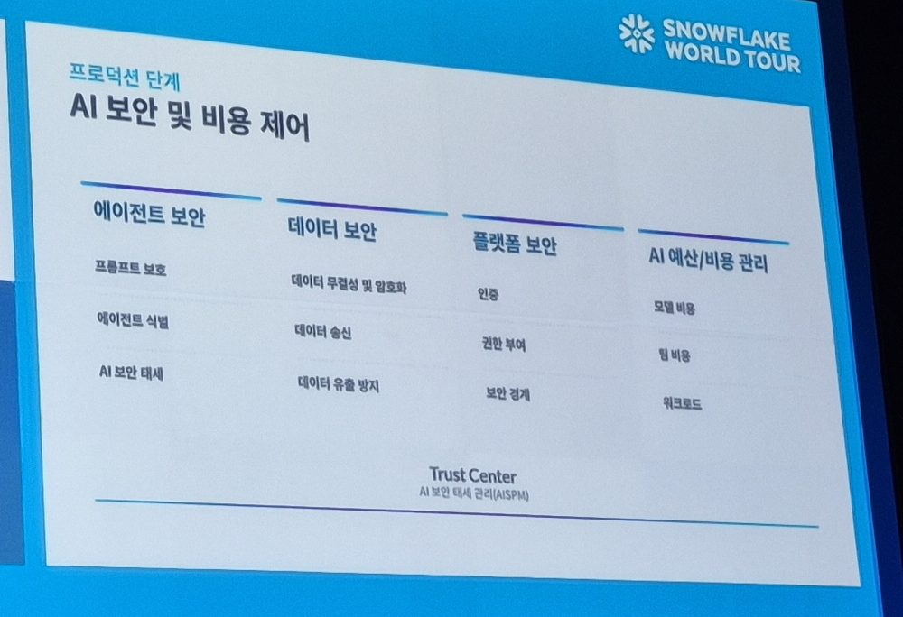

# Snowflake World Tour Seoul 2026

Snowflake · COEX, Seoul · 2026-08-27 · [Official event page](https://www.snowflake.com/en/world-tour/seoul/)

Snowflake's Seoul stop of its World Tour, under the tagline "Making AI Real for Business": an opening keynote, an expo hall, and afternoon breakout tracks on data platform modernization, data preparation for AI, and building and using AI agents. I followed the keynote and Track 1, AI Ready Data.
{ .en }

Snowflake World Tour의 서울 일정으로, 태그라인은 "Making AI Real for Business"였습니다. 오프닝 키노트와 엑스포 홀, 오후에는 데이터 플랫폼 현대화, AI를 위한 데이터 준비, AI 에이전트 구축과 활용 세 트랙의 세션이 열렸습니다. 저는 키노트와 Track 1(AI Ready Data)을 들었습니다.
{ .ko }

## Key takeaway

The bottleneck for production AI is not the model but security and cost control.
{ .en }

프로덕션 AI의 병목은 모델이 아니라 보안과 비용 제어다.
{ .ko }

## Highlights

### 1. AI in production needs security and cost control from day one { .en }

### 1. AI 프로덕션에는 처음부터 보안과 비용 제어가 필요하다 { .ko }

The keynote framed production AI around four areas: agent security, data security, platform security, and AI budget and cost management, with a Trust Center for AI security posture management.
{ .en }

키노트는 프로덕션 단계의 AI를 에이전트 보안, 데이터 보안, 플랫폼 보안, AI 예산·비용 관리의 네 영역으로 나누고, AI 보안 태세 관리를 위한 Trust Center를 제시했습니다.
{ .ko }

### 2. Agents arrive as CoWork for answers and CoCo for building { .en }

### 2. 에이전트는 답을 얻는 CoWork와 만드는 CoCo로 나온다 { .ko }

Snowflake CoWork is a personal enterprise agent that answers complex questions with verified queries under the platform's governance. Snowflake CoCo is a coding agent for the whole data stack that works in the desktop, terminal and web UI, connects external tools through MCP and ACP, and supports open-source tools such as dbt and Airflow.
{ .en }

Snowflake CoWork는 플랫폼 거버넌스 안에서 검증된 쿼리로 복잡한 질문에 답하는 개인용 엔터프라이즈 에이전트입니다. Snowflake CoCo는 전체 데이터 스택을 위한 코딩 에이전트로, 데스크톱·터미널·웹 UI에서 동작하고 MCP·ACP로 외부 도구를 연결하며 dbt, Airflow 같은 오픈소스 도구를 지원합니다.
{ .ko }

### 3. The AI Data Cloud is pitched as easy, connected and trusted { .en }

### 3. AI 데이터 클라우드는 편의성, 연결성, 신뢰성으로 설명된다 { .ko }

One platform covers data engineering, analytics, AI, and applications and collaboration, with governance, cross-cloud operation, interoperability and security across all of it.
{ .en }

하나의 플랫폼이 데이터 엔지니어링, 분석, AI, 애플리케이션과 협업을 포괄하고, 그 전체에 거버넌스, 크로스 클라우드, 상호 운용성, 보안이 적용됩니다.
{ .ko }

### 4. Open lakehouse on Apache Iceberg is the data foundation { .en }

### 4. Apache Iceberg 기반 오픈 레이크하우스가 데이터 기반이다 { .ko }

The AWS session on an AI-ready open lakehouse built on AWS-Snowflake interoperability gave five reasons to adopt Iceberg: cost efficiency, a simpler data architecture, performance and scale, governance and security, and AI/ML support.
{ .en }

AWS-Snowflake 상호운용성 기반의 AI Ready 오픈 레이크하우스 세션은 Iceberg를 도입하는 다섯 가지 이유로 비용 효율성, 단순한 데이터 아키텍처, 성능과 확장, 거버넌스와 보안, AI/ML 지원을 들었습니다.
{ .ko }

## Keynotes

| Time | Keynote | Speaker |
|---|---|---|
| 10:00 | Opening keynote | Snowflake |

## Photos

### Production AI: security and cost control { .en }

### 프로덕션 AI: 보안과 비용 제어 { .ko }

{ loading=lazy }
<small>Keynote: AI security and cost control (own photo)키노트: AI 보안 및 비용 제어 (직접 촬영)</small>
