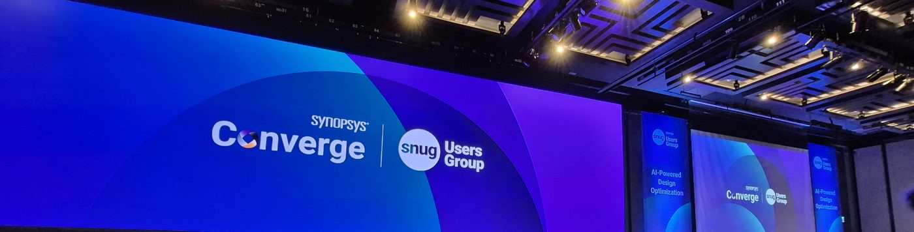
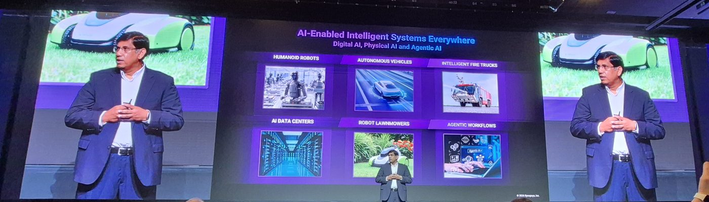
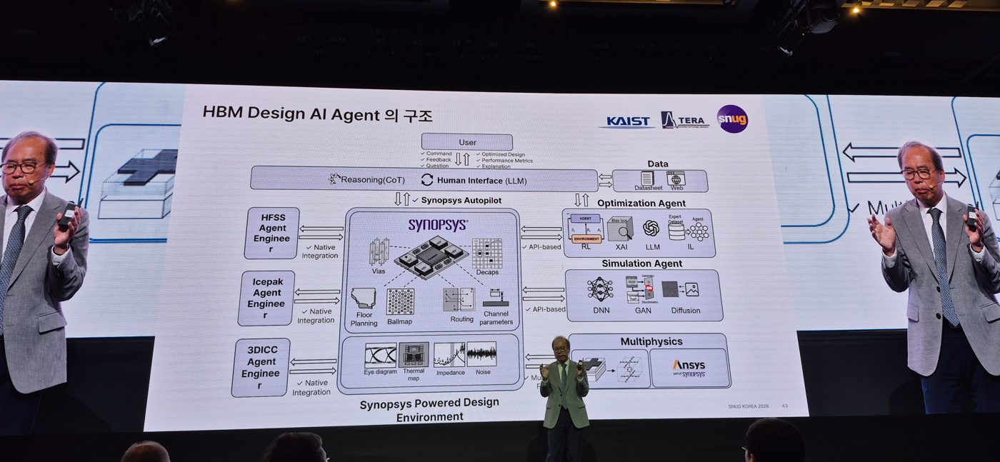

# SNUG Korea 2026 · Synopsys Converge

Synopsys Korea · Grand InterContinental Seoul Parnas (Grand Ballroom, 5F) · 2026-09-08 · [Official page](https://events.synopsys.com/event/SNUGKorea2026/home)

{ loading=lazy }
<small>Image: own photo (main screen at the venue)직접 촬영 (행사장 메인 스크린)</small>

A one-day conference where an EDA vendor, universities and a foundry described the same problem from their own sides: AI chip design cycles shrinking from about three years to one.
{ .en }

EDA 벤더, 대학, 파운드리가 각자의 입장에서 같은 문제, 즉 3년에서 1년으로 줄어드는 AI 칩 설계 주기를 이야기한 하루짜리 행사였습니다.
{ .ko }

The morning had five keynotes. The afternoon ran five parallel tracks: AI-Powered Design Optimization, Multi-Die and Next-Gen Memory, Shift-Left Manufacturing Design, AI-Driven Silicon Innovation, and Scalable Verification for the AI Chip Era. This page covers the morning keynotes.
{ .en }

오전에는 키노트 5개, 오후에는 5개 병렬 트랙(AI 설계 최적화, 멀티다이·차세대 메모리, 시프트레프트 제조 설계, AI 기반 실리콘 혁신, AI 칩 시대의 확장형 검증)이 열렸습니다. 이 페이지는 오전 키노트를 중심으로 정리했습니다.
{ .ko }

## Takeaways

### 1. Speed, performance and first-time-right are demanded at once { .en }

### 1. 속도, 성능, first-time-right를 동시에 요구받는다 { .ko }

AI chips now need a new generation every year, the first silicon has to work, and it has to be deployed in large clusters right away. Synopsys called this "extreme co-design": every stage from architecture to test has to run in parallel and hand off cleanly.
{ .en }

AI 칩은 매년 새 세대가 나와야 하고, 첫 실리콘이 맞아야 하며, 곧바로 대규모 클러스터에 배치돼야 합니다. Synopsys는 이를 "extreme co-design"이라 부르며, 아키텍처부터 테스트까지 모든 단계가 병렬로 맞물려야 한다고 설명했습니다.
{ .ko }

### 2. Agentic AI is moving from tool calls to long-running autonomy { .en }

### 2. 에이전트 AI는 도구 호출에서 장시간 자율 실행으로 이동 중 { .ko }

Synopsys described two layers. Long-running agents take a spec and build RTL and a test plan in parallel, or run coverage closure as an autonomous loop. Task agents underneath do single steps such as generating formal assertions or fixing lint. Customers are expected to start with small task agents and grow from there.
{ .en }

Synopsys는 두 개의 층을 설명했습니다. 사양서에서 RTL과 테스트 플랜을 동시에 만들거나 커버리지 클로저를 자율 루프로 돌리는 long-running agent가 위에 있고, 그 아래에서 formal assertion 생성이나 lint 수정 같은 단위 작업을 하는 task agent가 받칩니다. 고객은 작은 task agent에서 시작해 점차 넓히는 경로가 현실적이라고 했습니다.
{ .ko }

### 3. Verification is a 10^15-cycle problem { .en }

### 3. 검증은 10^15 사이클 문제 { .ko }

Verifying the chip, the package, the cluster and the software stack takes the full continuum from formal through simulation to emulation and prototyping. Synopsys stressed shift-left: run real AI workloads on a digital twin of the chip so software is validated together with hardware.
{ .en }

칩, 패키지, 클러스터, 소프트웨어 스택까지 검증하려면 formal부터 시뮬레이션, 에뮬레이션, 프로토타이핑까지 전 구간이 필요합니다. Synopsys는 칩의 디지털 트윈 위에서 실제 AI 워크로드를 돌려 소프트웨어를 하드웨어와 동시에 검증하는 shift-left를 강조했습니다.
{ .ko }

### 4. The memory hierarchy is the next bottleneck for AI computing { .en }

### 4. 메모리 계층이 AI 컴퓨팅의 다음 병목 { .ko }

Prof. Joungho Kim (KAIST) proposed networking HBMs together, pairing HBM with HBF (High Bandwidth Flash), and placing memory under the GPU. He also showed an agent-based structure for automating HBM design.
{ .en }

KAIST 김정호 교수는 HBM끼리 네트워크로 잇는 구조, HBM과 HBF(High Bandwidth Flash)를 함께 쓰는 계층, GPU 아래로 내리는 구조를 제안했고, 이런 HBM 설계를 에이전트로 자동화하는 구성도 보여줬습니다.
{ .ko }

## Sessions

| Time | Keynote | Speaker |
|---|---|---|
| 09:05 | Re-engineering the Future of Silicon Design | Shankar Krishnamoorthy (Synopsys) |
| 09:50 | The Future of Agentic AI and Innovations in the HBM-HBF-HBS Memory Hierarchy | Prof. Joungho Kim (KAIST) |
| 10:20 | Paving the Way for Silicon Intelligence | Samsung Foundry |
| 11:05 | Building a New Memory and Storage Hierarchy for AI Inference | SK hynix |
| 11:30 | From LLMs to Agentic and Physical AI | Prof. Jinwoo Shin (KAIST) |

## Photos

{ loading=lazy }
<small>Keynote 1, Shankar Krishnamoorthy (Synopsys): opening slide (own photo)Keynote 1, Shankar Krishnamoorthy (Synopsys): 오프닝 슬라이드 (직접 촬영)</small>

{ loading=lazy }
<small>Keynote 2, Prof. Joungho Kim (KAIST): HBM design AI agent structure (own photo)Keynote 2, KAIST 김정호 교수: HBM 설계 AI 에이전트 구조 (직접 촬영)</small>
